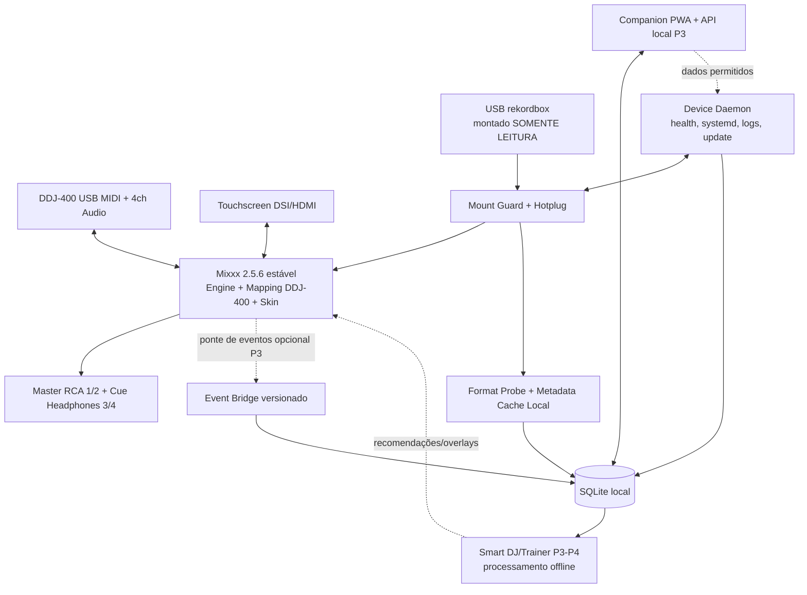
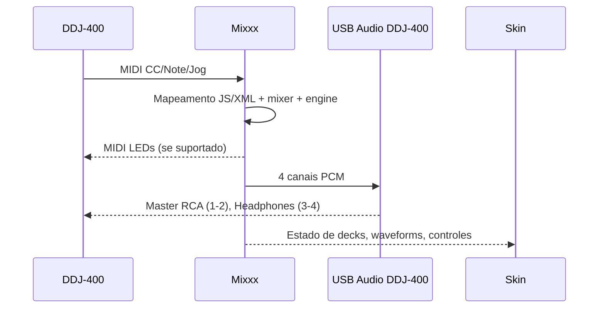
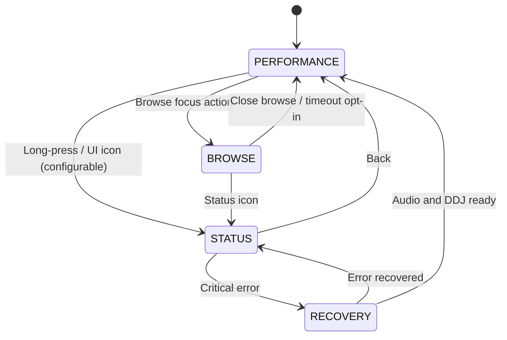

# DECKBRIDGE OS — ESPECIFICAÇÃO COMPLETA PARA IMPLEMENTAÇÃO AGÊNTICA

**Edição:** 1.0.0 · **Data:** 21/10/2026 · **Estado:** especificação, ainda não software implementado.

> **Importante:** este arquivo consolida todos os documentos normativos, técnicos e de implementação. As pastas independentes no ZIP são a fonte primária para GitHub Spec Kit; este arquivo existe para ingestão em um único contexto. O código e os testes físicos ainda precisam ser executados.

## Índice de documentos consolidados

1. **Missão e como usar** — `README.md`

2. **Instruções ao agente implementador** — `AGENTS.md`

3. **Constituição** — `.specify/memory/constitution.md`

4. **Especificação funcional** — `specs/001-ddj400-standalone/spec.md`

5. **Plano técnico** — `specs/001-ddj400-standalone/plan.md`

6. **Pesquisa e fontes** — `specs/001-ddj400-standalone/research.md`

7. **Modelo de dados e contratos internos** — `specs/001-ddj400-standalone/data-model.md`

8. **API Companion (P3)** — `specs/001-ddj400-standalone/contracts/openapi.yaml`

9. **Backlog e execução** — `specs/001-ddj400-standalone/tasks.md`

10. **Quickstart POC e instruções** — `specs/001-ddj400-standalone/quickstart.md`

11. **Checklist de completude** — `specs/001-ddj400-standalone/checklists/requirements.md`

12. **UI/UX** — `docs/ui-spec.md`

13. **Plano de testes** — `docs/test-plan.md`

14. **Registro de riscos** — `docs/risk-register.md`

15. **ADR-0001 Mixxx** — `docs/adr/0001-mixxx-base.md`

16. **ADR-0002 Pendrives** — `docs/adr/0002-usb-read-only.md`

17. **ADR-0003 Offline** — `docs/adr/0003-offline-first.md`

18. **Log de implementação** — `docs/runbooks/implementation-log.md`


---


# PARTE 01 — Missão e como usar

**Arquivo de origem:** `README.md`


# DeckBridge OS — Spec Kit para um sistema DJ standalone

**Estado:** especificação de engenharia inicial (não é software implementado)  
**Data:** 2026-10-21  
**Idioma:** pt-BR  
**Hardware-alvo:** Pioneer DJ DDJ-400 + Raspberry Pi 4/5; POC em Raspberry antigo conforme inventário  
**Motor:** Mixxx 2.5.6 estável (baseline a validar no repositório)  
**Responsável pela visão:** proprietário do projeto (decisões pendentes em `spec.md`)

## Objetivo

Transformar uma DDJ-400 em um equipamento **standalone**, que inicializa diretamente em uma interface para DJ, reproduz e pré-escuta dois decks via interface de áudio da própria controladora, navega em USBs exportados pelo rekordbox e permite desenvolvimento futuro de recomendações, registro de sets e DJ Trainer. Offline primeiro. O sistema **não é** uma tentativa de fazer o app rekordbox Android reconhecer a DDJ-400.

## Leia nesta ordem (agentes)

1. `AGENTS.md` — instruções operacionais obrigatórias para os agentes.
2. `.specify/memory/constitution.md` — princípios/limites invioláveis.
3. `specs/001-ddj400-standalone/spec.md` — requisitos, user stories, fluxos e gates.
4. `specs/001-ddj400-standalone/research.md` — fontes, pressupostos e investigações obrigatórias.
5. `specs/001-ddj400-standalone/plan.md` — arquitetura, interfaces e estratégia de implementação.
6. `specs/001-ddj400-standalone/data-model.md` — entidades e contratos.
7. `specs/001-ddj400-standalone/contracts/openapi.yaml` — API futura local (fase 0.3, não exigida para POC).
8. `specs/001-ddj400-standalone/tasks.md` — plano de execução com dependências e evidências.
9. `specs/001-ddj400-standalone/quickstart.md` — POC, builds, testes e rollout.
10. `specs/001-ddj400-standalone/checklists/requirements.md` — verificação de qualidade da especificação.

`ESPECIFICACAO_COMPLETA.md` concatena os documentos acima como **arquivo único para fornecer a um agente**. Em caso de divergência, os arquivos separados acima prevalecem; a versão consolidada é um artefato gerado.

## GitHub Spec Kit

O repositório está **estruturado no estilo** GitHub Spec Kit (`.specify/memory/constitution.md`, `specs/001-ddj400-standalone/spec.md`, `plan.md`, `tasks.md`). Não se afirma que o CLI `specify` tenha sido executado nem que esta pasta contenha todos os scripts oficiais. Para instalar o workflow oficial:

```bash
uv tool install specify-cli
specify init --here --integration codex
```

Verifique opções disponíveis com `specify init --help` na versão instalada antes de executar; inicialize em repositório/cópia limpa e preserve esta especificação. O nome `--integration` e as opções suportadas podem evoluir. O CLI oficial fornece comandos como `/speckit.constitution`, `/speckit.specify`, `/speckit.plan`, `/speckit.tasks`, `/speckit.implement`; a sintaxe varia por agente. **Não gere de novo esta especificação de modo a sobrescrever decisões, requisitos ou evidências.**

## Referências centrais (consultadas em 2026-10-21)

- Mixxx: https://github.com/mixxxdj/mixxx — motor upstream.
- Mixxx 2.5.6 stable: https://mixxx.org/download/ — baseline estável de produção; 2.6 beta/2.7 dev não são referência de performance em palco.
- DDJ-400 manual Mixxx: https://manual.mixxx.org/2.7/en/hardware/controllers/pioneer_ddj_400 — USB Audio/MIDI class-compliant; master 1–2, headphones 3–4; firmware requer verificação.
- Mixxx rekordbox manual: https://manual.mixxx.org/2.5/en_gb/chapters/library — importação a partir do USB exportado; limitações de mapeamento de cues.
- StandaloneMixxx: https://github.com/ghztomash/StandaloneMixxx — provisionamento, autostart, Pi 4B/5, skin; configuração original focaliza DDJ-FLX2/FLX4, **não garante DDJ-400**.
- TriMixxx: https://github.com/usr-ein/TriMixxx — estudo de UX, hotplug, patched Mixxx e hardware CDJ custom; **não é um fork pronto para DDJ-400**.
- NauticMixxx: https://github.com/nauticsoftware/NauticMixxx — referência de UI RX3; releases principais macOS/Windows, suporte DDJ-400 depende de preset; Linux/Pi experimental.
- mixxx-pi-gen: https://github.com/fayaaz/mixxx-pi-gen — imagem Pi com Sway/Mixxx.
- pyrekordbox: https://github.com/dylanljones/pyrekordbox — pesquisa e testes ANLZ/Device Library Plus; MIT.
- libdjinterop: https://github.com/xsco/libdjinterop — leitura OneLibrary, com limitações (SQLCipher/passphrase, side-effects SQLite WAL, ANLZ fora do DB).
- MIDI scripting Mixxx: https://github.com/mixxxdj/mixxx/wiki/midi-scripting
- Spec Kit: https://github.com/github/spec-kit
- Limites de alimentação Pi: https://www.raspberrypi.com/documentation/hardware/raspberrypi/power.html

## Política de afirmações

Termos como **comprovado** só podem constar em relatórios do projeto com logs, fotos ou testes executados no hardware-alvo. Recurso mencionado em projeto externo é **referência**, não prova de compatibilidade no nosso sistema.

## Licenças

Mixxx é GPL-2.0-or-later; o pacote composto deve manter os respectivos avisos de licença de todo código incorporado. TriMixxx e NauticMixxx publicam GPL-3.0 para seus componentes; pyrekordbox MIT; libdjinterop LGPL-3.0-or-later. **Antes de copiar qualquer código**, revisar licenças e compatibilidade de todos os arquivos e dependências. O nome provisório DeckBridge OS é independente de Pioneer/AlphaTheta e rekordbox.

### Regenerar o arquivo único após alterações

```bash
python3 tools/build_spec_bundle.py
```

O comando revalida IDs T001–T074, FR/NFR e gera `ESPECIFICACAO_COMPLETA.md`, `manifest.json` e o ZIP de entrega. Ele não executa código de aplicação.


---


# PARTE 02 — Instruções ao agente implementador

**Arquivo de origem:** `AGENTS.md`


# AGENTS.md — instruções obrigatórias ao agente implementador

## Missão

Implemente em incrementos verificáveis o DeckBridge OS, uma plataforma standalone para DDJ-400 em Raspberry Pi, fundamentada em `specs/001-ddj400-standalone/`. Priorize a integridade da biblioteca musical e a estabilidade do áudio acima de features.

## Ordem normativa

1. Constituição (`.specify/memory/constitution.md`)
2. `spec.md` (o QUÊ e aceites)
3. `plan.md` (COMO)
4. `data-model.md` e `contracts/` (interfaces)
5. `tasks.md` (execução)
6. `research.md` (evidências e dúvidas; referências não substituem testes)

## Regras

- Não inventar resultados de testes, versões, compatibilidade, tempo de boot, consumo ou nomes de controles do Mixxx.
- Não começar com um fork próprio de todo o engine. Primeiro um vertical slice em Mixxx upstream estável e mapping DDJ-400 existente.
- NÃO alterar firmware da DDJ-400; nenhuma necessidade de engenharia reversa de USB proprietária no MVP.
- **Nunca escrever no pendrive rekordbox** no MVP, nem permitir mount RW. Se algum parser abrir DB SQLite WAL, trabalhar em cópia isolada em disco local, não no pendrive.
- Nunca copiar músicas protegidas ao repositório; fixtures sintéticas com licenças compatíveis, consentimento para testes de arquivos pessoais.
- Operações de alto custo (scans, inferência, exportação, DB, rede) não podem bloquear thread de áudio/UI crítica.
- Guardar cada decisão arquitetural significativa em ADR; citar justificativa e alternativa descartada.
- Versionar e fixar SHA/tag de dependências, construir a partir de artefatos verificáveis; nunca `curl|sh` em produção. Evitar dependências non-free.
- Não chamar recurso de pronto antes de demonstrar critérios de aceite com provas.
- Não mudar requisitos do P0/P1 por conveniência; abrir proposta com trade-offs.
- Em ausência de hardware, implementar em desktop/simulação e marcar testes HIL como `BLOCKED_HARDWARE`, nunca `PASS`.
- Perguntar ao proprietário somente decisões listadas em `spec.md` com status `OWNER_DECISION`, ou se uma restrição nova impossibilitar o trabalho; as defaults se aplicam na ausência de resposta.

## Execução por tarefas

- Iniciar na primeira tarefa desbloqueada de `tasks.md`.
- Para cada tarefa: criar branch `feat/<id>-descricao`, testes e documentação; registrar commit, evidências, status, riscos e próxima tarefa em `docs/runbooks/implementation-log.md` (criar o arquivo se ausente).
- Gate: testes unitários/integração automatizados; HIL para áudio/DDJ quando disponíveis; static analysis; sem segredos; revisão de mudanças em licenças.
- PR pequeno por componente; preservar funcionamento musical e rollback de versão.
- Tarefas paralelas só quando não editarem o mesmo subsistema ou ABI.
- Configurar CI em Linux x86_64; builds arm64 via runner nativo ou cross-compilation; hardware HIL dedicado depois.
- No final de cada fase, publicar matriz de aceites de `spec.md` com `PASS/FAIL/BLOCKED` e links para evidências.

## Definition of Done por item

Código compilável, lint e testes aplicáveis passando, documentação/configuração reproduzível, logs sem dados sensíveis, compatibilidade verificada quando hardware disponível, sem regressão de áudio, task marcada concluída com referência do commit.

## Prompt recomendado

> Leia AGENTS.md e os arquivos em specs/001-ddj400-standalone/. Não produza apenas um plano: execute as tarefas em ordem de dependência, começando por T001. Para cada entrega, registre evidências e bloqueios no implementation-log. Preserve a política read-only para USB rekordbox e não afirme testes de hardware que não executou. Trate melhorias inteligentes como posteriores aos gates de estabilidade musical.


---


# PARTE 03 — Constituição

**Arquivo de origem:** `.specify/memory/constitution.md`


# Constituição do DeckBridge OS

**Versão:** 1.0.0 | **Ratificação:** 2026-10-21 | **Última alteração:** 2026-10-21

## I. Audio-first: estabilidade acima de funcionalidades

A thread de processamento em tempo real nunca faz I/O de disco, rede, parsing de USB, inferência, alocações imprevisíveis nem locks não limitados introduzidos pelo DeckBridge. Regressões de x-runs, descontinuidade ou travamento musical impedem release. Só dependências conhecidas/validadas no caminho crítico.

## II. Patrimônio musical é somente leitura por padrão

O USB do rekordbox é montado read-only no MVP. Não alterar `export.pdb`, `exportLibrary.db`, ANLZ ou arquivos de áudio. Estados modificados (cues e sessões) persistem localmente em espaço separado. Recursos de exportação bidirecional exigem especificação, opt-in, backup, validação offline e testes de corrupção; não entram nas releases iniciais.

## III. Prova antes de promessa

Toda claim de compatibilidade, desempenho e segurança precisa de teste reproduzível, hardware registrado e critérios objetivos. Documentação de terceiros não equivale a aceite local. Dados sintéticos e cenários falsos não são HIL.

## IV. Offline e controle físico primeiro

A DDJ-400 deve conseguir controlar o fluxo musical sem internet. Tela permite uso durante apresentações; um app móvel é secundário e nunca é necessário para iniciar ou continuar tocando. Modos inteligentes não podem se sobrepor a controles manuais, salvo ativação explícita do DJ.

## V. Upstream-first e interfaces versionadas

Usar Mixxx 2.5.6 como referência inicial e aproveitar mapeamento DDJ-400 existente. Preferir skin, mapping e serviços desacoplados. Alterações no core exigem ADR, flag, teste de regressão e patch isolável; upstream quando possível. Interfaces e schemas são versionados, migração compatível e rollback suportado.

## VI. Segurança e privacidade locais

Sem exposição de serviços em interfaces públicas por padrão; sem upload obrigatório de áudio, faixas, metadados ou telemetria; sem chaves embutidas ou execução arbitrária via API. API móvel é pareada/autenticada. USB e arquivos ANLZ/PDB são entradas não confiáveis: validar tamanho, paths, limites e fuzzing.

## VII. Releases reproduzíveis e recuperação

Pin SHA/tag upstream, checksum das imagens e arquivos, builds determinísticos sempre que factível, backup de dados locais e mecanismo de rollback. Boot e shutdown idempotentes; queda de energia deve permitir recuperação da configuração sem alterar USB externo.

## VIII. Desenvolvimento guiado por gates

Vertical slice funcional antes de abstrações. Cada marco produz testes, relatório de evidências e atualização do backlog; nenhuma tarefa pode ser declarada pronta sem DoD. Trabalho físico depende de execução com o proprietário.

## Política de governança

Mudanças desta constituição precisam de ADR e justificativa, incremento SemVer, atualização de templates e revalidação de aceites. Em conflitos, requisitos de segurança do áudio e integridade do USB têm precedência. O implementador deve interromper release com falha nesses princípios, ainda que a UI esteja funcional.


---


# PARTE 04 — Especificação funcional

**Arquivo de origem:** `specs/001-ddj400-standalone/spec.md`


# Feature Specification 001 — DeckBridge OS: DDJ-400 standalone

**Status:** Draft pronto para implementação incremental; hardware ainda não validado.  
**Versão do documento:** 1.0.0 (2026-10-21)  
**Projeto:** DeckBridge OS (nome de trabalho, sujeito à decisão do proprietário)  
**Tipo:** spec de produto e critérios de aceite, independente da escolha de stack; detalhes técnicos em `plan.md`.

## 1. Resumo executivo

Construir um **módulo portátil ligado por USB à DDJ-400** que elimina a necessidade de notebook/telefone para tocar música. Um Raspberry Pi executará Mixxx com UI adequada a tela pequena e navegação pelo hardware. O usuário prepara pendrives no rekordbox, conecta-os ao módulo e consegue selecionar faixas e tocar dois decks, com master e pré-escuta saindo da interface de áudio da DDJ-400. O sistema opera offline, tolera eventos comuns (USB conectado depois do boot, mudança de playlist, erro de arquivo), protege a biblioteca externa contra escritas e proporciona futura camada de telemetria, recomendações musicais e treinamento guiado.

**Não estamos desenvolvendo um plugin Android para rekordbox nem substituindo o firmware da DDJ-400.** Nosso produto é um computador DJ standalone independente do software proprietário da AlphaTheta.

### 1.1 Problema

A DDJ-400 é dependente de host para o software de mixagem. O rekordbox Android não oferece suporte oficial à DDJ-400 neste cenário, embora outros aplicativos aceitem seus comandos. O DJ deseja viajar com a controladora e um dispositivo compacto em lugar do notebook, preservando seu preparo de biblioteca no rekordbox.

### 1.2 Visão de experiência final

1. Preparar faixas, playlists, hot cues, beatgrids e loops no rekordbox no computador.
2. Exportar biblioteca para USB em formato compatível de dispositivo CDJ/XDJ.
3. Ligar o módulo à DDJ-400 via USB e à energia; a tela mostra o estado do sistema.
4. Conectar o pendrive, navegar por pastas/playlists pelo encoder, carregar faixas nos dois decks.
5. Ouvir master na saída RCA da DDJ-400 e cue nos fones da DDJ-400, com botões, faders, jogs, pads e LEDs integrados.
6. Tocar sem internet, sem celular e sem monitor externo.
7. Opcionalmente gravar e analisar a performance; no futuro, receber dicas e exercícios de DJ.

### 1.3 Alvos de entrega

- **P0 — Prova técnica:** funciona em Pi antigo *quando viável*: USB/MIDI, áudio 4 canais, Mixxx 2 decks, importação básica USB; monitor/teclado temporários aceitáveis. Sem promessa de performance até HIL.
- **P1 — MVP standalone:** Pi 4B 4 GB ou Pi 5 4+ GB validado; boot para tela pequena; controladora integral; biblioteca rekordbox USB (legado `export.pdb`); confiabilidade e ações de falha; USB somente leitura.
- **P2 — Produto estável:** imagem reprodutível, atualização/rollback, melhorias UX, diagnósticos e robustez.
- **P3 — Smart DJ:** telemetria de sets, tracklist, ranking não intrusivo de próxima faixa, PWA local opt-in.
- **P4 — DJ Trainer:** guiado e analytics por frase/transição; evolução posterior.
- **P5 — Interoperabilidade avançada:** OneLibrary/Device Library Plus e eventual escrita bidirecional, com condições legais/técnicas e gates próprios.

P0 e P1 são obrigatórios. P2 antes de considerar apresentações públicas. P3–P5 são roadmap, não pré-requisitos para concluir P1.

## 2. Personas e casos de uso

- **DJ portátil:** quer ligar e tocar, sem notebook, usando a DDJ-400 que já conhece.
- **DJ que prepara no rekordbox:** exige playlists e informações preparadas reconhecíveis; não quer retrabalho de análise.
- **Maintainer:** precisa de logs, boot previsível, reflash/recovery e diagnóstico de hardware.
- **DJ em treinamento (futuro):** quer feedback de timing/beatmatching/transições sem substituir sua decisão.

### 2.1 Jornadas

| ID | Jornada | Resultado esperado |
|---|---|---|
| J-01 | Primeiro boot com DDJ-400 conectada | Tela de inicialização, áudio e MIDI reconhecidos ou diagnóstico acionável |
| J-02 | Inserir USB rekordbox após boot | Biblioteca/playlist aparece sem reiniciar o processo musical |
| J-03 | Carregar deck A e B | Metadados, BPM/cues visíveis; reprodução independente |
| J-04 | Monitorar no fone e mixar no RCA | Pre-escuta isolada, crossfader/equalização funcionam |
| J-05 | Retirar USB por acidente | Aviso, sem corrupção externa; comportamento honesto se áudio não estiver armazenado em cache |
| J-06 | Queda/religamento de energia | Boot confiável; não tocar áudio automaticamente sem intenção explícita |
| J-07 | USB incompatível com formato futuro | Mostrar versão/formato não suportado e orientação de exportação; jamais escrever/"consertar" o USB |
| J-08 | Conectar tablet/celular (P3) | Visualizar status e configurações opt-in sem depender disso para tocar |
| J-09 | Ativar DJ Trainer (P4) | Recomendações observáveis, desligáveis, sem ações automáticas nos faders |

## 3. Escopo e prioridades

### 3.1 P0 — compatibilidade técnica

- Detectar Pi, versão de SO, RAM, energia e dispositivos USB; registrar resultados.
- Instalar/buildar Mixxx estável adequado à arquitetura; evitar fork invasivo se mapping nativo funcionar.
- Detectar DDJ-400 simultaneamente como USB MIDI e USB áudio.
- Validar canais 1–2 (master) e 3–4 (headphones) na controladora; confirmar medindo os sinais, não apenas vendo o dispositivo.
- Usar mapping oficial Mixxx DDJ-400; validar funções essenciais e firmware.
- Usar arquivos de teste lícitos e USB exportado com o rekordbox; registrar formato real encontrado.
- Fazer benchmark real de CPU/temperatura/x-runs na placa existente.

### 3.2 P1 — MVP standalone

- Login automático controlado/local, boot direto no software DJ, tela de 800x480 ou superior como baseline operacional.
- Biblioteca navega via encoder e botão LOAD, sem mouse ou teclado durante apresentação.
- Visualização de estado de dois decks: artista, faixa, BPM analisado/atual, tempo, posição, waveform, cue, loop, sync, tempo/pitch, VU e áudio.
- FX, EQ, play, cue, sync, browse, hot cues, loops, pitch slider, jog wheels, faders, crossfader, PFL/pre-escuta, volume e feedback LED conforme mapeamento DDJ-400; documentar diferenças físicas/firmware.
- USB autodetectado, montado RO e desmontado de forma segura; permitir re-scan da biblioteca sem reiniciar Mixxx.
- Ler formato legado USB rekordbox suportado pelo Mixxx: playlists, folders, beatgrid, hot cues, memory cues e loops com semântica explícita de mapeamento.
- Dizer claramente quando propriedades de cue não possuem correspondência 1:1 com Mixxx; não prometer importação sem perdas sem teste.
- Local library para trilhas/alterações internas; não alterar exportações do rekordbox.
- Tela de erro e modo recovery útil em ausência de USB/DDJ ou falha do processo.
- Reconfiguração e reboot/desligamento seguros, evitando corte imediato de energia durante escrita local.
- Configuração persistente local (volume padrão seguro, buffer, tema, idioma, dispositivo primário, caminho de montagens).

### 3.3 P2 — confiabilidade e experiência

- Imagem SD reprodutível, instalador idempotente, artefatos assinados/verificados, pin de upstream, rollback.
- Interface otimizada para 5/7 polegadas, variantes 800x480 e 1280x720 paisagem.
- Diagnóstico de alimentação, temperatura, CPU, x-runs, captura de logs de falha e checagem do mount read-only.
- Testes contínuos de 2 horas em perfil de hardware validado.
- Cache opcional de waveform/artwork/metadados em armazenamento **local** (não em USB), com limites e GC.
- Indicador de disco ausente/incompatível, recuperação segura de estado local, safe-mode sem plugins.
- Perfil de config para Pi 4/5 sem presumir equivalência de performance do Pi 3.

### 3.4 P3 — inteligência e companion

- Eventos de performance: load, play/pause, cue, loop, sync, pitch, EQ, filter, faders, fx, crossfader, track transition; timestamps e correlação com decks.
- Tracklist com tempos de início/fim estimados e edição pelo DJ; exportação JSON/CSV/M3U (sem embutir música).
- Regras transparentes de sugestão de próxima faixa (intervalos de BPM, tonalidade, energia anotada, duração e repetição); processamento offline.
- UI opcional no celular via PWA local; pareamento físico, autenticação e opção de desligar Wi-Fi; endpoints read-only inicialmente.
- Gravação Mixxx opcional no armazenamento local, respeitando espaço livre e autorização de quem opera.

### 3.5 P4 — DJ Trainer

- `PERFORMANCE`, `GUIDED_MIX` e `TRAINING` como modos mutuamente exclusivos, selecionáveis pelo DJ.
- Detector offline de pontos prováveis de intro/outro/breakdown/drop (heurístico/sinal) com confiança explícita.
- Overlay de frases (8/16/32 compassos) e próximo ponto recomendado; sobreposições de EQ estimadas a partir de MIDI + ganho, não de gravação multicanal garantida.
- Exercícios com checkpoints e pontuação reprodutível: tempo de entrada, alinhamento de frase, intervalos com sobreposição de graves, consistência de BPM.
- Nenhuma operação automatizada do mixer sem feature futura separada e consentimento explícito.
- Prefetch/análise não simultâneos com uso de CPU excessivo durante performance; desativar em hardware insuficiente.

### 3.6 P5 — interoperabilidade avançada (não MVP)

- Detectar e eventualmente ler `exportLibrary.db`/OneLibrary com dependências legais/técnicas documentadas.
- Diferenciar suporte `detectado`, `metadados lidos`, `música carregada`, `cues carregados` e `escrita suportada` no formato OneLibrary.
- Sem obtenção, distribuição ou hardcoding de segredos/passphrases proprietárias; nenhuma evasão de DRM/controle de acesso. Caso acesso autorizado não esteja disponível, oferecer caminho de exportação legado.
- Escrita de volta ao USB só por arquitetura transacional separada com backup, validação em dispositivo de laboratório e confirmação explícita — **não habilitar na versão P1–P4**.

## 4. Fora de escopo explícito

- Executar aplicativo proprietário rekordbox (Windows/macOS/Android) no Raspberry ou enganar seu reconhecimento USB.
- Modificar firmware/hardware interno da DDJ-400.
- Clone visual idêntico de XDJ/RX3 ou uso de assets proprietários sem licença.
- Streaming Spotify/Beatport/Tidal, reprodução DRM ou download de conteúdo protegido.
- Integração obrigatória com nuvem, usuários e assinaturas.
- Stems neurais em tempo real no Raspberry antigo; somente pesquisas e stems pré-processados futuros.
- Pro DJ Link/compatibilidade de rede com CDJs como requisito do MVP.
- Mixagem automática inteligente durante apresentação sem aprovação do DJ.
- Suporte a todas as controladoras MIDI no P1 (arquitetura extensível; DDJ-400 é perfil inicial).

## 5. Requisitos funcionais verificáveis (IDs persistentes)

| ID | Requisito | Marco | Critério resumido |
|---|---|---|---|
| FR-001 | Descobrir modelo Pi, OS, arquitetura, RAM, fonte/USB | P0 | Relatório JSON diagnósticos sem exceção |
| FR-002 | Reconhecer DDJ-400 MIDI e áudio USB | P0 | Eventos MIDI + dispositivo ALSA enumerados |
| FR-003 | Reproduzir deck A/B sem conflito | P0 | Dois arquivos simultâneos audíveis |
| FR-004 | Master 1–2 e cue 3–4 independentes | P0 | Captura/escuta prova separação |
| FR-005 | Mapear controles críticos da DDJ-400 | P1 | Matriz de 100% do conjunto M0 testado |
| FR-006 | Boot direto em UI de DJ | P1 | Boot sem login/manual; testes após 5 reinícios |
| FR-007 | Navegar por hardware sem teclado | P1 | Browse, selecionar playlist, load em A/B |
| FR-008 | Montar USB rekordbox RO | P1 | fs mount `ro` e hash idêntico pré/pós |
| FR-009 | Importar playlists/folders `export.pdb` | P1 | Comparação determinística com fixture |
| FR-010 | Importar BPM/beatgrid/hotcues/loops compatíveis | P1 | Fixtures reconhecidas e diferenças reportadas |
| FR-011 | Detecção hotplug + rescan | P1 | USB novo aparece sem restart engine |
| FR-012 | Erros explícitos de USB/formatos | P1 | UI informativa sem travamento |
| FR-013 | Estado local separado de origem USB | P1 | Nenhuma escrita na origem |
| FR-014 | UI landscape 800x480 / 1280x720 | P2 | Legibilidade e controles mensurados |
| FR-015 | Diagnóstico de áudio, alimentação, crashes | P2 | Logs exportáveis com dados mínimos |
| FR-016 | Instalação e rollback | P2 | Upgrade/rollback sem perder config |
| FR-017 | Registro de eventos / histórico de set | P3 | Eventos no banco com timestamps válidos |
| FR-018 | Tracklist editável e exportável | P3 | Exportação por 1 hora de set |
| FR-019 | Recomendações offline explicáveis | P3 | Ranking determinístico com razões |
| FR-020 | PWA local opt-in autenticada | P3 | Pairing, revogação, rede desativada por default |
| FR-021 | Guided Mix não intrusivo | P4 | Indicação de pontos sem automatizar faders |
| FR-022 | Feedback de exercícios | P4 | Métricas reproduzíveis por dados de teste |
| FR-023 | OneLibrary detectável, com fallback | P5 | Mensagem correta com/sem parser disponível |
| FR-024 | Dispositivo desconectado não causa corrupção USB | P1 | Hash/FS verificados em cenários HIL |

### 5.1 Matriz M0 de controles DDJ-400

**A tabela abaixo é contratual por função, não presume IDs MIDI.** Os CC/notes/LED statuses devem ser extraídos do mapping Mixxx fixado e capturados com `aseqdump` ou equivalente no dispositivo real.

| Grupo | Controles / ações a validar | Aceite |
|---|---|---|
| Transporte | PLAY/PAUSE, CUE, SHIFT | ambos os decks, ação/feedback sem travar |
| Navegação | encoder BROWSE (giro/click), LOAD A/B | foco correto e seleção observável |
| Ritmo | jog touch/turn, pitch fader, SYNC, tempo range se mapeado | resposta apropriada e sem saltos espúrios |
| Hot cues | pads HOT CUE e mudança de modo | disparo conforme mapping e LED correspondente |
| Loops | loop IN/OUT, reloop/exit, beat loop | marcador temporal e feedback coerentes |
| Mixer | faders A/B, crossfader, gain/trim, EQ high/mid/low | direção, escala, ganho e limites coerentes |
| Cue/master | PFL A/B, volume headphone, cue/master blend se disponível, master knob | separação de canais e comportamento audível |
| FX | seleção, ON/OFF, parâmetro, filter | controles mapeados ao Mixxx e testados |
| Segurança | reconexão DDJ, restart Mixxx com DDJ conectada, firmware | sem estados presos e sem MIDI fantasma |

Limite: algumas funções/controles são de áudio analógico/firmware e podem não gerar MIDI; registrar comportamento real, não simular detecção inexistente. Firmware DDJ-400 tem aviso de slider MIDI espúrio em versões antigas: inventariar firmware e seguir processo oficial externo quando aplicável.

## 6. Requisitos não funcionais e indicadores

| ID | Meta | Medição e gate |
|---|---|---|
| NFR-001 | 0 x-runs audíveis introduzidos em teste contínuo de 120 min, 2 decks, perfil validado | JACK/PipeWire/ALSA + logs e loopback; falha se houver corte audível |
| NFR-002 | Latência control-to-sound perceptualmente utilizável; alvo inicial <=25 ms com hardware validado | medição loopback/jog/pads; ajustar buffer, documentar limites |
| NFR-003 | Boot até UI utilizável: alvo <=60 s Pi 5; Pi 4 e Pi 3 somente benchmark | 10 cold boots; p95 registrado, falha ao exceder somente depois da baseline |
| NFR-004 | CPU de pico sustentável: reservar ao menos 25% de margem média no perfil escolhido | 120min CPU por processo/core, temperatura, throttling |
| NFR-005 | Biblioteca 10 mil faixas (metadados) navegável sem congelamento de áudio | fixture sintética; <300ms p95 interação após indexação (meta) |
| NFR-006 | 0 escrita em USB durante MVP | montagem RO + hashes de arquivos sensíveis antes/depois; monitor de I/O |
| NFR-007 | Processo Mixxx e daemon recuperam-se após falhas controladas | systemd, crash recovery, sem reprodução involuntária |
| NFR-008 | Construção reprodutível em arm64, com SHA registrado | CI + release manifest e checksum SHA256 |
| NFR-009 | Integrações não expostas por default | portas/serviços auditados e testes de autenticação |
| NFR-010 | Tela operável a 50–80 cm, sob luz doméstica | teste humano em protótipo, contraste e botões físicos |
| NFR-011 | Volume inicial seguro | não iniciar reprodução automaticamente; níveis recuperados com limites documentados |
| NFR-012 | Recuperação após desligamento súbito sem corrupção de origem | 20 ciclos de bancada + fsck/SQLite integrity_check local |

**Todas as metas de desempenho são objetivos de engenharia, não valores já comprovados.** Gates dependentes de hardware ficarão `BLOCKED_HARDWARE` até benchmark no modelo exato.

## 7. Compatibilidade de formatos rekordbox — contrato do produto

### 7.1 Modos e garantias

| Origem | Prioridade | Operação | Observações |
|---|---|---|---|
| Exportação USB rekordbox em formato tradicional com `export.pdb` | P1 | READ-ONLY (Mixxx) | caminho primário suportado pelo manual Mixxx |
| `ANLZ*.DAT`, `ANLZ*.EXT`, variantes conhecidas | P1 | READ-ONLY, via parser Mixxx | cues, grids e waveforms quando suportados; lacunas são detectadas |
| USB com OneLibrary `exportLibrary.db` | P5 | Detecção em P1; leitura condicionada a acesso técnico/lícito | SQLCipher, ANLZ externos, WAL; nunca escrita no pendrive |
| Biblioteca `master.db` interna do rekordbox PC | Fora MVP | Não importar | formato diferente, não é export USB |
| XML exportado pelo rekordbox | P3 opcional | Importação offline de metadados | não substitui garantia de USB para palco |
| MP3/FLAC/WAV/AIFF no USB comum | P0/P1 | leitura do decoder Mixxx | track files sem metadata RB ainda reproduzem |

### 7.2 Semântica

- Não afirmar que cues são equivalentes 1:1: Mixxx pode mapear memory cues e loops adicionais a hot cues, e o cue/loop principal a slots específicos; consultar manual da versão fixada.
- Posição temporal deve manter precisão em amostras/frames quando disponível; tempo em milissegundos apenas para UI/API, com taxa de amostragem explícita.
- Os BPMs podem ter variação local e beatgrid não pode ser representado por BPM único quando há múltiplos marcadores. Manter estrutura de markers e seus offsets.
- Faixas ausentes ou caminhos inválidos: mostrar como indisponíveis, sem alterar dados originais.
- Duplicação de IDs entre múltiplos USB: usar identidade `(source_volume_uuid, rekordbox_track_id)` e hash de conteúdo apenas quando explicitamente necessário.
- A leitura OneLibrary requer estudo da licença e do mecanismo de acesso; sem senha autorizada, recuar para exportação tradicional com mensagem clara.
- Compatibilidade por versão deverá ser declarada conforme fixtures coletadas (`rb_export_version`, `format_variant`, `parser_version`), não por marketing 'suporta rekordbox 7 inteiro'.

### 7.3 Comportamento com USB removido

Enquanto o deck está tocando arquivos no USB, a remoção física pode interromper a reprodução, dependendo do buffering do Mixxx. Não alegar comportamento gapless nem que faixas inteiras foram carregadas. P1 exibe aviso e impede novos loads da origem; P2 estuda *precache* explícito em disco local, consentido pelo DJ, com restrição de espaço. Um sistema de arquivos ro preserva dados contra escritas locais, mas não impede falhas físicas ou falhas provocadas externamente.

## 8. Fluxos e estados

### 8.1 Máquina de estados do dispositivo

`BOOTING -> CHECKING_HW -> READY_NO_LIBRARY -> LIBRARY_SCANNING -> READY -> PLAYING -> READY`; estados de exceção `DEGRADED_AUDIO`, `USB_UNSUPPORTED`, `CONTROLLER_DISCONNECTED`, `RECOVERY`. `PLAYING` pode coexistir com `USB_SCANNING` e `DEGRADED` visual; na implementação separar dimensões `system/audio/controller/library` em vez de uma enum monolítica para evitar estado impossível.

**Inicialização:** nunca disparar play automático; se DDJ ausente, entrar em `READY_NO_CONTROLLER` com instruções para reconexão e detecção sem restart quando factível.

**USB reconhecido:** validar label/FS, verificar read-only, identificar diretório Pioneer/rekordbox, usar importação Mixxx. Recusar paths fora da raiz (symlink traversal) e arquivos malformados sem afetar engine.

**Audio device desaparece:** display de alerta visível e estado de saída inválido; silenciar seguramente; recuperação guiada de áudio, não alternar silenciosamente para HDMI.

**Desligar:** opção na UI/tecla configurada que fecha sessão e sync local antes do `poweroff`; não executável inadvertidamente ao pressionar botão de performance.

## 9. Histórias de usuário (BDD / rastreáveis)

### US-01 — Tocar uma apresentação sem notebook (P1)

**Given** Pi com imagem testada, DDJ-400, fonte adequada, monitor/tela e USB válido  
**When** ligo o dispositivo  
**Then** a UI DJ inicia, reconhece controladora/USB e consigo navegar, carregar e reproduzir dois decks sem computador e internet.

**Aceite:** gates FR-002/003/004/005/006/007/008/009, HIL com vídeo/áudio e logs.

### US-02 — Aproveitar biblioteca do rekordbox (P1)

**Given** pendrive exportado com playlists, 5 faixas de teste, cue, memory cue, loop e beatgrid documentados  
**When** o insiro com Mixxx em execução  
**Then** playlists/faixas surgem, carregam e exibem marcadores compatíveis, sem escrita no USB.

**Aceite:** diff de expected vs actual, hashes de PDB/ANLZ antes/depois; lista de incompatibilidades.

### US-03 — Pré-escuta independente (P0/P1)

**Given** deck A audível no master e deck B em cue  
**When** pressiono PFL B e ajusto crossfader  
**Then** deck B é audível nos fones sem ser enviado ao master até mistura deliberada.

**Aceite:** captura/certificação áudio master RCA vs fones; curva de isolamento registrada.

### US-04 — Recuperar quando o USB falha (P1)

**Given** set ativo e USB com arquivo ilegível/retirado  
**When** ocorre erro de mídia  
**Then** UI apresenta causa e orientação; a origem permanece íntegra; não há crash ou escrita na origem.

### US-05 — Usar controles físicos (P1)

**Given** nenhum mouse/teclado conectado  
**When** navego e mixo  
**Then** execução de set de 15 minutos é concluída; tela serve como feedback, não depende do toque.

### US-06 — Ver estatísticas de um set (P3)

**Given** registro de set consentido  
**When** finalizo a sessão  
**Then** tracklist e eventos cronológicos podem ser exibidos/exportados localmente e apagados pelo DJ.

### US-07 — Receber orientação sem automação (P4)

**Given** Guided Mix ativado e 2 tracks com análise de frases  
**When** a próxima seção se aproxima  
**Then** indicação de ponto aparece e não altera mixer ou transporte.

## 10. Edge cases e tratamento exigido

| Situação | Ação esperada |
|---|---|
| USB FAT/exFAT/HFS conforme drivers presentes | Detectar capacidade real e montar `ro`; HFS não garantido sem suporte do SO |
| USB criptografado, sem PDB, com OneLibrary-only | Fallback explicativo, nunca pedir/extraír senha de forma insegura |
| USB fisicamente corrompido | Limitar parsing, no retry infinito, música atual tratada com degradação explicada |
| Caminho com caracteres unicode, espaço ou case | Preservar nomes; testes Unicode NFC/NFD; evitar interpretações indevidas |
| Vários USB ao mesmo tempo | Sources por UUID, labels amigáveis, desambiguar duplicados |
| Disco quase cheio | Gravação/cache bloqueados e log, playback existente preservado |
| Logs/caches grandes | quotas e rotação; não esgotar filesystem raiz |
| Fonte insuficiente / undervoltage | alerta e telemetria; recomendar hub USB alimentado; não alegar estabilidade |
| DDJ ligada após boot | redescoberta/reconexão quando suportada, sem perda de settings |
| Conflito de ALSA/PipeWire | seleção explícita da DDJ-400; sem fallback silencioso |
| Firmware com pitch messages sem toque | testar e recomendar update oficial no Windows/Mac quando necessário |
| Fones desconectados, RCA sem caixas | áudio não depende de confirmação visual; healthcheck por sinais/captura |
| Usuário toca com touchscreen desativado | teclado/encoder controla 100% do fluxo crítico |
| Queda de energia em gravação | arquivo de áudio pode ficar incompleto; preservar DB via transação e reportar |
| Atualização interrompida | boot anterior/rollback quando P2 implantado |

## 11. Matriz de verificação por perfis de hardware

| Perfil | Uso | Status de suporte (inicial) |
|---|---|---|
| H0: Raspberry Pi existente do proprietário (modelo desconhecido) | provas mínimas/benchmark | **a descobrir por comandos** |
| H1: Pi 4B, 4 GB, Raspberry Pi OS 64 bit | alvo funcional mínimo candidato | **suporte planejado, validar HIL DDJ-400** |
| H2: Pi 5, 4/8 GB, Raspberry Pi OS 64 bit | alvo recomendado final | **suporte planejado, validar HIL DDJ-400** |
| H3: Linux desktop x86_64 | CI, UX, testes parser, simulação MIDI | **sem substituir HIL** |
| H4: Pi 3B/3B+ | descoberta MIDI/áudio; Mixxx se possível | **POC best effort; sem compromisso com dois decks estáveis** |

Inventariar: CPU/RAM, distro/versão, kernel, display (tipo e resolução), fonte, armazenamento, modelo DDJ e firmware, filesystem e origem USB, mixxx build tag, temperatura e ambiente. Não declarar 'Pi 4/5 funcionam' para nossa combinação antes de testar.

## 12. Acessibilidade, UX e observabilidade

- UI com hierarquia visual: informação de deck > tempo/waveform > metadata > diagnóstico.
- Controles físicos são fonte primária durante tocar; áreas touch opcionais devem ser >=44px de alvo visual quando aplicável.
- Em 800x480 apresentar 2 decks e estado da biblioteca sem elementos não essenciais; toggle Browse/Performance pelo encoder ou SHIFT sem depender de toque.
- Feedback na tela para source ausente, áudio sem dispositivo, sem saída master e status de gravação.
- Logs estruturados locais: `ts_utc`, `monotonic_ns`, `severity`, `subsystem`, `device_id`, `session_id`, `event`, `details_sanitized`.
- Saúde local: CPU, memória, temperatura, throttling, USB disconnect, status de outputs, contagem de underruns quando disponível.
- Não registrar nomes completos de faixas/metadados em logs diagnósticos exportáveis por padrão; permitir opt-in.
- Idiomas: strings externalizadas; pt-BR como tradução principal e en-US fallback.

## 13. Definição de pronto e release gates

### Gate G0 — feasibility (fecha P0)

1. Modelo Pi/fonte, OS e DDJ inventariados.
2. MIDI DDJ mapeado e dump salvo (sem informações pessoais).
3. Master/cue separados e dois decks audíveis, benchmark mínimo 15 min.
4. 1 USB real/export de teste analisado e formatos encontrados documentados.
5. Relatório `G0-evidence.md` com PASS/FAIL/BLOCKED (sem claims implícitas).

### Gate G1 — MVP (fecha P1)

1. A DDJ é controlada inteiramente por hardware em execução de set de 15min.
2. Desktop/tela boot automatizado 5/5 vezes; sem teclado após provisioning.
3. 5 ou mais faixas de fixtures, 3 playlists, hotcue/memory cue/loop/beatgrid validados.
4. Mídia exportada RO e hashes pré/pós idênticos.
5. Erros `USB_UNSUPPORTED`, `CONTROLLER_DISCONNECTED`, `AUDIO_ERROR` comunicados e recuperáveis.
6. Não há escrita no pendrive, mesmo ao navegar, carregar e alterar cues no Mixxx.

### Gate G2 — palco confiável (fecha P2)

1. 120min contínuos com 2 decks no hardware homologado, nenhum corte audível.
2. p95 boot/latência e relatório térmico completos.
3. 20 ciclos de power-loss em bancada sem corrupção de configuração persistente.
4. Imagem com checksums, rollback comprovado, restauração de backup testada.
5. 2 USB de fornecedores/diferentes exports físicos, coleção >=10k de fixture sintética.

### Gate G3 — smart DJ (fecha P3)

1. Histórico de eventos confiável, exportações revisáveis pelo DJ, falhas isoladas do áudio.
2. API local autenticada e desligada por default; nenhuma dependência online.
3. Ranking reproducível com reason codes e nenhum controle automático do mixer.

### Gate G4 — trainer (fecha P4)

1. Métricas validadas com simulações rotuladas e sets de bancada.
2. Usuário pode desativar em 1 ação; CPU e buffer sem regressão.

## 14. Decisões tomadas e pendências do proprietário

### 14.1 Decisões tomadas nesta especificação (podem ser revisadas por ADR)

- D-01: produto standalone **Raspberry+DDJ-400**, não driver Android.
- D-02: usar **Mixxx 2.5.6 estável** como baseline; melhoria de forks externa só com port + testes.
- D-03: read-only rekordbox em P1; OneLibrary completa adiada a P5.
- D-04: priorizar controles físicos e **display landscape**; sem tela é possível desenvolver P0.
- D-05: módulo independente da DDJ; sem abrir/modificar a controladora.
- D-06: Linux Raspberry Pi OS 64-bit; código x86_64 de desenvolvimento e arm64 para distribuição.
- D-07: offline-first, sem conta/servidor; PWA opt-in no futuro.
- D-08: manter UI em skins Qt/Mixxx inicialmente; evitar reescrever player.
- D-09: ferramentas de analytics/IA somente fora da thread de áudio.
- D-10: licença open source respeitando as dependências; nome independente de marcas existentes.

### 14.2 OWNER_DECISION — perguntas que não impedem P0/P1

| ID | Pergunta | Default escolhido | Quando precisa decidir |
|---|---|---|---|
| OD-01 | Qual Raspberry antigo, RAM e SO atual? | tratar como desconhecido; coletar com comandos antes de HIL | Gate G0 |
| OD-02 | Qual tela: 5", 7" ou sem tela inicial? | 7" 1280x720 landscape para produto; HDMI monitor para P0 | antes de comprar carcaça/UI final |
| OD-03 | Fonte de músicas principal? MP3, FLAC, WAV, AIFF? | MP3 e WAV P0; FLAC e AIFF P1 se Mixxx suportar na build | fixtures G1 |
| OD-04 | Qual versão do rekordbox e tipo de export USB? | export tradicional em paralelo ao OneLibrary quando disponível | fixtures G1 |
| OD-05 | Quer operar com fonte na tomada ou bateria? | tomada oficial; bateria adiada | escolha de carcaça P2 |
| OD-06 | Licença do produto final / intenção comercial? | estudo pessoal open source com GPL apropriada; sem exploração de marcas | antes de publicar repo/fork distribuído |
| OD-07 | Nome definitivo e identidade visual? | DeckBridge OS provisório e tema dark/high-contrast | antes da release pública |
| OD-08 | PWA remota deve permitir comandos do mixer? | não, read-only/config no P3 | P3 |
| OD-09 | Quais métricas importam mais no DJ Trainer? | alinhamento temporal/frases e sobreposição de grave | P4 |
| OD-10 | Precisa gravar o set no MVP? | não; recurso P3, sem bloquear P1 | P3 |

### 14.3 Protocolo de dúvidas bloqueantes

Se o agente depender de dados não observáveis (modelo real Pi, firmware, USB exportado, potência), **não deve supor que o teste passou**. Solicitar esses dados, continuar com tarefas independentes e registrar o gate em `BLOCKED_HARDWARE` até solução. Owner decisions de longo prazo não interrompem o MVP.

## 15. Critérios de sucesso do projeto

- **Técnico:** DDJ-400+Pi homologado realmente tocam um set contínuo com cue separado e export USB rekordbox imutável.
- **Operacional:** o usuário prepara no rekordbox, conecta USB e atua sem notebook/celular/internet.
- **Extensibilidade:** skin, mapping, engine e serviços têm fronteiras versionadas e testes, permitindo Smart DJ/Trainer depois.
- **Segurança:** sem perda de biblioteca, sem exposição de API por default, rollback e observabilidade disponíveis.
- **Honestidade:** matriz pública de formatos/hardware testados e não testados.

---

**Fim de `spec.md`.** A execução é descrita em `plan.md`, `tasks.md` e `quickstart.md`.


---


# PARTE 05 — Plano técnico

**Arquivo de origem:** `specs/001-ddj400-standalone/plan.md`


# Implementation Plan 001 — arquitetura e estratégia técnica

**Relacionado a:** `spec.md` v1.0.0 | **Estado:** plano para execução incremental | **Data:** 2026-10-21

## 0. Technical Context

| Dimensão | Decisão inicial | Observação / verificação |
|---|---|---|
| Core DJ | Mixxx 2.5.6 stable, tag imutável + patchset local | Mixxx 2.6 beta e 2.7 dev fora do release principal até nova decisão |
| Core/runtime | C++ / Qt / scripts MIDI JavaScript/XML do Mixxx | Preservar API de controles upstream; minimizar patches C++ |
| Pi OS | Raspberry Pi OS 64-bit, inicialmente Desktop Debian 13 Trixie onde suportado | alinhar distro/kernel ao hardware real e imagem mixxx-pi-gen |
| Hardware | DDJ-400 USB class-compliant, Pi 4B 4GB target e Pi 5 preferencial | Pi antigo não identificado, gate obrigatório |
| Áudio | dispositivo USB da DDJ-400; master ch1–2, cue ch3–4 | ALSA preferido se estável; PipeWire/JACK apenas se benchmark justificar |
| MIDI | mapping nativo DDJ-400 Mixxx, scripts JS estendidos de forma conservadora | CC/notes, IDs e feedback inferidos do mapping fixado e captura HIL |
| Tela | skin nativa do Mixxx e touchscreen 800x480+ em paisagem | usar LateNightMini como referência/derivação sujeita a licença; UI própria se necessário |
| USB | udev + udisks2/systemd mount com `ro,nodev,nosuid,noexec` onde suportados | fs-dependent; mount manual em laboratório inicialmente |
| Biblioteca USB | suporte nativo Mixxx à exportação PDB tradicional | rastrear limitacões do mixxx 2.5.6 e diferenças de cues |
| Persistência local | SQLite (dados do produto), Mixxx library DB separada | não editar banco Mixxx externamente com Mixxx rodando |
| Agente de dispositivo | Python 3.11+ `deckbridge-daemon`, systemd | fora do processo/thread de áudio; stdlib/dep mínimas |
| Companion PWA | TypeScript + Svelte ou Web Components; API local FastAPI no P3 | começar read-only, não obrigatório; escolha framework final por ADR |
| Interprocesso | Unix domain sockets + JSON versionado com timeouts | apenas fases P2/P3 que necessitem telemetria/comandos não críticos |
| Code quality | CMake/CTest, pytest, ruff, mypy, tests fixtures | adaptar versão real ambiente sem branch experimental |
| Build | Desktop x86_64 CI e arm64 nativo/cross-compile, artifacts pinned | build Pi lentos: runner arm64 preferencial |
| Licença | Mixxx GPL-2.0-or-later e derivados compatíveis; auditar tudo | código externo GPLv3 pode impor GPLv3 na distribuição combinada |

## 1. Arquitetura lógica



> Os traços pontilhados são APIs novas, **não** funcionalidades já presentes no Mixxx; seu contrato é entregue por T-3xx, depois dos gates de áudio. O P1 deve funcionar sem `BRIDGE`, API ou SMART.

### 1.1 Processos e responsabilidade

| Processo | Responsabilidade | Evitar |
|---|---|---|
| `mixxx` | áudio, DSP, control surfaces, biblioteca nativa, waveform, UI | chamadas síncronas a parsing externo ou serviços remotos |
| `deckbridge-daemon` | inventário de dispositivos, mounts RO, notificações simples, diagnósticos, filesystems | abrir o dispositivo ALSA de forma exclusiva e disputar com Mixxx |
| `deckbridge-eventd` (P3) | persistir/normalizar eventos não-críticos | processamento de áudio e polling excessivo de controls |
| `deckbridge-api` (P3) | endpoints de status, config e pairing local | controle remoto de mixer por default |
| `deckbridge-analyzer` (P3/P4) | heurísticas offline/análises em filas | qualquer inferência em contexto RT |
| `deckbridge-updater` (P2) | manifest, checksum, backup, rollback | alteração de versão durante set ativo |

### 1.2 Fluxo de dados da biblioteca

1. Kernel detecta bloco USB e aciona udev, sem executar parsers como root.
2. `deckbridge-daemon` valida dispositivo pelo `DEVTYPE`, UUID/FS e usa serviço de montagem com whitelist de paths, `ro`, permissões de usuário apropriadas e timeout limitado.
3. Guard verifica `findmnt -o OPTIONS` e mecanismo de bloqueio de escrita; se não conseguir garantir RO, não disponibiliza a fonte.
4. Mixxx descobre USB export via integração já existente; refresh automático só se API/script seguro disponível, caso contrário indicar ação controlada sem reiniciar áudio.
5. Daemon opcional identifica versão e metadados em subprocesso confinado com quotas; sem ler o DB interno do Mixxx durante escrita.
6. No MVP todas as mudanças de cues do Mixxx permanecem localmente; a origem é imutável.
7. Remoção USB invalida fonte e mensagens; os decks podem parar se arquivo não estiver em buffer; essa limitação será explicada.

### 1.3 Fluxo de áudio/MIDI



**Política RT:** não aplicar Python, sockets, DB, alocações grandes, logs síncronos ou locks de duração imprevisível no callback de áudio. O Mixxx já implementa seu engine: quaisquer patches devem obedecer padrões upstream e passar review focado em RT. Scripts MIDI também não devem executar operações pesadas.

### 1.4 Injeção futura de eventos (P3)

- Preferir observação de controles pelo mecanismo oficial do Mixxx (mapping JS `engine.makeConnection`/mecanismo disponível na versão fixa) para eventos não críticos.
- **Spiking obrigatório:** verificar se há canal seguro para exportar eventos sem sobrecarregar mapping. Opções: loopback MIDI virtual ALSA, patch C++ assíncrono que escreve em queue lock-free, ou mecanismo upstream suportado. Selecionar mediante ADR com teste de `input latency` e sem disputar I/O DDJ.
- Priorizar *at-most-once* para eventos brutos: perdas toleráveis em telemetria, nunca bloquear controls; inserir `sequence` e `source_event_id` para idempotência quando houver retry.
- O mapa canônico de eventos deve ser derivado do controle lógico, não dos bytes MIDI proprietários, para permitir outras controladoras no futuro.

## 2. Organização do repositório de implementação (proposta)

```text
DeckBridgeOS/
├── .specify/memory/constitution.md
├── AGENTS.md
├── README.md
├── specs/001-ddj400-standalone/{spec.md,plan.md,research.md,data-model.md,tasks.md,contracts/}
├── docs/{adr/,runbooks/,compatibility/,benchmarks/,legal/}
├── config/{profiles/pi4.toml,profiles/pi5.toml,defaults.toml}
├── mappings/ddj400/{mapping.xml,script.js,README.md}
├── skins/deckbridge/{skin.xml,assets/,translations/}
├── systemd/{deckbridge-daemon.service,deckbridge-ui.service,deckbridge-api.service}
├── tools/{probe-hardware.py,probe-usb.py,collect-diagnostics.py}
├── services/
│   ├── device-daemon/deckbridge/
│   ├── library-adapter/deckbridge_library/
│   ├── eventd/
│   ├── analyzer/
│   └── companion-api/
├── packages/deckbridge-common/ (schemas comuns)
├── images/{pi-gen-stage/,build-image.sh,manifest.json}
├── tests/{unit/,integration/,fixtures/,hil/,soak/,security/}
└── .github/workflows/{ci.yml,arm64.yml,release.yml}
```

**Não criar toda essa estrutura de uma vez sem conteúdo útil.** Criar diretórios por T-ID, mantendo nomes da spec. `mappings/ddj400` contém apenas deltas, quando possível, em vez de copiar o mapping upstream.

## 3. Estratégia de fork e proveniência

### 3.1 Escolha de base

1. **Core base obrigatório:** `mixxxdj/mixxx` em tag estável `2.5.6` como primeiro commit/commit pin do fork. Confirmar a tag e SHA no momento do bootstrap.
2. **Projetos auxiliares não intercambiáveis:**
   - `StandaloneMixxx` usa scripts de provisioning, LateNightMini e versões customizadas (2.7) para FLX2/FLX4. Reusar conceito/artefatos permitidos por licença; **não afirmar suporte DDJ-400 nativo deste instalador**.
   - `TriMixxx` demonstra Pi 4B + skin pequena + lib USB + custom hardware ESP32-S3 e patches; extrair lições, não copiar arquitetura de controladora custom.
   - `NauticMixxx` UX de biblioteca-only e interface RX3; compilações principais Windows/macOS, Pi é experimento; não usar como baseline arm64 do MVP.
   - `mixxx-pi-gen` candidata a build inicial da imagem Pi/Sway; auditar pins/serviços e escolher incrementalmente, sem misturar grandes mudanças.
3. Política: branches `upstream-stable`, `deckbridge/main`, `feature/*`; patches em `patches/mixxx/` por necessidade documentada; integração de upstream com smoke regressions em estação de teste.
4. Para skins, respeitar API/esquema Mixxx vigente; não utilizar assets gráficos comerciais copiados.

### 3.2 Regra de importação de código

Antes de importar código de um projeto de referência: registrar repositório/commit, licença, headers originais, diff, origem das dependências, versão de Qt/Mixxx suportada e matriz de testes; preferir implementar comportamento quando fonte incompatível ou excessivamente acoplada. Conferir histórico do repo e contribuição, não presumir que ter GitHub significa licença permissiva.

## 4. Plano de UI

### 4.1 Estados de apresentação

- `PERFORMANCE`: dois decks simétricos, waveforms centralizadas, BPM, tempo, posições de cue/loop, ganho/VU, source e estado de master/cue.
- `BROWSE`: seletor de fonte USB/local, pastas, playlists, lista de faixas com artista, título, BPM, key, duração, indicador carregado/ausente.
- `STATUS`: perifericos, fonte elétrica, output devices, diagnóstico sem abandonar áudio; acesso protegido contra acionamento acidental.
- `ERROR`: erro persistente sem bloquear controles que continuam funcionando; texto curta + ação de recuperação.

### 4.2 Design system

- Tema dark de alto contraste, cores de decks consistentes, sem depender de cores apenas para status.
- Layout adaptativo para 800x480 e 1280x720 landscape; teste de legibilidade à distância.
- UI no P1 é skin Qt Mixxx com XML e assets vetoriais/licenciados. Customizar tags de skin e conexão de controls do próprio Mixxx; evitar overlay Electron/Chromium que consuma recursos em Pi antigo.
- Touch é recurso secundário; todos os gestos essenciais da performance/navegação mapeados para DDJ.
- “Onde tocar?”: shortcut/encoder navega playlist; botão LOAD define deck; SHIFT + seleção troca foco source/playlist quando mapeamento suportar; documentação de botões conforme mapping real.
- Screen não pode ocultar aviso crítico de áudio/USB por animação, popup ou transição.

### 4.3 Critérios UX mensuráveis

- Em 800x480, BPMs dos decks legíveis com distância 50–80 cm, títulos truncados sem apagar identificação, tempo/buffer mostrados claramente.
- Navegação por uma playlist de 100 faixas só com encoder e load, sem touch, em menos de 60s na prova humana (meta).
- Feedback para entrada em PLAY, CUE, LOOP, SYNC e ocorrência de desconexão em menos de 200ms perceptíveis; medido por vídeo ou logs quando aplicável.

## 5. Ingestão e parsing de biblioteca

### 5.1 P1 — Mixxx como parser de verdade

Não escrever parser PDB do zero quando integração nativa for suficiente. Usar a tree "Rekordbox" do Mixxx para montar source; comparar com fixtures de verdade (metadados/beatgrids/cues). A função de cache opcional deve ler fora da thread de áudio.

### 5.2 P2/P3 — `LibraryAdapter` normalizado

Se for necessário apresentar metadados para API/PWA e Smart DJ: criar `LibraryAdapter` independente com interfaces `probe(source)`, `list_playlists(source)`, `list_tracks(source, playlist)`, `get_track(source, id)`, `get_markers(source, id)` e `diagnostics(source)`. Implementar `LegacyExportAdapter` reutilizando bibliotecas maduras apenas quando necessário e legalmente compatível. Não acessar simultaneamente Mixxx DB por escrita. `LibraryAdapter` **não substitui o parser que Mixxx usa para carregar o deck**, a menos que alteração de core seja comprovadamente necessária.

### 5.3 P5 — OneLibrary

- `libdjinterop` pode ler OneLibrary com SQLCipher opcional, mas não fornece passphrase; os dados de grade/cues estão em arquivos ANLZ externos.
- O libdjinterop informa que leitura de WAL pode criar arquivos `-wal`/`-shm` no diretório do DB. Para cumprir política read-only, copiar snapshot do DB e arquivos associados para storage temporário local antes de inicializar SQLite; nunca abrir o DB diretamente na mídia para um parser com efeitos de escrita.
- Sem meios de acesso autorizados/segredos fornecidos licitamente, apenas detectar formato e instruir usuário a usar export legado. Não tentar brute force/decompilar app proprietário para roubar senha.
- Criar suíte de fixtures anonimizadas, versões específicas de export e grid/cue edge cases antes de aceitar.

## 6. Montagem USB e segurança

- Não usar `mount -o rw`, mesmo temporariamente. Preferir `ro,nodev,nosuid,noexec`, além de flags por filesystem aplicáveis; caso `uid/gid` de FAT exijam ajustes, documentar opções.
- Ponto de montagem único `/media/deckbridge/<uuid>` com nome saneado e validação por caminho real (realpath); não interpolar shell com valores de USB.
- Serviço com privilégios mínimos; regra udev aponta para serviço systemd/DBus autorizado; **não** executar scripts Python pesados diretamente em udev worker.
- Nunca seguir symlinks do USB que escapam da mount root; proteger também traversal em arquivos ANLZ com paths relativos.
- Defender contra `zip bomb`, comprimentos inválidos de registros binários, número excessivo de playlists/tracks e arquivos truncados.
- Fuzz de parser, timeouts e isolamento; em erro, fechar handle, liberar recursos e manter engine musical.
- Imutabilidade do pendrive verificada por mount + checksum da árvore de dados críticos (PDB/ANLZ; hash total opcional no laboratório); garantir consistência no teste e não prometer que ro protege contra remoção física.

## 7. Persistência, backups e atualizações

- **Mixxx library DB:** de propriedade exclusiva do Mixxx. Não manipular diretamente com SQL externo enquanto o player estiver ativo; se necessário usar arquivos de export temporários e interface suportada.
- **DeckBridge DB:** SQLite próprio em `/var/lib/deckbridge/deckbridge.db`, WAL e `busy_timeout`, transações e schema migrations reversíveis quando factível. Na falha de energia, validar `PRAGMA integrity_check` em laboratório.
- **Config:** `/etc/deckbridge/config.toml` somente config do produto; Mixxx user config isolada em home de service user.
- **Logs:** `journald`, quota definida, não incluir URI completa de músicas por default; diagnósticos zip coletados por comando autenticado local.
- **Backup:** snapshot de DB e config, versionado antes de migração/upgrade, sem copiar trilhas protegidas. Restaurar versão anterior da app/config compatível.
- **Atualizador P2:** download explícito somente fora de set e quando online opt-in; manifest SHA256 e assinatura para release pública; sem autoatualizar durante playback.
- **Imagem:** build reproducível/manifest (`os`, `kernel`, `Mixxx SHA`, `skin SHA`, `config schema`, `all packages`) com teste cold-boot, mídia SD A/B ou estratégia de snapshot validada. Não supor que overlayfs garante rollback sem teste.

## 8. Estratégia de testabilidade

### 8.1 Camadas

- Unit: serialização, IDs, state machines, parsing/validação, heurísticas do Smart DJ.
- Integration: mounts loopback de imagens FAT (read-only), fixtures de export RB autorizados, db migrations, re-scan process orchestration, HTTP loopback.
- Simulation: fake MIDI control changes; screenshots de UI quando possível; audio render deterministic via Mixxx headless/offline onde suportado.
- Hardware-in-the-loop (HIL): DDJ-400 real + Pi com 4ch e RCA/fones, MIDI/LED e hotplug, capture loopback/temperatura/latência.
- Soak: 15min P0, 120min P2 2 decks; medir problemas por runtime e syslog.
- Security: fuzz USB files, traversal, requests repetidas, tokens, CORS, alcance de rede, travamento de parser.

### 8.2 Benchmarks/restrições de coleta

`traces` do engine não podem ser coletados com frequência que cause cortes. CPU per-core a 1Hz, temperatura/undervoltage a cada 5–10s, contador de x-runs disponível por backend; áudio de teste loopback externo quando possível. Logs de MIDI de alta frequência habilitados apenas durante diagnóstico, jamais no release.

### 8.3 Quality gates em CI

- Python format/lint/type/pytest; JS mapping syntax/static tests; XML skin/mapping validity; C++ build/Ctest e sanitizers em x86_64 onde factível.
- `openapi.yaml` validado com parser OpenAPI; schema migration tests; SBOM/licensing report; SAST/secret scanning; Python dependency locks.
- Pi ARM build/test; HIL não reexecutável em CI geral fica identificado como manual/runner hardware dedicado.

## 9. Falhas, classificação e recuperação

| Código | Severidade | Política |
|---|---|---|
| `E_POWER_BUDGET` | WARNING/CRITICAL | exibir risco de instabilidade; sugerir hub/fonte, não liberar selo G2 |
| `E_DDJ_NOT_FOUND` | WARNING | buscar hotplug sem bloquear software; aviso persistente |
| `E_AUDIO_4CH_MISSING` | CRITICAL | impedir rótulo READY, separar diagnóstico Master/Cue |
| `E_RB_EXPORT_NOT_FOUND` | INFO/WARNING | instruir export CDJ/XDJ tradicional |
| `E_RB_UNSUPPORTED_VARIANT` | WARNING | recusar parser, não tentar escrever/converter in situ |
| `E_USB_READONLY_UNVERIFIED` | CRITICAL | não disponibilizar fonte, orientar remount |
| `E_USB_REMOVED` | WARNING | invalidar source, não congelar GUI |
| `E_DISK_LOW` | WARNING | suspender gravação/cache, preservar playback |
| `E_AUDIO_XRUN` | WARNING/CRITICAL | incrementar métrica; investigar e reprovar soak conforme critério |
| `E_ENGINE_CRASH` | CRITICAL | supervisor reinicia app em modo seguro, **sem auto-play** |
| `E_PARSER_TIMEOUT` | WARNING | encerrar worker confinado, manter áudio |
| `E_UPGRADE_FAILED` | CRITICAL | rollback e diagnóstico, nunca sobrescrever USB |

## 10. Sequenciamento e migração

### Fase A: Engenharia inicial (T001–T019)

Inventariar hardware, baseline Mixxx 2.5.6, USB MIDI/audio, firmware, USB export e primeira prova 2-decks. Entregar matriz H0/H1/H2 real com resultados. Não introduzir PWA, telemetria ou UI sofisticada.

### Fase B: MVP (T020–T039)

Montagem RO + hotplug, skin standalone, mapping UX com DDJ, fixtures rekordbox, configuração e boot, recovery básico. Fechar G1.

### Fase C: Appliance (T040–T054)

Imagem, release manifest, segurança, diagnóstico, bench longo, rollback, recovery, proteção de energia. Fechar G2.

### Fase D: Smart e futuro (T055+)

Event bridge versionada, store de sessões, PWA read-only, recommender offline, trainer e OneLibrary via spikes independentes e gates.

## 11. Interfaces a especificar antes de implementar

- USB volume event (`VolumeDetected`, `VolumeMountedRO`, `FormatProbeResult`, `VolumeRemoved`), contratos no `data-model.md`.
- Observability (`HealthSnapshot`, `AudioStatus`, `ControllerStatus`).
- Event schema (`PerformanceEvent`) separado do áudio.
- API REST P3 (`contracts/openapi.yaml`), sem endpoints de play/pause/FX em default.
- Config TOML versionada e documentada (exemplo em quickstart).

## 12. Revisão de segurança e licenças (obrigatória no bootstrap e release)

- Revisar dependências de lib, GPL-2.0-or-later Mixxx, GPL-3.0 TriMixxx/Nautic, LGPL-3.0 libdjinterop, MIT pyrekordbox e licenças de codecs/assets.
- Projeto próprio/combinação só pode ser distribuído conforme obrigações aplicáveis (fonte correspondente, avisos, modificações). Documento não é parecer jurídico.
- Pioneer DJ, DDJ, rekordbox e AlphaTheta são marcas de terceiros: uso descritivo, não sugerir parceria/aprovação.
- Excluir chaves, dados pessoais, mídias protegidas e bibliotecas proprietárias do repositório e fixtures públicas.

## 13. Planejamento de recursos (referência, não pedido de compra)

- **POC:** Raspberry Pi antigo + monitor HDMI + teclado/Mouse para setup + DDJ-400 + cabo USB-B + fonte correta + USB com biblioteca de teste.
- **MVP:** Pi 4B/5 com fonte certificada para seu perfil USB, cooler, SD boa qualidade, touch em paisagem e estrutura com ventilação. DDJ-400 já é interface áudio, não adicionar DAC externo.
- **Risco de energia:** Pi 5 com fonte 3A limita periféricos a 600 mA; fonte 5A adequada permite orçamento USB agregado até 1,6A, compartilhado. Pi 4 possui limite agregado USB de ~1,2A. Medir consumo DDJ/controlador/tela; usar hub alimentado se necessário. Referência Raspberry Pi oficial nos docs.

## 14. Estratégia de evolução independente

- `EngineAdapter`: mantém abstração de Mixxx controls, UI não conhece MIDI bytes.
- `ControllerProfile`: mapeamento e capabilities genéricas para futuras FLX4, Hercules etc., com DDJ-400 primeiro.
- `LibraryAdapter`: source e parser versionados; PDB/OneLibrary separados.
- `ExperienceMode`: UX de performance vs guided/training, sem substituir áudio.
- `RecommendationProvider`: regras simples primeiro, ML offline facultativo.
- `EventBridge`: coletor não-crítico; não usar como command bus central para controls físicos.

Se uma implementação exigir reescrita de engine de áudio para suportar uma função não-MVP, registrar o risco e não prosseguir sem ADR e benchmark isolado. Uma release opera bem com metade das features; **não opera com metade da estabilidade**.


---


# PARTE 06 — Pesquisa e fontes

**Arquivo de origem:** `specs/001-ddj400-standalone/research.md`


# Research & Due Diligence — achados, referências e spikes

**Consulta:** 2026-10-21. Fontes são páginas e repositórios públicos; APIs, status e versões podem mudar. Fixar SHAs/versões antes do bootstrap.

## R-01. Mixxx release e suas APIs

- Fonte: https://mixxx.org/download/
- **Confirmado por página oficial:** versão estável recomendada para apresentações: **2.5.6**; **2.6 beta** e **2.7 development** são versões não recomendadas para apresentações.
- Decisão: base de produção `2.5.6`; upgrades só com release/gate. `Stable` não assegura performance no Pi antigo.
- Fonte MIDI scripting: https://github.com/mixxxdj/mixxx/wiki/midi-scripting
- Fonte MIDI mapping XML: https://github.com/mixxxdj/mixxx/wiki/MIDI-Controller-Mapping-File-Format
- A investigar: nomes exatos de controls e como acionar rescan USB pela versão 2.5.6, suporte de skin para 800x480 e comportamento em Pi 3. Não copiar APIs de Mixxx 2.7 como se existissem no 2.5.6.

## R-02. DDJ-400 em Linux

- Fonte: https://manual.mixxx.org/2.7/en/hardware/controllers/pioneer_ddj_400
- **Confirmado pelo manual:** DDJ-400 é USB Audio + MIDI class compliant em Linux; mixer com dois decks; outputs **Main 1-2, Headphones 3-4**; microphone TS não roteado para host/gravável por software.
- O manual alerta bug de firmware em versões antigas, capaz de produzir eventos de tempo slider sem toque; update oficial via Windows/macOS.
- A validar: o mapping real 2.5.6 da DDJ-400; nível funcional de cada tecla e LED com firmware do usuário, potência USB real.

## R-03. Rekordbox USB import no Mixxx

- Fonte: https://manual.mixxx.org/2.5/en_gb/chapters/library
- O Mixxx importa bibliotecas de dispositivos USB/SD exportados no modo Export do rekordbox; formatos de DB de desktop não são o mesmo formato. Documenta playlists, pastas, grids, hot cues, memory cues e loops e como estes são mapeados para o modelo de cues do Mixxx.
- A validar: comportamento de Mixxx 2.5.6 para exports de rekordbox 7 do usuário. Há variantes Device Library Plus em alguns USBs; não prometer import automaticamente de todas as variantes.

## R-04. StandaloneMixxx

- URL: https://github.com/ghztomash/StandaloneMixxx
- Documenta Raspberry Pi 5 e Pi 4B 4GB, Raspberry Pi OS Desktop Debian 13 Trixie, touchscreen Pimoroni HyperPixel 4.0 e controladoras DDJ-FLX4/FLX2; cita build customizada Mixxx 2.7 com melhorias da biblioteca RB e skins.
- Uso: bootstrap/provisioning, permissões RT, autostart, integração skin e scripts como referência de implementação, sem tratar DDJ-400 como validada pelo projeto original.
- **Risco:** código custom 2.7 dev e autostart verifica nome de dispositivo `DDJFLX`: requer alterações para DDJ-400. Não executar automaticamente scripts remotos sem revisar e pin SHA.

## R-05. TriMixxx

- URL: https://github.com/usr-ein/TriMixxx
- Projeto standalone de CDJ custom (Pi 4B + ESP32-S3 + placas próprias), UI otimizada em 1024x600, USB Rekordbox, patched Mixxx baseado em 2.5.6 e ponte de MIDI para hardware novo.
- Uso: referência de layout/tamanho, boot, hotplug e adaptação de player; **não usar control electronics** do TriMixxx na DDJ-400 sem necessidade.
- Licença: GPL-3.0-or-later para a maior parte do repo, com exceções explícitas e submodules.

## R-06. NauticMixxx

- URL: https://github.com/nauticsoftware/NauticMixxx
- UX RX3-like em Mixxx 2.5.6, modos orientados a export USB, presets que citam DDJ-400; produto principal macOS/Windows e documenta experimentos Linux/Pi.
- Uso: estudar arquitetura visual, browse via encoder e funcionalidades; **não reutilizar binary Windows/macOS no Pi**.
- Licença: componentes GPL-3.0; observar licença de assets.

## R-07. mixxx-pi-gen

- URL: https://github.com/fayaaz/mixxx-pi-gen
- Imagem Raspberry Pi com Mixxx 2.5, 64-bit Raspberry Pi OS Debian 13, Sway, skins compactas e configurações de performance.
- Uso: alternativa para build da imagem; pin release e auditar serviços. **Não presumir compatibilidade integral** com DDJ-400 ou Raspberry antigo.

## R-08. pyrekordbox

- URL: https://github.com/dylanljones/pyrekordbox
- MIT; suporta interfaces de biblioteca, XML, ANLZ, Device Library Plus e `master.db` de desktop (contextos diferentes). Docs de versão indicam algumas versões 5/6/7 testadas.
- Uso: laboratório de análise de fixtures, extração de markers e validação cross-parser; não inserir em thread RT e não assumir cobertura de export PDB sem checar módulos.

## R-09. libdjinterop / OneLibrary

- URLs: https://github.com/xsco/libdjinterop e https://github.com/xsco/libdjinterop/blob/main/GUIDE.md
- Biblioteca C++ LGPL-3.0-or-later. Suporte OneLibrary read-only, com SQLCipher e passphrase fornecida externamente; não inclui beatgrid, waveforms nem cues no banco (ficam em ANLZ). O guia alerta que SQLite WAL pode escrever arquivos auxiliares na origem, mesmo em read.
- Decisão: **não abrir a biblioteca OneLibrary na mídia original**; usar cópia temporária local, se um dia houver acesso autorizado. Não distribuir senha/procurar contornar encriptação.

## R-10. Energia e Pi

- URL: https://www.raspberrypi.com/documentation/hardware/raspberrypi/power.html
- Pi 5: limites USB agregados de 600mA com alimentação 3A e até 1600mA com 5A reconhecida, compartilhados com fan; Pi 2/3/4: 1200mA total. Periféricos USB podem falhar por fonte insuficiente.
- Decisão: coletar undervoltage/throttling e considerar hub alimentado; alimentação correta é condição do gate de palco.

## R-11. GitHub Spec Kit

- URL: https://github.com/github/spec-kit
- Fluxo com `.specify/memory/constitution.md`, `specs/.../spec.md`, `plan.md`, `tasks.md`, prompts do agente. CLI `specify` instala via `uv tool install specify-cli`; comando oficial `specify init`, integração depende do agente.
- Este pacote é **Spec Kit-ready** na organização e orientações, não um repo de aplicação criado por CLI; não alegar que `/speckit.implement` foi executado.

## Spikes de pesquisa mandatórios

| ID | Hipótese/questão | Procedimento | Critério de saída |
|---|---|---|---|
| SP-001 | Modelo antigo do Pi roda Mixxx 2 decks com áudio USB? | inventário + 15min áudio/CPU/HIL | relatório por hardware, sem extrapolar |
| SP-002 | Mapping DDJ-400 2.5.6 cobre funções M0? | inspecionar mapping + midi dump + HIL | matriz funções/CC/LED |
| SP-003 | Mixxx rescan USB após hotplug é scriptável sem patch C++? | código fonte + test GUI | patch mínimo ou UI com refresh manual |
| SP-004 | 7" 1280x720 via DSI em Pi 4/5 atende orientação horizontal? | datasheet, driver, test de rotação/touch | imagem consistente touch+display |
| SP-005 | Rekordbox do usuário gera export legacy? | 1 USB synthetic autorizado por versão do rekordbox | coleta segura de metadados/paths |
| SP-006 | Formatos de file system aceitos no Pi OS? | USBs FAT32/exFAT; HFS apenas com driver presente | matriz real de mount RO |
| SP-007 | Mensagens MIDI para telemetry sem custo de RT? | JS mapping bridge vs C++ queue em x86/Pi | benchmark + ADR |
| SP-008 | Stable Mixxx suporta backends sound estáveis Pi 4/5? | ALSA/PipeWire/JACK perf | menor latência sem x-runs |
| SP-009 | OneLibrary pode ser lido com direitos e sem tocar origem? | cópia local + libdjinterop com credencial autorizada | parser independente funcional ou não suportado |
| SP-010 | Licenciamento de skins upstream/forks | inventário arquivos/assets/licenças | NOTICE/SBOM e ADR para código reutilizado |

## Limitações conhecidas, não escondidas

- Os repositórios externos são referência, não uma receita pronta que funciona na DDJ-400 + Pi antigo.
- A interface de áudio da DDJ é 4 canais USB, mas o dispositivo *físico* e o setup de ALSA ainda precisam de HIL.
- Mixxx não tem um endpoint REST documentado como seu padrão de administração; a API local proposta é nosso software e nasce apenas P3.
- Não existe neste pacote um parser OneLibrary funcional nem credencial de acesso; essa etapa pode permanecer bloqueada por restrições legais/técnicas.
- Performance, boot, latência e x-runs ainda não foram mensurados neste projeto.


---


# PARTE 07 — Modelo de dados e contratos internos

**Arquivo de origem:** `specs/001-ddj400-standalone/data-model.md`


# Data Model & Internal Contracts — DeckBridge OS

**Versão dos contratos:** 1.0.0 | **Data:** 2026-10-21 | **Escopo:** serviços do produto; não modela o banco privado do Mixxx.

## 1. Regras globais

- **DB de propriedade única:** `deckbridge.db` é acessado por processos DeckBridge e nunca escreve diretamente no banco de biblioteca interno do Mixxx quando este está aberto.
- **IDs:** strings UUIDv7 ou UUIDv4 (registrar algoritmo por release), não usar track ID global de rekordbox isoladamente.
- **Tempo:** UTC RFC3339 `timestamp_utc` para auditoria; `monotonic_ns` para ordenação/duração no mesmo boot; `sample_index` + `sample_rate` para eventos dependentes de áudio. Não confundir relógio de parede com posição musical.
- **Origem imutável:** source UUID/FS + versão de export + `track_id` local à origem. Não assumir IDs persistentes entre reformatações; hash de caminho e metadados é fallback, não chave de identidade única.
- **Classificação:** metadata e áudio podem ser pessoais/protegidos; logs sanitizados, opção de apagar histórico, nenhum envio remoto padrão.
- **Versionamento:** eventos usam `schema_version` SemVer, campos desconhecidos ignorados quando seguro, validação estrita em entradas externas e controle de migrações.
- **Propriedade da fonte:** `READ_ONLY` P1; campos editáveis ficam em `local_override` com origem e versão base, sem sobrescrever arquivo do USB.
- **Tamanho:** APIs de listagem paginadas e limitadas (1 <= limit <= 100). Dados de análise musical extensos por arquivo/objeto, não embutidos nos eventos rápidos.

## 2. Modelo relacional proposto (SQLite local)

O SQL abaixo descreve contrato lógico; migrations reais são incrementais e devem usar constraints/índices adequados. Não inicializar todas as tabelas no P1 sem consumidor funcional.

### 2.1 `source_volume`

| Campo | Tipo | Semântica |
|---|---|---|
| `source_id` | TEXT PK | UUID local desta identidade de volume |
| `fs_uuid` | TEXT | UUID de filesystem, nullable em FS sem UUID |
| `device_path_hash` | TEXT | hash sanitizado, sem expor dev path em logs |
| `label` | TEXT | display name saneado |
| `fs_type` | TEXT | fat/exfat/hfs/unknown |
| `mount_path` | TEXT | mount dir local; não expor API externa por default |
| `mount_mode` | TEXT | `READ_ONLY` ou `NOT_MOUNTED`; P1 nunca RW |
| `format_kind` | TEXT | `REKORDBOX_LEGACY`, `ONELIBRARY`, `AUDIO_FILES`, `UNSUPPORTED`, `UNKNOWN` |
| `detected_at_utc` | TEXT | ISO 8601 UTC |
| `available` | INTEGER | boolean: source conectada e montada agora |
| `scan_status` | TEXT | `IDLE`, `SCANNING`, `READY`, `FAILED` |
| `last_error` | TEXT | código interno sanitizado |

Invariantes: `mount_mode=READ_ONLY` para qualquer source `available=1` exposta ao Mixxx no P1. `mount_path` deve ser subdiretório real de `/media/deckbridge`.

### 2.2 `library_track` (cache de metadados, P2/P3)

| Campo | Tipo | Semântica |
|---|---|---|
| `track_uid` | TEXT PK | `sha256(source_id + ':' + source_track_id + ':' + normalized_path)` ou UUID persistido |
| `source_id` | TEXT FK | source |
| `source_track_id` | TEXT | ID de export, se disponível |
| `relative_path` | TEXT | relativo à raiz, validado; sem traversal |
| `title` | TEXT | opcional |
| `artist` | TEXT | opcional |
| `album` | TEXT | opcional |
| `duration_ms` | INTEGER | >=0 |
| `bpm` | REAL | >0 se disponível; bpm nominal, não substitui beatgrid |
| `musical_key` | TEXT | representação preservada (`8A`, `Am`, etc.) |
| `file_type` | TEXT | MIME/extension verificada |
| `artwork_ref` | TEXT | cache local opcional |
| `available` | INTEGER | estado após rescans |
| `analysis_format` | TEXT | legacy/ANLZ version |
| `provenance_json` | TEXT | versão parser e campos suportados |

Índices: `(source_id, title)`, `(source_id, artist)`, `(source_id, bpm)`. Caminho relativo é utilizado apenas após normalização e conferência que fica dentro de source mount.

### 2.3 `playlist` e `playlist_track`

- `playlist(playlist_uid PK, source_id FK, source_playlist_id, parent_playlist_uid NULL, name, position, available, provenance_json)`.
- `playlist_track(playlist_uid FK, track_uid FK, ordinal INTEGER, PRIMARY KEY (playlist_uid, ordinal))`.
- Invariante: preservar ordenação manual e múltiplas aparições se formato permitir, não colapsar repetidos pelo track_uid.

### 2.4 `analysis_marker` e `beatgrid_marker`

- `analysis_marker(marker_id PK, track_uid FK, type ENUM('HOT_CUE','MEMORY_CUE','LOOP_IN','LOOP_OUT','PHRASE','UNKNOWN'), slot NULLABLE INT, sample_index INTEGER, sample_rate INTEGER, position_ms INTEGER, color_hex NULLABLE, label TEXT NULLABLE, provenance_json)`.
- Para loops, agrupar pares com `loop_pair_id`; rejeitar `LOOP_OUT < LOOP_IN` e markers fora da duração, documentar conversões de timebase.
- `beatgrid_marker(grid_id PK, track_uid FK, sample_index INTEGER, sample_rate INTEGER, beat_number INTEGER NULLABLE, bar_number INTEGER NULLABLE, bpm REAL, downbeat BOOLEAN, provenance_json)`.
- Não gravar grade como coluna única `bpm`; conservar vários trechos/offsets quando disponíveis.
- Cues importados para Mixxx podem ser remapeados: registrar campo `mapped_as_mixxx_slot` em provenance ou tabela auxiliar `cue_mapping`, e diferenciar original x interpretação.

### 2.5 `local_override`

`override_id PK`, `source_id`, `track_uid`, `property`, `value_json`, `base_metadata_revision`, `updated_utc`, `conflict_state ENUM('NONE','SOURCE_CHANGED','MANUAL_REVIEW')`. Alterações feitas pelo DJ em nosso sistema são locais; não escrever no USB. Export futuro é processo separado, nunca merge silencioso.

### 2.6 `device_profile`, `device_health`

- `device_profile(profile_id PK, pi_model, revision, arch, ram_bytes, os_release, kernel_version, ddj_vendor_id, ddj_product_id, ddj_firmware, usb_audio_device, primary_display, screen_width, screen_height, power_supply_note, current_limits_json, created_utc)`.
- `device_health(sample_id PK, ts_utc, monotonic_ns, cpu_percent, memory_bytes, temperature_c, throttled_flags, audio_xruns_total NULLABLE, controller_connected, master_available, cue_available, active_source_count, storage_free_bytes)`.
- Coleção default: 1–10s conforme métrica, retenção de amostras brutas 7 dias (configurável), agregados por hora por 90 dias em P2; desativar se Pi fraco. Não logar identificadores USB sensíveis.

### 2.7 `performance_session`, `performance_event`, `track_play`

- `performance_session(session_id PK, started_at_utc, ended_at_utc NULL, status ENUM('RECORDING','STOPPED','RECOVERED','INCOMPLETE'), owner_label NULL, notes NULL, schema_version)`.
- `performance_event(event_id PK, session_id FK, sequence INTEGER, ts_utc, monotonic_ns, source ENUM('MIDI','MIXXX_CONTROL','SYSTEM','MANUAL'), deck ENUM('A','B','MASTER','SYSTEM') NULLABLE, type ENUM(...), payload_json TEXT, schema_version, UNIQUE(session_id,sequence))`.
- `track_play(play_id PK, session_id FK, track_uid, deck, started_at_utc, ended_at_utc, start_position_ms, end_position_ms, inferred BOOLEAN, confidence REAL, manual_override BOOLEAN)`.
- Telemetria é best-effort e pode perder eventos; índices `(session_id,sequence)`, `(session_id,monotonic_ns)` e `(session_id, type)`.
- `PerformanceEvent` enum inicial: `DECK_LOAD`, `DECK_UNLOAD`, `PLAY`, `PAUSE`, `CUE`, `SYNC_TOGGLE`, `LOOP_START`, `LOOP_END`, `PFL_TOGGLE`, `EQ_CHANGE`, `FADER_CHANGE`, `CROSSFADER_CHANGE`, `PITCH_CHANGE`, `FX_CHANGE`, `USB_CHANGED`, `ERROR`, `SESSION_MARKER`. Evento `EQ_CHANGE` deve ser debounced/coalesced; não capturar mensagem MIDI de alta frequência em arquivo ilimitado.

### 2.8 `recommendation` (P3) e `training_attempt` (P4)

- `recommendation(rec_id PK, session_id FK, produced_utc, current_track_uid, candidate_track_uid, score REAL, rank INTEGER, algorithm_version, reasons_json, feature_snapshot_json, dismissed BOOLEAN)`.
- `training_attempt(attempt_id PK, exercise_id, session_id FK, start_utc, end_utc, score REAL, metrics_json, rubric_version, engine_version, feedback_json)`.
- Resultados devem ser recalculáveis com fixtures fixadas; `reasons_json` contém regra de BPM, tonalidade, energia e histórico, nunca justificativas opacas inventadas.

## 3. Schemas de eventos interprocessos

### 3.1 Envelope comum

```json
{
  "schema_version": "1.0.0",
  "event_id": "f757adbe-246a-45b3-89f1-4dd8a639f87a",
  "event_type": "volume.mounted_ro",
  "timestamp_utc": "2026-10-21T12:00:00Z",
  "monotonic_ns": 67588102000,
  "origin": "device-daemon",
  "payload": {}
}
```

### 3.2 `volume.detected`

```json
{
  "source_id": "11111111-1111-4111-8111-111111111111",
  "fs_type": "vfat",
  "format_kind": "REKORDBOX_LEGACY",
  "label": "RB_USB",
  "status": "DETECTED"
}
```

### 3.3 `volume.mounted_ro`

```json
{
  "source_id": "11111111-1111-4111-8111-111111111111",
  "mount_mode": "READ_ONLY",
  "mount_path": "/media/deckbridge/11111111-1111-4111-8111-111111111111",
  "format_kind": "REKORDBOX_LEGACY"
}
```

**Invariante:** não emitir mounted_ro enquanto `findmnt` e opção RO não forem confirmadas por API de sistema. Mensagem pública nunca incluir path de filesystem de host em redes.

### 3.4 `audio.status` (interno)

```json
{
  "audio_device_name": "DDJ-400",
  "backend": "ALSA",
  "sample_rate": 48000,
  "buffer_frames": 512,
  "master_channels": [1, 2],
  "headphones_channels": [3, 4],
  "master_available": true,
  "headphones_available": true,
  "xruns_total": null,
  "status": "READY"
}
```

**Nota:** nomes/canais podem ser expostos com indexação zero no backend real. Este contrato usa canais lógicos numerados a partir de 1 e o adapter normaliza. `xruns_total=null` = não instrumentado, **não** = zero.

### 3.5 `performance.event` (P3)

```json
{
  "schema_version": "1.0.0",
  "event_id": "f1cf2c36-1dc6-45c2-b756-4fd996285e8a",
  "session_id": "8e8ce97b-0d8a-4d59-bd1b-2f4d8cb59a4f",
  "sequence": 56,
  "timestamp_utc": "2026-10-21T12:31:42.115Z",
  "monotonic_ns": 166575818105000,
  "source": "MIXXX_CONTROL",
  "deck": "B",
  "type": "DECK_LOAD",
  "payload": {
    "track_uid": "22222222-2222-4222-8222-222222222222",
    "position_ms": 0
  }
}
```

## 4. Config versionada — TOML exemplificativo

```toml
schema_version = "1.0.0"
profile = "pi4"
locale = "pt-BR"
boot_into_mixxx = true
allow_internet = false

[audio]
device_name_hint = "DDJ-400"
preferred_backend = "ALSA"
master_channels = [1, 2]
headphone_channels = [3, 4]
sample_rate = 48000
buffer_frames = 512
# Valores de áudio são placeholders iniciais. Determinar na calibração HIL.

[controller]
profile = "pioneer-ddj400"
auto_reconnect = true

[usb]
mount_root = "/media/deckbridge"
read_only = true
allow_write = false
probe_timeout_seconds = 10
max_file_scan_bytes = 33554432

[ui]
mode = "PERFORMANCE"
orientation = "landscape"
preferred_width = 1280
preferred_height = 720
skin = "DeckBridgeCompact"

[health]
enabled = true
sample_interval_seconds = 5
local_retention_days = 7

[companion]
enabled = false
bind_host = "127.0.0.1"
port = 8765
pairing_required = true

[performance]
enable_event_recording = false
save_audio = false

[trainer]
enabled = false
mode = "PERFORMANCE"
```

**Validação:** `allow_write=true` é inválido enquanto P1/P2/P3/P4; não existir bypass por config em release. Mudanças em `config.toml` não podem editar Mixxx controls em tempo de palco sem uma reconciliação segura.

## 5. Contratos do Library Adapter (fase P2/P3)

Interfaces de domínio independentes de um parser específico:

```text
probe(source_path: Path) -> FormatProbeResult
list_playlists(source_id: str, cursor?: str, limit: int=50) -> Page[Playlist]
list_tracks(source_id: str, playlist_uid?: str, cursor?: str, limit: int=50) -> Page[Track]
get_track(track_uid: str) -> Track|NotFound
get_markers(track_uid: str) -> Markers|Unsupported
get_source_diagnostics(source_id: str) -> SourceDiagnostics
```

- `probe` é idempotente e limitado por timeout/memória.
- `list_*` não executa scan de USB de O(N) a cada requisição; responde de cache/index.
- `source_path` vem exclusivamente do Mount Guard validado, não da entrada HTTP.
- `Unsupported` informa capacidade/campo, e não inventa metadados vazios para parecer sucesso.
- `format_kind` permite `UNKNOWN` e `UNSUPPORTED`; não forçar `legacy` ao ver arquivo `exportLibrary.db`.

## 6. Política de recursos e filas (P3)

- Eventos de knobs/faders coalescidos por `(session,deck,control)` em janela de 50–200ms, mantendo início/fim do gesto se relevante.
- Teto configurável de eventos persistidos por segundo; em overload descartar telemetria com contador de drops, nunca travar mixer.
- `analysis_job` roda com nice/CPU quota baixos, pausa ao detectar alta carga e durante teste HIL.
- Cache de artwork e waveforms versionado por origem e metadados; limites por tamanho total e LRU.
- Recomendação offline consome snapshots de biblioteca, sem acesso a áudio PCM em tempo real.

## 7. API externa local (P3)

`contracts/openapi.yaml` cobre `/health`, `/devices`, `/sources`, `/library/*`, `/sessions`, `/recommendations`, `/pairing` e `/config` em escopo limitado. Os endpoints `play`, `cue`, `crossfader`, `fx`, `eject-source` e `shutdown` **não** pertencem à API padrão. Nenhuma ação remota crítica enquanto set ativo sem especificação separada.

## 8. Migrations e integridade

- Criar ferramenta `deckbridge-db migrate --dry-run` e backup transacional.
- Testar migration N->N+1 com rollback, `PRAGMA integrity_check`, numeração de schema e sinalização `MIGRATION_REQUIRED`.
- Retenção e exclusão de sessões são operações locais e explícitas. O usuário consegue exportar e apagar histórico sem apagar arquivos de música.
- Falha de DB não pode derrubar Mixxx. O software volta a tocar sem analytics e exibe aviso `DEGRADED_ANALYTICS`.


---


# PARTE 08 — API Companion (P3)

**Arquivo de origem:** `specs/001-ddj400-standalone/contracts/openapi.yaml`


```yaml
openapi: 3.1.0
info:
  title: DeckBridge Companion API
  version: 0.1.0-alpha
  description: >-
    API local opcional (P3), desligada por padrão. Nunca participa do caminho de áudio.
    Não oferece comandos remotos de reprodução/mixagem. Respostas sem caminhos de
    arquivos de host e sem acesso ao conteúdo das músicas.
servers:
  - url: http://127.0.0.1:8765/api/v1
    description: Exclusivamente loopback por padrão; acesso LAN somente após pairing/opt-in
security:
  - PairToken: []
tags:
  - name: Health
  - name: Devices
  - name: Sources
  - name: Library
  - name: Sessions
  - name: Recommendations
  - name: Pairing
paths:
  /health:
    get:
      tags: [Health]
      summary: Saúde do appliance
      operationId: getHealth
      security: []
      responses:
        '200':
          description: Saúde sanitizada (não contém IDs privados ou paths locais)
          content:
            application/json:
              schema:
                $ref: '#/components/schemas/Health'
  /devices:
    get:
      tags: [Devices]
      summary: Estado da DDJ, display e saída de áudio
      operationId: listDevices
      responses:
        '200':
          description: Estado de dispositivos
          content:
            application/json:
              schema:
                type: object
                required: [controller, audio]
                properties:
                  controller:
                    $ref: '#/components/schemas/ControllerStatus'
                  audio:
                    $ref: '#/components/schemas/AudioStatus'
  /sources:
    get:
      tags: [Sources]
      summary: Volumes USB conhecidos
      operationId: listSources
      responses:
        '200':
          description: Fontes removíveis, sem filesystem paths
          content:
            application/json:
              schema:
                type: object
                required: [items]
                properties:
                  items:
                    type: array
                    items:
                      $ref: '#/components/schemas/Source'
  /sources/{sourceId}:
    get:
      tags: [Sources]
      summary: Diagnóstico de uma fonte
      operationId: getSource
      parameters:
        - $ref: '#/components/parameters/SourceId'
      responses:
        '200':
          description: Fonte encontrada
          content:
            application/json:
              schema:
                $ref: '#/components/schemas/Source'
        '404':
          $ref: '#/components/responses/NotFound'
  /library/playlists:
    get:
      tags: [Library]
      summary: Playlists indexadas de uma fonte
      operationId: listPlaylists
      parameters:
        - in: query
          name: source_id
          required: true
          schema: {type: string, minLength: 1, maxLength: 128}
        - $ref: '#/components/parameters/Limit'
        - $ref: '#/components/parameters/Cursor'
      responses:
        '200':
          description: Lista paginada
          content:
            application/json:
              schema:
                $ref: '#/components/schemas/PlaylistPage'
        '422':
          $ref: '#/components/responses/BadRequest'
  /library/tracks:
    get:
      tags: [Library]
      summary: Faixas indexadas, sem conteúdo de áudio
      operationId: listTracks
      parameters:
        - in: query
          name: source_id
          required: true
          schema: {type: string, minLength: 1, maxLength: 128}
        - in: query
          name: playlist_uid
          schema: {type: string, maxLength: 128}
        - $ref: '#/components/parameters/Limit'
        - $ref: '#/components/parameters/Cursor'
      responses:
        '200':
          description: Lista paginada
          content:
            application/json:
              schema:
                $ref: '#/components/schemas/TrackPage'
        '422':
          $ref: '#/components/responses/BadRequest'
  /sessions:
    get:
      tags: [Sessions]
      summary: Histórico local de sessões de performance
      operationId: listSessions
      parameters:
        - $ref: '#/components/parameters/Limit'
        - $ref: '#/components/parameters/Cursor'
      responses:
        '200':
          description: Sessões
          content:
            application/json:
              schema:
                type: object
                required: [items]
                properties:
                  items:
                    type: array
                    items:
                      $ref: '#/components/schemas/Session'
                  next_cursor:
                    type: [string, 'null']
    post:
      tags: [Sessions]
      summary: Iniciar registro de metadados de sessão (não inicia reprodução)
      operationId: startSession
      description: Exige ativação explícita do recurso na configuração e token pareado.
      requestBody:
        required: true
        content:
          application/json:
            schema:
              type: object
              additionalProperties: false
              properties:
                notes: {type: string, maxLength: 2000}
      responses:
        '201':
          description: Sessão iniciada
          content:
            application/json:
              schema:
                $ref: '#/components/schemas/Session'
        '403':
          $ref: '#/components/responses/Forbidden'
  /sessions/{sessionId}:
    get:
      tags: [Sessions]
      operationId: getSession
      summary: Detalhes de sessão
      parameters:
        - $ref: '#/components/parameters/SessionId'
      responses:
        '200':
          description: Sessão
          content:
            application/json:
              schema:
                $ref: '#/components/schemas/Session'
        '404':
          $ref: '#/components/responses/NotFound'
    delete:
      tags: [Sessions]
      operationId: deleteSession
      summary: Excluir somente os metadados de uma sessão
      parameters:
        - $ref: '#/components/parameters/SessionId'
      responses:
        '204': {description: Excluída}
        '404':
          $ref: '#/components/responses/NotFound'
  /sessions/{sessionId}/events:
    get:
      tags: [Sessions]
      operationId: listSessionEvents
      summary: Eventos normalizados e paginados de sessão
      parameters:
        - $ref: '#/components/parameters/SessionId'
        - $ref: '#/components/parameters/Limit'
        - $ref: '#/components/parameters/Cursor'
      responses:
        '200':
          description: Eventos paginados
          content:
            application/json:
              schema:
                type: object
                required: [items]
                properties:
                  items:
                    type: array
                    items:
                      $ref: '#/components/schemas/PerformanceEvent'
                  next_cursor:
                    type: [string, 'null']
  /sessions/{sessionId}/tracklist:
    get:
      tags: [Sessions]
      operationId: getTracklist
      summary: Tracklist revisável da sessão
      parameters:
        - $ref: '#/components/parameters/SessionId'
      responses:
        '200':
          description: Tracklist
          content:
            application/json:
              schema:
                type: object
                required: [items]
                properties:
                  items:
                    type: array
                    items:
                      $ref: '#/components/schemas/TrackPlay'
  /recommendations:
    get:
      tags: [Recommendations]
      operationId: getRecommendations
      summary: Próximas faixas candidatas offline
      parameters:
        - in: query
          name: current_track_uid
          required: true
          schema: {type: string, maxLength: 128}
        - $ref: '#/components/parameters/Limit'
      responses:
        '200':
          description: Ranking com razões
          content:
            application/json:
              schema:
                type: object
                required: [items, algorithm_version]
                properties:
                  algorithm_version: {type: string}
                  items:
                    type: array
                    items:
                      $ref: '#/components/schemas/Recommendation'
        '503':
          description: Serviço de recomendação não ativado
  /pairing/challenge:
    post:
      tags: [Pairing]
      operationId: requestPairing
      security: []
      summary: Solicitar pareamento (apenas LAN explicitamente habilitada)
      description: >-
        Cria desafio de uso único de curta duração. Exige confirmação no dispositivo
        físico antes de emitir credencial. Endpoint com rate limit severo.
      responses:
        '202':
          description: Aguardando aprovação física
          content:
            application/json:
              schema:
                type: object
                required: [challenge_id, expires_in_seconds]
                properties:
                  challenge_id: {type: string}
                  expires_in_seconds: {type: integer, minimum: 1, maximum: 120}
        '403':
          $ref: '#/components/responses/Forbidden'
  /pairing/exchange:
    post:
      tags: [Pairing]
      operationId: exchangePairing
      security: []
      summary: Trocar desafio aprovado por token pareado
      requestBody:
        required: true
        content:
          application/json:
            schema:
              type: object
              required: [challenge_id, proof]
              additionalProperties: false
              properties:
                challenge_id: {type: string}
                proof: {type: string, minLength: 12, maxLength: 256}
      responses:
        '200':
          description: Token de sessão emitido ao dispositivo aprovado
          content:
            application/json:
              schema:
                type: object
                required: [token, expires_in_seconds]
                properties:
                  token: {type: string}
                  expires_in_seconds: {type: integer, minimum: 1}
        '403':
          $ref: '#/components/responses/Forbidden'
components:
  securitySchemes:
    PairToken:
      type: http
      scheme: bearer
      bearerFormat: opaque
      description: Token aleatório curto ou sessão revogável, armazenado como hash em repouso
  parameters:
    SourceId:
      name: sourceId
      in: path
      required: true
      schema: {type: string, minLength: 1, maxLength: 128}
    SessionId:
      name: sessionId
      in: path
      required: true
      schema: {type: string, minLength: 1, maxLength: 128}
    Limit:
      name: limit
      in: query
      schema: {type: integer, minimum: 1, maximum: 100, default: 50}
    Cursor:
      name: cursor
      in: query
      schema: {type: string, maxLength: 512}
  responses:
    NotFound:
      description: Recurso não localizado
      content:
        application/json:
          schema:
            $ref: '#/components/schemas/Error'
    Forbidden:
      description: Operação desabilitada ou não autorizada
      content:
        application/json:
          schema:
            $ref: '#/components/schemas/Error'
    BadRequest:
      description: Parâmetros inválidos
      content:
        application/json:
          schema:
            $ref: '#/components/schemas/Error'
  schemas:
    Error:
      type: object
      required: [code, message]
      properties:
        code: {type: string}
        message: {type: string}
        details: {type: object}
    Health:
      type: object
      required: [status, uptime_seconds, version]
      properties:
        status: {type: string, enum: [READY, DEGRADED, STARTING, ERROR]}
        uptime_seconds: {type: integer, minimum: 0}
        version: {type: string}
        controller_connected: {type: boolean}
        audio_ready: {type: boolean}
        xruns_total:
          type: [integer, 'null']
          minimum: 0
        throttled: {type: [boolean, 'null']}
    ControllerStatus:
      type: object
      required: [name, connected]
      properties:
        name: {type: string, example: DDJ-400}
        connected: {type: boolean}
        firmware: {type: [string, 'null']}
    AudioStatus:
      type: object
      required: [status, master_available, headphones_available]
      properties:
        status: {type: string, enum: [READY, DEGRADED, ERROR]}
        backend: {type: [string, 'null']}
        master_available: {type: boolean}
        headphones_available: {type: boolean}
        sample_rate: {type: [integer, 'null']}
        buffer_frames: {type: [integer, 'null']}
    Source:
      type: object
      required: [source_id, name, available, format_kind, read_only]
      properties:
        source_id: {type: string}
        name: {type: string}
        available: {type: boolean}
        format_kind:
          type: string
          enum: [REKORDBOX_LEGACY, ONELIBRARY, AUDIO_FILES, UNSUPPORTED, UNKNOWN]
        read_only: {type: boolean}
        scan_status: {type: string, enum: [IDLE, SCANNING, READY, FAILED]}
        last_error: {type: [string, 'null']}
    Playlist:
      type: object
      required: [playlist_uid, source_id, name, position]
      properties:
        playlist_uid: {type: string}
        source_id: {type: string}
        name: {type: string}
        position: {type: integer, minimum: 0}
        parent_playlist_uid: {type: [string, 'null']}
    PlaylistPage:
      type: object
      required: [items]
      properties:
        items:
          type: array
          items: {$ref: '#/components/schemas/Playlist'}
        next_cursor: {type: [string, 'null']}
    Track:
      type: object
      required: [track_uid, source_id, available]
      properties:
        track_uid: {type: string}
        source_id: {type: string}
        available: {type: boolean}
        title: {type: [string, 'null']}
        artist: {type: [string, 'null']}
        duration_ms: {type: [integer, 'null']}
        bpm: {type: [number, 'null']}
        musical_key: {type: [string, 'null']}
        # raw file paths, audio bytes and proprietary DB keys are never returned
    TrackPage:
      type: object
      required: [items]
      properties:
        items:
          type: array
          items: {$ref: '#/components/schemas/Track'}
        next_cursor: {type: [string, 'null']}
    Session:
      type: object
      required: [session_id, started_at_utc, status]
      properties:
        session_id: {type: string}
        started_at_utc: {type: string, format: date-time}
        ended_at_utc: {type: [string, 'null'], format: date-time}
        status: {type: string, enum: [RECORDING, STOPPED, RECOVERED, INCOMPLETE]}
        notes: {type: [string, 'null']}
    PerformanceEvent:
      type: object
      required: [event_id, session_id, sequence, timestamp_utc, type, source]
      properties:
        event_id: {type: string}
        session_id: {type: string}
        sequence: {type: integer, minimum: 0}
        timestamp_utc: {type: string, format: date-time}
        source: {type: string, enum: [MIDI, MIXXX_CONTROL, SYSTEM, MANUAL]}
        deck: {type: [string, 'null'], enum: [A, B, MASTER, SYSTEM, null]}
        type: {type: string}
        payload: {type: object}
    TrackPlay:
      type: object
      required: [play_id, track_uid, deck, inferred]
      properties:
        play_id: {type: string}
        track_uid: {type: string}
        deck: {type: string, enum: [A, B]}
        started_at_utc: {type: [string, 'null'], format: date-time}
        ended_at_utc: {type: [string, 'null'], format: date-time}
        inferred: {type: boolean}
        confidence: {type: [number, 'null'], minimum: 0, maximum: 1}
    Recommendation:
      type: object
      required: [track_uid, rank, score, reasons]
      properties:
        track_uid: {type: string}
        rank: {type: integer, minimum: 1}
        score: {type: number, minimum: 0, maximum: 1}
        reasons:
          type: array
          items:
            type: object
            required: [code, text]
            properties:
              code: {type: string}
              text: {type: string}
```


---


# PARTE 09 — Backlog e execução

**Arquivo de origem:** `specs/001-ddj400-standalone/tasks.md`


# Tasks 001 — backlog executável por agentes

**Versão:** 1.0.0 | **Formato:** IDs permanentes `T001...`, dependências explícitas, saída + evidência.  
**Estados permitidos:** `TODO`, `IN_PROGRESS`, `PASS`, `FAIL`, `BLOCKED_HARDWARE`, `BLOCKED_OWNER`, `DEFERRED`.  
**Status inicial de todas as tarefas:** `TODO`, exceto onde indicado. Nenhuma tarefa de implementação foi executada neste pacote.

## Regras de execução

1. Executar tarefas respeitando dependências; não fechar fase sem gate Gx.
2. Para cada tarefa gerar PR/commit, saída reproduzível e arquivos de evidência em `docs/benchmarks/` ou `docs/runbooks/implementation-log.md`.
3. **Nunca** marcar teste manual como PASS sem hardware ou logs reais; usar `BLOCKED_HARDWARE` e prosseguir em paralelo se a dependência permitir.
4. Tarefas `[P]` podem ser implementadas em paralelo quando o escopo de arquivos não se sobrepõe.
5. Trabalhos de Smart DJ, PWA e Trainer não são desbloqueados para release antes de G1/G2, embora spikes offline possam começar.
6. Aceite das tarefas menciona testes específicos por FR/NFR; os gates consolidados continuam obrigatórios.

## Fase 0 — bootstrap, trilha de provas e baseline

- [ ] **T001** `[P]` Criar repo com branch policy, README, AGENTS e Spec Kit, licença provisional verificada, arquivos de configuração/CI. **Deps:** nenhuma. **Entregável:** skeleton em Git + branch. **Teste:** auditoria de árvore, CI kickoff. **Evidência:** commit hash, árvore de repo.
- [ ] **T002** `[P]` Fixar Mixxx `2.5.6` tag/SHA, registrar releases e política de forks em `docs/adr/001-upstream-base.md`. **Deps:** nenhuma. **Teste:** `git cat-file`/`git tag -v` se disponível; checksum da fonte. **Aceite:** ADR, sem beta em release.
- [ ] **T003** `[P]` Auditoria de licença por repositório (Mixxx, StandaloneMixxx, TriMixxx, Nautic, skins, pyrekordbox, libdjinterop, assets, codecs). **Deps:** T001. **Teste:** NOTICE/LICENSE/SBOM inicial. **Aceite:** sem código sem licença.
- [ ] **T004** `[P]` Criar harness de evidências: template HIL, coleta de `uname`, Pi model, RAM, energia, kernel, Mixxx, DDJ firmware, logs, ISO time. **Deps:** T001. **Teste:** dados ausentes se tornam `UNKNOWN`, nunca valores inventados.
- [ ] **T005** `[HIL]` Inventariar Raspberry antigo com script read-only e DDJ-400 (firmware/model/power/cables). **Deps:** T004. **Aceite:** perfil H0 em JSON, foto de ligação opcional. **Se hardware ausente:** `BLOCKED_HARDWARE`.
- [ ] **T006** `[P]` Criar ambiente x86_64 com Mixxx estável, fixtures áudio de licença aberta e guia de setup; testar execução fora do Pi. **Deps:** T002. **Teste:** smoke desktop CI manual reproduzível.
- [ ] **T007** `[P]` Preparar pipeline arm64 baseado em Raspberry Pi OS; optar por Pi-gen/apt build após ADR. **Deps:** T002,T003. **Teste:** `.deb` ou release tarball arm64 com manifest e hashes.
- [ ] **T008** `[P]` Ler mapping oficial DDJ-400 da versão fixada, extrair tabela de controls, JS hooks e LEDs sem inventar CC/notes. **Deps:** T002. **Entrega:** `docs/compatibility/ddj400-control-matrix.md`.
- [ ] **T009** `[HIL]` Capturar MIDI de DDJ-400 em hardware e correlacionar à matriz; investigar bug firmware slider. **Deps:** T005,T008. **Teste:** cada ação M0 tem evento correspondente ou exceção documentada.
- [ ] **T010** `[HIL]` Enumerar canais de saída áudio da DDJ-400 em Linux; distinguir números lógicos e indexes do backend. **Deps:** T005. **Teste:** reproduzir sinais separados 1–2/3–4.
- [ ] **T011** `[HIL]` Instalar Mixxx estável no Pi antigo e configurar mapping/ALSA com backup. **Deps:** T005,T007,T008. **Teste:** app inicia sem crash, controladora aparece.
- [ ] **T012** `[HIL]` Realizar teste master/cue + 2 decks e play/cue/sync/tempo/FX/fader/jog com sample test. **Deps:** T009,T010,T011. **Teste:** matriz 15min + registros áudio/log (G0).
- [ ] **T013** `[P]` Criar fixtures sintéticas de MP3/WAV/FLAC/AIFF e metadados + imagens de USB permitidas; direitos/atribuição. **Deps:** T001. **Teste:** hashes reproduzíveis, sem músicas comerciais.
- [ ] **T014** `[HIL]` Produzir USB teste no rekordbox, identificar export legacy/OneLibrary e gravar expected metadata (5 faixas, 3 playlists, cues, loops, beatgrids). **Deps:** T013 e OD-04. **Teste:** manter arquivos de teste privados quando tiverem mídia protegida.
- [ ] **T015** `[P]` Analisar árvore do código de import RB da versão Mixxx fixada e os padrões ANLZ; criar matriz semântica de cues. **Deps:** T002,T013. **Entrega:** `docs/compatibility/rekordbox-format-matrix.md`.
- [ ] **T016** `[HIL]` Rodar import de USB real na build em Pi, comparar playlists/markers com expected, sem write. **Deps:** T011,T014,T015. **Teste:** hashes pré/pós; diff de cues/loops.
- [ ] **T017** `[P]` Benchmark de CPU/RAM/temperatura/x-runs em desktop e harness Pi (15min). **Deps:** T004,T006. **Teste:** relatórios sem extrapolações.
- [ ] **T018** `[HIL]` Coletar benchmark de Pi antigo nas condições reais. **Deps:** T012,T017. **Teste:** gravação de dados em 15min; definir decisão Pi 3/4/5.
- [ ] **T019** Consolidar **Gate G0**, riscos, backlog reordenado e blockers owner, com matriz FR-001...004. **Deps:** T009,T010,T012,T016,T018. **Resultado:** `G0-evidence.md` PASS/FAIL/BLOCKED, sem liberar G1 com FAIL grave.

## Fase 1 — produto mínimo DDJ-400 standalone

- [ ] **T020** `[P]` Criar `DeviceProfile` + `Config TOML` versionados e parser/validation. **Deps:** T001,T004. **Teste:** defaults, schema inválido, `usb.allow_write=true` recusado.
- [ ] **T021** `[P]` Criar adapter de detecção udev/udevmon em daemon não-root (processamento fora do udev worker). **Deps:** T020. **Teste:** simulação coldplug/hotplug e desconexão.
- [ ] **T022** Implementar Mount Guard `ro,nodev,nosuid,noexec`, mount root saneado, timeout e verificação de `findmnt`. **Deps:** T021. **Teste:** loopback FAT/exFAT, fake paths, USB read-only.
- [ ] **T023** `[P]` Implementar state machine de device/controller/audio/source, códigos de erro do plano. **Deps:** T020. **Teste:** transições e idempotência, property tests se possível.
- [ ] **T024** `[P]` Implementar Format Probe de legacy/OneLibrary/audio-only/unknown sem alterar USB, com recursos limitados. **Deps:** T022. **Teste:** PDB válido, arquivos truncados, huge paths, timeout.
- [ ] **T025** Integrar mount/source com descoberta/rescan USB Mixxx; resolver SP-003 antes de patch C++. **Deps:** T015,T022,T024. **Teste:** conectar USB em set ativo e visualizar fonte sem resetar áudio.
- [ ] **T026** `[P]` Definir skin compacta baseada em mecanismos Mixxx, wireframes 800x480 e 1280x720. **Deps:** T002. **Teste:** screenshots das 4 telas em pelo menos 2 resoluções.
- [ ] **T027** Implementar `PERFORMANCE` skin com 2 decks, waveform, BPM, tempo, estado, cues e loops. **Deps:** T026. **Teste:** screenshots/visibilidade; sem uso de webview pesada.
- [ ] **T028** Implementar `BROWSE` e fluxo source/playlist/track/load para encoder e DDJ-400. **Deps:** T008,T025,T026. **Teste:** 100 faixas e navegação sem mouse.
- [ ] **T029** Mapear combinações de botões para alternar BROWSE/PERFORMANCE/STATUS, sem quebrar controles de performance. **Deps:** T008,T028. **Teste:** mapeamento explícito por estados + HIL.
- [ ] **T030** Implementar `STATUS` e mensagens E_DDJ/E_AUDIO/E_RB/E_USB legíveis, com i18n pt-BR/en-US. **Deps:** T023,T026. **Teste:** states sintéticos.
- [ ] **T031** Configurar autostart supervisionado (systemd + desktop/Sway) com usuário não-root, grace shutdown e fallback recovery. **Deps:** T020,T027. **Teste:** 5 cold boots HIL.
- [ ] **T032** Implementar diagnóstico mínimo do sistema (logs com privacy, temperatur/undervoltage, DDJ status e 4ch). **Deps:** T023,T031. **Teste:** eventos sintetizados, sem root shell injection.
- [ ] **T033** `[HIL]` Provar hotplug USB, DDJ reconnection e ausência de keyboard na apresentação. **Deps:** T025,T028,T029,T031. **Teste:** roteiro manual com vídeo/log.
- [ ] **T034** `[HIL]` Provar imutabilidade USB com hashes e variações de ações (load/cue/loop). **Deps:** T022,T025,T027. **Teste:** 100% hashes iguais, mount `ro`.
- [ ] **T035** `[HIL]` Provar master/cue/LEDs e todas as ações da matriz M0 por 15min na UI final. **Deps:** T027,T029,T033. **Teste:** report de DDJ-400 por firmware.
- [ ] **T036** `[P]` Testar parsers com fuzz limitado e inputs maliciosos/Unicode/path traversal; confinamento para processo parser auxiliar. **Deps:** T024. **Teste:** não criar arquivo fora mount/DB local.
- [ ] **T037** `[P]` Suite de regression unit/integration de estados, configuração, montagens, formats e rendering metadata. **Deps:** T023,T024,T026,T028. **Teste:** executa em CI.
- [ ] **T038** `[HIL]` Testes de remocão USB durante playback e falha áudio, com mensagens honestas sem promessa gapless. **Deps:** T030,T033. **Teste:** nenhum crash e nenhum write USB.
- [ ] **T039** Consolidar **Gate G1** (`G1-evidence.md`), publicar matriz PDB/cues/controls e instruções de uso offline. **Deps:** T025–T038. **Condição:** G0 evidenciado e sem fail crítico.

## Fase 2 — appliance confiável

- [ ] **T040** `[P]` Parametrizar perfis Pi4/Pi5 com valores de áudio *medidos*, temperatura, CPU e limites de cache. **Deps:** T039. **Teste:** config e benchmark por perfil; defaults safe.
- [ ] **T041** `[P]` Criar build de imagem Pi pinado, com installer idempotente e release manifest SHA. **Deps:** T007,T031,T039. **Teste:** flash limpo + boot em cartão separado.
- [ ] **T042** Implementar backup config/SQLite local + restore e migrations versionadas. **Deps:** T020,T041. **Teste:** migration N->N+1, rollback, integrity_check.
- [ ] **T043** Implementar updater manual transacional e rollback em falha, bloqueado durante set. **Deps:** T041,T042. **Teste:** image good/bad e corte de atualização em bancada.
- [ ] **T044** `[P]` Desenvolver captura e relatório de áudio xruns/CPU/thermal sem afetar RT. **Deps:** T032,T040. **Teste:** stress com instrumentação on/off.
- [ ] **T045** `[P]` Melhorar waveform/artwork cache local com LRU e limites; não cachear áudio em P2 sem autorização específica. **Deps:** T024,T039. **Teste:** no USB writes, storage limit.
- [ ] **T046** `[P]` Ajustar render e acessibilidade a 800x480/1280x720 e touch landscape; revisão humana. **Deps:** T027,T028. **Teste:** tela/rotação/touch real.
- [ ] **T047** `[P]` Harden SD, logs, configs, usuários/serviços, udev, USB parser quotas e política de rede. **Deps:** T036,T041. **Teste:** port scan, root escalation checks, fuzz.
- [ ] **T048** `[P]` Gerar SBOM, licença/NOTICE, bundle de fontes correspondentes de código modificado. **Deps:** T003,T041. **Teste:** auditoria legal e licença por arquivo.
- [ ] **T049** `[HIL]` Executar benchmark 120min com 2 decks; monitorar underruns audíveis, latência e throttling. **Deps:** T040,T044,T046. **Teste:** NFR-001/002/004.
- [ ] **T050** `[HIL]` Testar 10 cold boots/tempos e 20 power-loss em SD de laboratório; nunca com USB pessoal. **Deps:** T041,T042,T043. **Teste:** p95 boot, integrity_check, recovery.
- [ ] **T051** `[HIL]` Testar fontes/USB múltiplos e dataset sintético de 10k faixas, limites de scan e browse. **Deps:** T045,T047. **Teste:** NFR-005/006; montar RO.
- [ ] **T052** `[HIL]` Testar subalimentação, fan/throttling e hub USB alimentado como mitigação. **Deps:** T044,T049. **Teste:** alerta e registro, nunca testar com risco de danificar hardware.
- [ ] **T053** `[P]` Criar manual do appliance (first boot, usar palco, diagnosticar, backup, reflash, restaurar, avisos USB). **Deps:** T043,T047. **Teste:** usuário segue procedimento sem conhecimento de Linux.
- [ ] **T054** Consolidar **Gate G2** e assinar release candidate usando evidências HIL. **Deps:** T040–T053. **Produto:** imagem e release notes com hardware homologado.

## Fase 3 — analytics e assistente (P3)

- [ ] **T055** `[P]` Spike event bridge com Mixxx 2.5.6; comparar JS MIDI loopback vs queue C++; benchmark de impacto. **Deps:** G2 (T054). **Entrega:** ADR seleção sem sobrecarregar engine.
- [ ] **T056** Criar `deckbridge.db` migrations para sessions/events/trackplays e pipeline best-effort idempotente. **Deps:** T042,T055. **Teste:** events ordenados e drops contados.
- [ ] **T057** Implementar telemetria de controls/decks (load/play/cue/loop/volume/EQ/FX/etc.) com throttle. **Deps:** T055,T056. **Teste:** simulação e HIL 15min sem x-runs novos.
- [ ] **T058** Gerar tracklist e export CSV/JSON/M3U com timestamps, fallback revisão manual. **Deps:** T057. **Teste:** fixtures de 1h e discrepâncias explícitas.
- [ ] **T059** Implementar `LibraryAdapter` cache local e contratos paginados, sem competir com Mixxx DB. **Deps:** T054, T015. **Teste:** 10k fixture, timeout, mmap/SQLite read de cópia.
- [ ] **T060** Implementar recomendador determinístico por BPM/key/energy/recent repeats e explicações. **Deps:** T059,T058. **Teste:** topK reproducível + reason codes + edge cases sem key.
- [ ] **T061** `[P]` Implementar API REST local P3 conforme OpenAPI, com defaults em loopback/disabled e testes OpenAPI/security. **Deps:** T059,T056. **Teste:** 401/403/422/limits, nenhuma rota de mixer.
- [ ] **T062** Implementar pairing físico opt-in, token revogável, PWA read-only de status, biblioteca e histórico. **Deps:** T061. **Teste:** scan em rede e flows de token/CORS/CSRF.
- [ ] **T063** Habilitar gravação de áudio local opcional via Mixxx, quota e indicator, sem impactar engine. **Deps:** T054. **Teste:** armazenamento insuficiente gracefully, exclusão consentida.
- [ ] **T064** Testar P3 HIL sob concorrência de APIs/indexação + 2h de áudio e consolidar G3. **Deps:** T055–T063. **Teste:** nenhuma regressão G2.

## Fase 4 — Trainer (P4)

- [ ] **T065** Definir conjunto de exercícios, rubric e dataset sintético/rotulado para transições musicais. **Deps:** T064. **Teste:** anotação reproduzível e inter-anotador se possível.
- [ ] **T066** Implementar detector offline de frases por heurística e confidence, cache versionado. **Deps:** T065,T059. **Teste:** dataset benchmark; não alocar CPU em áudio.
- [ ] **T067** Implementar `GUIDED_MIX` overlay opt-in (8/16/32 bars, markers, indicação de graves). **Deps:** T066. **Teste:** sem tocar em transport/fader, latência UI aceitável.
- [ ] **T068** Implementar modo `TRAINING`, analytics e feedback após sessão. **Deps:** T065,T067. **Teste:** métricas coerentes com trilhas sintéticas rotuladas.
- [ ] **T069** Ensaiar UI/CPU e HIL com guided/trainer 2 decks 2h sem regressão G2; consolidar G4. **Deps:** T066–T068. **Teste:** desativação instantânea e modo performance sem efeitos colaterais.

## Fase 5 — OneLibrary e expansão (opcional, condicionado)

- [ ] **T070** `[P]` Spike legal/técnico OneLibrary: determinar alcance de dados exportados autorizadamente e disponibilidade de acesso documentada. **Deps:** T054. **Resultado:** ADR `SUPPORTED/UNSUPPORTED/REQUIRES_AUTHORIZED_CREDENTIAL`, sem contorno de proteção.
- [ ] **T071** Implementar copiar snapshot de DB+WAL para local protegido e abrir apenas cópia; reader OneLibrary com libdjinterop quando permitido. **Deps:** T070. **Teste:** nenhuma escrita USB, markers ANLZ tratados separadamente.
- [ ] **T072** Teste de matrizes de export legado/OneLibrary e fallback UI claro; publicar capacidades campo a campo. **Deps:** T071. **Teste:** 2 export versions, sem claim `full support` com lacuna.
- [ ] **T073** `[P]` Avaliar ControllerProfile extensível para FLX4/Hercules sem quebrar DDJ-400. **Deps:** T054. **Teste:** M0 regressão DDJ-400.
- [ ] **T074** Definir projeto separado para writeback bidirecional com backup, transaction & autorizações — apenas se proprietário aprovar. **Deps:** T070, decisão OD-06 e decisão explícita de writeback. **Status:** `DEFERRED` por default.

## Traçabilidade requisito -> tarefas -> testes/gates

| Requisito | Tarefas-chave | Gate |
|---|---|---|
| FR-001, NFR-004 | T004,T005,T017,T018,T044 | G0/G2 |
| FR-002, FR-005 | T008,T009,T011,T029,T035 | G0/G1 |
| FR-003, FR-004 | T010,T012,T035,T049 | G0/G1/G2 |
| FR-006, FR-007, FR-014 | T026–T031,T033,T046 | G1/G2 |
| FR-008, FR-024, NFR-006 | T021,T022,T034,T036,T047 | G1/G2 |
| FR-009–FR-011 | T014–T016,T024,T025,T051 | G0/G1/G2 |
| FR-012, FR-013 | T023,T030,T032,T038 | G1 |
| FR-015, FR-016 | T041–T044,T047,T050 | G2 |
| FR-017, FR-018 | T055–T058 | G3 |
| FR-019, FR-020 | T059–T064 | G3 |
| FR-021, FR-022 | T065–T069 | G4 |
| FR-023 | T070–T072 | G5 opcional |
| NFR-001,NFR-002 | T012,T017,T049,T064,T069 | G0/G2/G3/G4 |
| NFR-003 | T031,T041,T050 | G1/G2 |
| NFR-005 | T045,T051,T059 | G2/G3 |
| NFR-007–NFR-009 | T031,T041–T050,T061 | G2/G3 |
| NFR-010,NFR-011 | T027,T030,T046 | G1/G2 |
| NFR-012 | T042,T043,T050 | G2 |

## Gerenciamento de blockers

- `T005/T009/T010/T012/T014/T016/T018/T033/T034/T035/T038/T049/T050/T051/T052` exigem hardware físico ou export USB do proprietário.
- Na ausência de hardware, agentes podem executar T001–T004/T006–T008/T013/T015/T017/T020–T024/T026/T027/T030/T036/T037 e simulações, **sem fechar gates reais**.
- HIL não pode ser substituído por testes no desktop nem documentação de terceiros.
- Qualquer issue de upstream incompatível exige issue com repro, commit e contorno verificável.


---


# PARTE 10 — Quickstart POC e instruções

**Arquivo de origem:** `specs/001-ddj400-standalone/quickstart.md`


# Quickstart — POC, implementação por agentes e homologação

**Guia de laboratório; não executar diretamente em dispositivos com dados importantes.** Use SD de teste e USB com faixas que podem ser copiadas/testadas legalmente. Este documento descreve passos e comandos, **não afirma que foram executados**.

## A. Começar sem comprar Raspberry novo

Material mínimo: Raspberry Pi já existente, fonte apropriada ao modelo, microSD de laboratório, DDJ-400 com cabo USB-B para USB-A, monitor HDMI, teclado/mouse para configuração, fones/saída RCA e USB de teste exportado no rekordbox.

1. Ler modelo, RAM e arquitetura (sem alterar nada):

```bash
tr -d '\0' </proc/device-tree/model; echo
free -h
uname -m
cat /etc/os-release
uname -r
```

2. Inventariar periféricos com DDJ-400 ligada por USB:

```bash
lsusb
lsusb -t
aplay -l
arecord -l
amidi -l
aconnect -i -o 2>/dev/null || true
```

3. Sinal de alimentação/temperatura; `vcgencmd` se presente:

```bash
command -v vcgencmd && vcgencmd get_throttled || true
command -v vcgencmd && vcgencmd measure_temp || true
dmesg | grep -Ei 'undervolt|voltage|usb|audio' | tail -n 100
```

4. Registre o modelo DDJ, firmware (consultar software/ferramenta oficial, se preciso) e fonte. **Não** tente atualizar firmware por ferramenta desconhecida de Linux.

5. Mixxx na imagem de laboratório: use pacote do SO como primeira prova, **verificando sua versão**:

```bash
sudo apt update
sudo apt install mixxx alsa-utils usbutils
mixxx --version || true
```

Se a versão instalada for diferente da baseline 2.5.6, o teste **não homologa** o fork 2.5.6; deve apenas informar viabilidade da placa. Para execução por agentes, configurar build ARM da tag fixada e registrar o SHA.

6. No Mixxx Preferences > Sound Hardware, escolher **DDJ-400**, testar **Master ch1–2**, **Headphones ch3–4**, sample rate/buffer experimental. Nas preferências de controladoras, habilitar mapping DDJ-400 nativo da build (não usar mapping FLX2/FLX4). Com fones, monitor e duas faixas de teste, confirmar cue separado antes de prosseguir.

## B. Como obter material de teste para rekordbox

1. No computador que executa rekordbox, preparar pelo menos **5 faixas licenciadas ou produzidas pelo usuário**, sendo 3 playlists (uma aninhada), 4 hot cues em uma faixa, 2 memory cues, 1 loop, 1 beatgrid com downbeat e capas opcionais.
2. Exportar para pendrive como biblioteca de **dispositivo** (fluxo CDJ/XDJ; formato legacy se disponível), não simplesmente copiar `master.db` do computador.
3. Registrar a versão do rekordbox, sistema operacional e qual combinação `export.pdb`, `exportLibrary.db`, arquivos ANLZ realmente surgiu no USB.
4. Guardar uma tabela expected contendo faixa/playlist, BPM, key, cue position, loop position, cor. O arquivo expected pode ser versionado **sem áudio proprietário**.
5. O dispositivo pode ter outro layout de diretórios conforme versão/FS. Não codificar paths específicos sem probe.

## C. Verificar e montar pendrive manualmente em somente leitura

**Atenção:** comandos abaixo são para um pendrive de laboratório, substituindo `/dev/sdX1` pela partição confirmada por `lsblk`. Nunca executar sobre a partição do sistema. Se o desktop montou automaticamente em `rw`, desmonte primeiro e configure o automount do produto para `ro` antes de testes de integridade.

```bash
lsblk -fp -o NAME,FSTYPE,LABEL,UUID,SIZE,MOUNTPOINTS
sudo mkdir -p /media/deckbridge/lab
# Substitua sdX1; confirme a partição antes de rodar
sudo mount -o ro,nodev,nosuid,noexec /dev/sdX1 /media/deckbridge/lab
findmnt -no SOURCE,FSTYPE,OPTIONS /media/deckbridge/lab
find /media/deckbridge/lab -type f \( -iname 'export.pdb' -o -iname 'exportLibrary.db' \) -print
```

**Proteção adicional de laboratório:** registrar hashes de arquivos de análise antes do ensaio (em local persistente diferente do USB):

```bash
find /media/deckbridge/lab -type f \( -iname '*.pdb' -o -iname 'ANLZ*.DAT' -o -iname 'ANLZ*.EXT' -o -iname 'exportLibrary.db' \) -print0 \
  | sort -z \
  | xargs -0 -r sha256sum > "$HOME/rekordbox-before.sha256"
```

Repetir ao final em arquivo `after`, diff os hashes. Não registrar/distribuir passphrases nem publicar dados privados. O hash de tudo pode levar algum tempo e deve ser executado fora de apresentação.

## D. Protocolo de prova inicial

1. Iniciar Mixxx e verificar DDJ no Preferences, mapping ativado.
2. Reproduzir faixa A no master; verificar fone de B via PFL sem que B vaze para RCA.
3. Operar play, cue, hot cues, jog, pitch, loop, browse, FX, faders e crossfader.
4. Importar USB no item Rekordbox do Mixxx e capturar screenshot e tabela expected/actual.
5. Reproduzir A/B simultaneamente por 15 minutos, verificar CPU/temperatura/hardware logs.
6. Retirar USB de teste **somente após encerrar reprodução** no primeiro ensaio; depois realizar teste de remoção durante reprodução **em mídia descartável**, com resultados honestos (pode parar música).
7. Validar hashes antes/depois, `findmnt ro` e erros claros. Gate G0 exige evidências.

## E. Ambiente de desenvolvimento e fluxo Spec Kit

```bash
# No computador de desenvolvimento
uv tool install specify-cli
# Depois de criar/copiar o repositório, execute o init oficial preservando specs existentes:
specify init --here --integration codex --force
```

**Cuidado:** `--force` pode modificar arquivos existentes. Execute em cópia/branch limpa, examine o diff e restaure `AGENTS.md`, `.specify/memory/constitution.md` e `specs/001-ddj400-standalone/` caso o CLI tenha substituído conteúdo. O pacote aqui é spec-first, não contém o CLI e seus scripts.

Depois, no Codex (sintaxe de skills, se instalada): leia AGENTS.md, leia `tasks.md` e implemente T001 em diante. Quando houver dúvida de sintaxe, rode `specify --help`; as skills variam por versão. Evitar executar `/speckit.specify` sem preservar a spec existente, pois pode sobrescrever requisitos.

## F. Testes automatizados esperados (a criar pelo agente)

```text
tests/unit/test_config_validation.py
tests/unit/test_device_state_machine.py
tests/unit/test_volume_identity.py
tests/unit/test_path_safety.py
tests/unit/test_format_probe.py
tests/unit/test_cue_mapping.py
tests/unit/test_timebase_conversion.py
tests/unit/test_event_serialization.py
tests/unit/test_recommendation_rules.py
tests/integration/test_mount_ro_loopback.py
tests/integration/test_hotplug_simulated.py
tests/integration/test_library_diff.py
tests/integration/test_sqlite_migrations.py
tests/integration/test_api_auth.py
tests/integration/test_api_pagination.py
tests/security/test_malicious_anlz.py
tests/security/test_traversal_symlink.py
tests/security/test_pairing_bruteforce.py
tests/hil/test_ddj400_4ch.md
tests/hil/test_ddj400_controls.md
tests/hil/test_usb_rekordbox_roundtrip_readonly.md
tests/soak/test_two_decks_120min.md
```

## G. Matriz específica de fixtures e esperado

| Fixture | Entrada | Resultado esperado |
|---|---|---|
| FX01 | USB legacy com 5 faixas, 3 playlists | source descoberta, hierarquia e ordem preservadas |
| FX02 | Faixa com 4 hot cues | positions/colors quando Mixxx suportar; diff dos não mapeados |
| FX03 | Faixa com 2 memory cues, 2 loops | primeira cue/loop principal, extras remapeados conforme Mixxx |
| FX04 | Grid com BPM variável e downbeat | não reduzir só a BPM constante sem aviso |
| FX05 | ANLZ truncado | parser falha com código, não trava engine |
| FX06 | 100 caracteres Unicode, nomes longos | render com ellipsis, não perde caminho/ID |
| FX07 | Export Only OneLibrary sem acesso autorizado | source detectada e fallback explicado, sem acesso indevido |
| FX08 | Dois USB, track IDs iguais | `track_uid` composto desambigua |
| FX09 | USB sem export, somente WAV | modo áudio comum, não fingir metadata RB |
| FX10 | USB com symlink traversal | recusar path externo |
| FX11 | Pasta com 10.000 registros sintéticos | browse paginado/indexado, sem travar áudio |
| FX12 | DDJ desconectada durante UI | status e recover seguro; sem autoplay |
| FX13 | Saída DDJ com menos de 4 ch | `E_AUDIO_4CH_MISSING`, gate não passa |
| FX14 | Under-voltage | alertar/registrar, não marcar sistema como homologado |
| FX15 | Conexão remota sem pairing (P3) | 401/403; porta não exposta por default |
| FX16 | Crash do daemon de analytics | Mixxx continua, aviso não crítico |
| FX17 | DB local corrompido | backup/recuperação, nenhuma escrita no USB |
| FX18 | Mídia removida em playback | informar problema, nenhum write/crash; áudio não garantido |

## H. Evidências por teste HIL

Cada execução deve produzir:

```yaml
case_id: HIL-DDJ-001
build:
  mixxx_tag: '2.5.6'
  mixxx_commit: <registrar>
  deckbridge_commit: <registrar>
hardware:
  pi_model: <registrar>
  ram_gib: <registrar>
  os_release: <registrar>
  kernel: <registrar>
  ddj_firmware: <registrar|UNKNOWN>
  usb_audio: <registrar>
  power: <registrar>
media:
  export_format: <LEGACY|ONELIBRARY|OTHER>
  rekordbox_version: <registrar>
  fixture_id: FX01
metrics:
  duration_seconds: 900
  xruns_total: <integer|null>
  audible_dropouts: <integer>
  cpu_mean: <number>
  temp_peak_c: <number>
  readonly_mount: <true|false>
  hash_equal_before_after: <true|false|null>
result: <PASS|FAIL|BLOCKED_HARDWARE>
evidence_files: []
notes: <limitações e reprodução>
```

Os campos `<>` são placeholders para o relatório a preencher depois do teste. Nunca copiar esse YAML como se representasse resultado real.

## I. Princípios de suporte/uso no palco

- Testar todo release 2 horas antes de qualquer apresentação real.
- Não usar beta 2.6/alpha 2.7 em live sem aceitar risco experimental e homologar separadamente.
- Backup da biblioteca rekordbox no computador; pendrive dedicado, sem ser o único exemplar.
- Fonte adequada, cooler e hub alimentado quando necessário. Não apoiar confiabilidade apenas em 'parece funcionar'.
- HDMI/áudio do Pi não substitui silenciosamente DDJ; fone e RCA saem dela.
- Captura/gravação do microfone físico da DDJ-400 não é suportada através do áudio USB segundo manual Mixxx.

## J. Primeiro prompt para o agente

> Leia AGENTS.md e todos os arquivos em specs/001-ddj400-standalone. Crie a implementação incremental do DeckBridge OS. Comece por T001–T004 e T006–T008 em paralelo onde permitido. NÃO codifique um motor DJ novo. Use Mixxx estável e seu mapping DDJ-400. Produza testes e logs verificáveis. Trate DDJ/USB/benchmarks reais como BLOCKED_HARDWARE enquanto não houver hardware. Não permita nenhuma escrita no pendrive rekordbox. Depois faça a primeira POC funcional, sem adiantar PWA/IA antes de G1/G2.


---


# PARTE 11 — Checklist de completude

**Arquivo de origem:** `specs/001-ddj400-standalone/checklists/requirements.md`


# Checklist de qualidade e completude da especificação

**Data:** 2026-10-21 | **Escopo:** definição de requisitos (não implementação).  
**Marcadores**: `[x]` = documentado, `[ ]` = pendente de validação ou execução; não confundir spec com produto concluído.

## Requisitos e definição de produto

- [x] Problema e contexto da DDJ-400 definidos.
- [x] Resultado final e experiência operacional offline descritos.
- [x] Escopos P0, P1, P2, P3, P4, P5 separados.
- [x] Fora de escopo e dependências explicitados.
- [x] Requisitos FR/NFR numerados e rastreáveis.
- [x] Histórias BDD de casos críticos.
- [x] Error handling, USB removido, DDJ ausente, firmware e energia cobertos.
- [x] Critérios G0–G4 com evidências e condições de bloqueio.
- [x] Decisões arquiteturais assumidas e OWNER_DECISION documentadas.

## Integração e viabilidade

- [x] Mixxx stable 2.5.6 indicado, sem confundir com 2.7 dev.
- [x] Canais master 1–2 e fones 3–4 especificados com fonte.
- [x] DDJ-400 mapeamento XML/JS oficial indicado como baseline.
- [x] Diferença entre USB `export.pdb`, OneLibrary e `master.db` explicitada.
- [x] Segurança de USB RO garantida como requisito, inclusive caches/SQLite WAL.
- [x] Núcleo RT isolado de rede, parsing e IA.
- [x] Licenças e separação entre projetos de referência explicadas.
- [x] Pipeline de POC em Pi antigo sem compra nova definido.
- [ ] Modelo real Raspberry do proprietário identificado (OD-01, bloquear HIL).
- [ ] DDJ firmware e mapeamentos reais capturados (T009).
- [ ] Export real da versão do rekordbox do usuário auditado (T014).
- [ ] Performance latência/x-runs medida na placa escolhida (T018/T049).

## Entrega agentic

- [x] `AGENTS.md` completo e com proibições normativas.
- [x] Constituição em `.specify/memory/constitution.md`.
- [x] `spec.md`, `plan.md`, `research.md`, `data-model.md`, `tasks.md`, `quickstart.md` criados.
- [x] API local futura definida em OpenAPI 3.1.
- [x] Tasks com deps, gates e evidências.
- [x] Plano de testes por unidade, integração, HIL, soak e segurança.
- [ ] Aplicação / firmware / scripts reais implementados (escopo da execução futura pelos agentes).
- [ ] Produção/release distribuível homologado no Pi e DDJ-400 (G2).

## Condição de aceite da especificação

Esta especificação é considerada pronta para delegação quando `README`, `AGENTS`, arquivos Speckit e API passam revisão de consistência e sintaxe, e decisões críticas do MVP têm defaults. **Gates HIL continuam pendentes** e não são falhas na especificação; são trabalhos que agentes e proprietário precisam executar em hardware real.


---


# PARTE 12 — UI/UX

**Arquivo de origem:** `docs/ui-spec.md`


# UI/UX Detailed Specification — DeckBridge OS (P1–P4)

**Data:** 2026-10-21 | **Dispositivos:** touchscreen landscape 800x480 mínimo e 1280x720 recomendada.  
**Padrão:** controla-se primariamente pela DDJ-400; interface serve de estado, browsing e informações de DJ.  
**Nota:** layouts abaixo são wireframes funcionais, não reproduções de interface comercial. Brand/assets produzidos pelo projeto, não copiados de Pioneer/AlphaTheta.

## 1. Objetivos de interação

- Usuário consegue iniciar set, encontrar playlist/faixa, carregar A e B e mixar por 15 minutos somente com a DDJ-400.
- Telas sempre exibem a faixa que está realmente carregada e estado de PLAY/SYNC, evitando indicar que um deck está tocando quando está em pausa.
- A interface não controla volume automaticamente, não solicita login, não depende de internet.
- Uma falha de áudio sempre ganha prioridade sobre recomendação e animações.

## 2. Wireframe: PERFORMANCE — paisagem (1280x720)

```text
┌──────────────────────────────────────────────────────────────────────┐
│ SOURCE: RB_USB  ● AUDIO OK  ● DDJ OK       12:31   TEMP 48°C       │
├───────────────────────────────┬──────────────────────────────────────┤
│ DECK A                        │ DECK B                               │
│ ARTIST / TITLE                │ ARTIST / TITLE                       │
│ BPM 125.00  KEY 8A            │ BPM 125.03   KEY 9A                   │
│ 01:42 / 06:31   PLAY          │ 00:21 / 05:27    CUE                 │
│╭~~~~~~~ waveform A ~~~~~~~~╮  │╭~~~~~~~~ waveform B ~~~~~~~~~╮       │
││beats | bars | cue | loop  │  ││ beats | bars | cue | loop │       │
│╰────────────────────────────╯  │╰──────────────────────────────╯       │
│ ▮▮▮ VU     SYNC / LOOP / PFL  │ ▮▮ VU      SYNC / LOOP / PFL          │
├───────────────────────────────┴──────────────────────────────────────┤
│ ◉ BROWSE      LOAD A/B para faixa selecionada      REC: OFF         │
└──────────────────────────────────────────────────────────────────────┘
```

Em 800x480, reduzir metadados a título/autor truncado, BPM, time, waveform simplificada, flags e barra de status. Não exibir um teclado on-screen permanente.

## 3. Wireframe: BROWSE

```text
┌──────────────────────────────────────────────────────────────────────┐
│ SOURCE ▸ RB_USB       PLAYLIST ▸ HOUSE / 2026                        │
├───────────────────┬──────────────────────────────────────────────────┤
│ ▸ USB: RB_USB      │  Track / Artist              BPM   Key   Time   │
│   ▸ HOUSE          │ > Warmup A                    124  8A    05:24  │
│     2026          │   Warmup B                    124  9A    06:10  │
│   TECHNO           │   Peak C                      126  8B    04:30  │
│ ▸ Local            │   Outro D                     123  7A    05:14  │
├───────────────────┴──────────────────────────────────────────────────┤
│ Rotate: selecionar · Press: abrir/voltar · LOAD A/B: carregar deck   │
└──────────────────────────────────────────────────────────────────────┘
```

Sem nomes técnicos de paths do SO. Se houver 2 USB com label idêntico, mostrar código curto derivado do source ID, não imprimir UUID completo.

## 4. Estados de segurança

- `USB_UNSUPPORTED`: mostrar "Exportação USB não reconhecida. Exporte no modo CDJ/XDJ tradicional do rekordbox." e link QR de ajuda somente se rede não for necessária.
- `AUDIO_4CH_MISSING`: indicar fones/canais não disponíveis e destacar que não há segurança para a pré-escuta.
- `E_USB_REMOVED`: banner persistente; manter UI responsiva, source marcada `DESCONHECIDA` até reconectar; não fingir cache completo.
- `POWER_BUDGET`: aviso amarelo; em P2, exibir no STATUS com informação de undervoltage.
- `E_ENGINE_CRASH`: tela recovery sem play automático; botão físico ou touch para reabrir app, se houver controls ainda ativos.

## 5. State chart de navegação



**Importante:** combinações físicas exatas `SHIFT+encoder`, `press encoder` etc. **não estão assumidas**. Devem ser definidas somente depois de auditar mapeamento DDJ-400 e testar conflito com funcionalidades existentes (T008/T009/T029). A estrutura de ações da UI é independente de botões específicos: `OPEN_BROWSE`, `BROWSE_NEXT`, `BROWSE_PREVIOUS`, `BROWSE_ENTER`, `BROWSE_BACK`, `LOAD_A`, `LOAD_B`, `OPEN_STATUS`, `BACK`, `SAFE_SHUTDOWN`.

## 6. Regras visuais

- Dois decks dividem área equilibradamente; cor semântica secundária, texto e formas suficientes para daltônicos.
- Tipografia de dados > títulos de seção; preferir números tabulares para BPM e tempo.
- Render de waveform utiliza componentes do Mixxx já existentes; não implementar canvas WebGL próprio no P1.
- Arraste/gestos multi-touch não são pré-requisito da performance; tela deve continuar usável com touch defeituoso se controles físicos estiverem presentes.
- Modo `BROWSE` não esconde status crítico de áudio.
- Mensagens de erro em pt-BR com fallback en-US, sem stack traces para o DJ; detalhes técnicos somente em Status/Diagnostics.
- Contraste mínimo WCAG AA nos elementos não decorativos quando aplicável, sem comprometer desenho para luz baixa.

## 7. Componentes a implementar

| Componente | Fonte de dados | Fase |
|---|---|---|
| `DeckHeader` | engine controls Mixxx | P1 |
| `WaveformPair` | skin engine Mixxx | P1 |
| `TrackOverview` | engine library | P1 |
| `LoopCueMarkers` | Mixxx cue model | P1 |
| `BrowserSourceTree` | Rekordbox in Mixxx + local library | P1 |
| `DeviceBanner` | system/device events | P1 |
| `StatusPanel` | device daemon metrics | P1/P2 |
| `HealthGraph` | health snapshots locais | P2 |
| `TrackSuggestionPanel` | recommendations reasons | P3 |
| `PhraseOverlay` | offline analyzed markers | P4 |
| `TrainingFeedback` | scored attempts | P4 |

## 8. Testes de interação

- UX-01: selecionar playlist com 100 músicas e carregar A/B sem teclado/mouse.
- UX-02: trocar de Browse para Performance durante reprodução sem atraso ou mudança de áudio.
- UX-03: retirar USB durante browse; aviso e retorno seguro.
- UX-04: DDJ ausente ao ligar; telas status e recuperação guiada.
- UX-05: UI landscape 800x480, 1024x600 e 1280x720 (sem corte/overflow) quando suportado.
- UX-06: tecla LOAD rápida 10x não carrega faixa no deck errado; debounce de input com logs de ação.
- UX-07: navegar apenas pelo encoder com toque da tela desligado.
- UX-08: E_AUDIO_4CH_MISSING visível até correção.

## 9. Evolução visual

- P1: performance + browser + status e erros.
- P2: organização de preferências e diagnóstico; telas adaptativas.
- P3: contexto de set/tracklist, recomendações opcionais, conectividade PWA.
- P4: overlays de frases e exercícios, nunca tirando o foco dos decks.


---


# PARTE 13 — Plano de testes

**Arquivo de origem:** `docs/test-plan.md`


# Test Plan / HIL & Release Qualification

**Data:** 2026-10-21 | **Estado:** protocolo especificado, **sem execução**.

## 1. Métricas e instrumentos

| Métrica | Instrumento candidato | Unidade | Limite/resultado |
|---|---|---|---|
| Latência control-to-sound | MIDI timestamp + interface externa loopback/gravador | ms p50/p95 | <=25ms inicial; perfil validado |
| Buffer/period | ALSA/PipeWire logs Mixxx | frames / ms | configurado por hardware; documentar |
| XRUN/corte audível | backend counter quando disponível + captura externa | contagem / timestamp | 0 corte audível em 120min G2 |
| CPU core busy | `pidstat`, `top` amostrado | % por core | headroom >=25% médio candidato |
| Temp / throttling | `vcgencmd`/hwmon e kernel logs | °C / bit flags | nenhum throttling sustentado em G2 |
| Boot | timestamp power-on -> UI READY | s p95 de 10 ensaios | <=60s alvo Pi5, perfil revisável |
| Browse responsiveness | vídeo + logs de input/UI | ms p95 | <=300ms após indexação |
| Imutabilidade USB | hash de PDB/ANLZ e `findmnt` | igual/diferente | hashes iguais, mount RO |
| Integridade SQLite local | integrity_check pós falha energia | PASS/FAIL | PASS em 20 ciclos de bancada |

`AudioStatus.xruns_total=null` significa não instrumentado. Não inferir zero. Medição de latência não pode usar somente log timestamp sem sincronia do relógio/loopback. Registrar backend e interfaces envolvidas.

## 2. Cenários de áudio

- A-01: 44.1kHz/512 frames, 2 decks com MP3 em Pi (se suportado).
- A-02: 48kHz/512 frames, 2 decks com WAV.
- A-03: 48kHz/256 frames para comparação; se xrun, retornar ao buffer mais seguro.
- A-04: scratches repetidos e pitch ajustado rapidamente, FX em pelo menos um deck, enquanto navega em 1000 tracks.
- A-05: DJ mix master crossfader A->B e PFL B independente durante 15 min.
- A-06: gravação de áudio ligada (P3) não reduz qualidade do core.
- A-07: análise offline em background com CPU quota (P3) não causa cortes.

**Não considerar valores de buffer universalmente bons** — medição e backend definem.

## 3. Injeção de falhas

- F-01: DDJ desconectada ao iniciar; UI state e reconexão.
- F-02: DDJ desconectada com áudio ativo; status e restart sem autoplay.
- F-03: USB removido no browse; graceful error.
- F-04: USB removido tocando; reportar drop/limitação, sem corromper fonte.
- F-05: USB com ANLZ truncado/corrompido e `export.pdb` inválido; parser abort isolado.
- F-06: USB OneLibrary-only; format probe sem acessar DB encriptado não autorizado.
- F-07: 10k entries e memory pressure; UI responsiva e áudio preservado.
- F-08: SD ficando sem espaço durante gravação (P3), interromper gravação e manter áudio.
- F-09: falha do daemon; áudio Mixxx segue tocando, UI mostra DEGRADED.
- F-10: reboot enquanto set está ativo: não haver autoplay nem restore de fader arriscado.
- F-11: atualização interrompida (P2), rollback eficaz.
- F-12: power loss bancada 20 ciclos, recupera dados locais.
- F-13: encoding e unicode paths, `..`, symlinks fora da mount, FS labels maliciosos.
- F-14: PWA desligado, firewall não expõe porta; PWA ligado com token inválido, retorna 401/403.

## 4. USB read-only test protocol

1. Identificar partição via serial/FS UUID e backups; não confiar em `/dev/sda` fixo.
2. Calcular SHA256 da seleção sensível e registrar tamanho/mtime.
3. Montar somente leitura e conferir kernel flags; testar leitura do Mixxx.
4. Executar load, hot cues, memory cues, loops, escaneamento, touch, restart app.
5. Encerrar playback, ejetar seguro e recalcular hashes em outro host quando possível.
6. Verificar **nenhuma escrita**, inclusive arquivos WAL/SHM, `.db`, ANLZ, `PIONEER/` e qualquer sidecar criado.
7. Falha de RO = release blocker. Permissão `rw` não pode ser exposta mesmo em laboratório como recurso do produto.

## 5. Compatibilidade rekordbox test matrix

| Versão/export | Legacy `export.pdb` | OneLibrary | Marcadores | Resultado |
|---|---|---|---|---|
| USB A, RB versão informada pelo proprietário | coletar | coletar | hot/memory/loop/grid | A EXECUTAR |
| USB B, segunda exportação gerada independente | coletar | coletar | variação tempo/key/artwork | A EXECUTAR |
| fixture sem RB, WAV simples | n/a | n/a | n/a | A EXECUTAR |
| OneLibrary-only (P5) | não | sim | em ANLZ | SP-009 bloqueável |

Não preencher tabela acima com compatibilidade de outra versão se não foi testada nesta implementação.

## 6. Formato relatório de aceite

`docs/benchmarks/G0-evidence.md`, `G1-evidence.md` etc.:

- SHA da imagem/build e commit, host/kernel/Mixxx, placa e fonte.
- Dados de músicas/USB usados anonimizados, fs mount e formato.
- Lista de FR/NFR provados com `PASS`, `FAIL`, `BLOCKED_HARDWARE`, provas e tempo.
- Métricas brutas, parâmetros de áudio e conclusão explícita de release.
- Regressões descobertas e issue/PR que as resolvem; não esconder discrepâncias.

## 7. Go/No-Go para uso real

NO-GO se qualquer um: saída cue não separa corretamente, drop audível em teste G2, USB montado RW, processo auto-play após recovery, firmware com falsos pitch sem mitigação, throttling/undervoltage persistente, release sem imagem/rollback testados. Demo doméstica experimental pode ocorrer antes de G2, mas não deve ser vendida como pronta para apresentações.


---


# PARTE 14 — Registro de riscos

**Arquivo de origem:** `docs/risk-register.md`


# Risk Register — hipóteses, severidade e mitigação

**Atualização:** 2026-10-21. Probabilidade relativa até existir HIL; não confundir risco com defeito observado.

| Risco | Prob. | Impacto | Estratégia / owner técnico | Gate |
|---|---|---|---|---|
| Pi antigo não suportar Mixxx com dois decks | alta desconhecida | alta | SP-001 e fallback Pi4/5 após benchmark | G0 |
| Alimentação insuficiente para DDJ USB e tela | média | alta | fonte 5A Pi5 apropriada, orçamento/medição, hub alimentado | G0/G2 |
| Firmware DDJ-400 gerar pitch fantasma | média | alta | revisar versão e update oficial com PC/Mac | G0 |
| Mixxx 2.5.6 não importar determinada export RB7 | média | alta | matriz legacy, fallback UX, patch isolado com upstream, no OneLibrary promise | G1 |
| Dados de cues/loops não serem equivalentes | alta | média | provenance e diff semântica, comunicar diferença | G1 |
| Parser OneLibrary exigir acesso não autorizado | alta | média | escopo opcional, fallback legacy, sem extração de segredo | P5 |
| Queda de energia corromper SD local | média | alta | DB transacional, backup, image rollback, teste power-loss | G2 |
| Skin elevada em custo GPU / CPU Pi | média | alta | perfil 800x480, OpenGL validado, reduzir visual effects | G1/G2 |
| USB removido no meio do set parar áudio | média | alta | alerta, educação operacional, estudar preload explícito | G1/G2 |
| Fork divergir do upstream Mixxx | média | média | patchset pequeno e ADR, pipeline rebase/retest | contínuo |
| Uso indevido de nomes/assets proprietários | média | alta | marca independente, licença/NOTICE/SBOM auditados | G2 |
| IoT/PWA habilitada expor API | baixa com default seguro | alta | loopback off por default, pairing físico, firewall/auth | G3 |
| Eventos/IA degradarem thread de áudio | média | alta | evitar RT, bridge async, quotas, soak | G3/G4 |
| Armazenar músicas/cache inadvertidamente | média | média/alta | metadados e waveform local só quando previsto, quotas/consentimento | G2/P3 |
| Matriz teste sem hardware real gerar falso positivo | média | alta | reportar BLOCKED_HARDWARE e evidências rastreáveis | todos |


---


# PARTE 15 — ADR-0001 Mixxx

**Arquivo de origem:** `docs/adr/0001-mixxx-base.md`


# ADR-0001: motor upstream Mixxx stable, em vez de reescrever engine

**Status:** ACCEPTED (baseline inicial) | **Data:** 2026-10-21

## Contexto

A DDJ-400 é USB MIDI/audio class compliant; Mixxx já oferece mapping DDJ-400, áudio 4ch, interface e leitura USB rekordbox. Reimplementação do áudio criaria risco/latência e custos sem valor incremental.

## Decisão

Base de produção é `mixxxdj/mixxx` release 2.5.6 fixado por tag+SHA. Primeiro executar pacote sem mudanças no core, com mapping/skin próprios. Usar StandaloneMixxx/mixxx-pi-gen como referências de appliance, NauticMixxx de UX e TriMixxx de estratégias, copiando código apenas com licença verificada e port deliberado.

## Consequências

- Prós: menos risco em áudio, compatibilidade madura, possibilidade de sincronização upstream.
- Contras: APIs de skin e importação limitam customização; patches futuros podem ser necessários.
- Gatilho para rever: requisito impossível via mapping/skin e POC do patch demonstra ausência de regressão.

## Fontes

https://mixxx.org/download/ ; https://manual.mixxx.org/2.7/en/hardware/controllers/pioneer_ddj_400 ; https://github.com/mixxxdj/mixxx


---


# PARTE 16 — ADR-0002 Pendrives

**Arquivo de origem:** `docs/adr/0002-usb-read-only.md`


# ADR-0002: USB rekordbox somente leitura até uma especificação nova

**Status:** ACCEPTED | **Data:** 2026-10-21

## Contexto

USB exportado contém banco e arquivos binários importantes (PDB/ANLZ/OneLibrary). A escrita/cue roundtrip pode corromper coleção e formatos evoluem. `libdjinterop` alerta sobre auxiliares WAL/SHM ao ler OneLibrary.

## Decisão

Todo dispositivo externo de música será montado `ro` e validado antes de a UI disponibilizar a fonte. Qualquer parsing SQLite/OneLibrary que possa escrever usa snapshot local. Configuração do produto rejeita `allow_write=true`. Alterações musicais locais persistem em arquivo/DB local e não são exportadas automaticamente. Hash e FS check entram no gate G1.

## Consequências

- Prós: segurança da biblioteca, previsibilidade do MVP.
- Contras: mudanças feitas no Pi não aparecem automaticamente ao voltar ao rekordbox.
- Extensão: projeto separado de writeback com backup, controle transacional, validação em USB descartável e opt-in explícito.

## Fontes

https://manual.mixxx.org/2.5/en_gb/chapters/library ; https://github.com/xsco/libdjinterop/blob/main/GUIDE.md


---


# PARTE 17 — ADR-0003 Offline

**Arquivo de origem:** `docs/adr/0003-offline-first.md`


# ADR-0003: controles locais e operação offline como modo padrão

**Status:** ACCEPTED | **Data:** 2026-10-21

## Contexto

O produto deve operar durante apresentações sem notebook, celular ou rede; a superfície da DDJ-400 é suficiente para controle musical. Serviços extras podem criar interferência no áudio e vulnerabilidades.

## Decisão

DeckBridge roda offline-first com user-space local; não exige login. PWA vem só após G2, desligada inicialmente, pareamento e sem comandos de mixer. Análises são processadas fora da thread de áudio com throttling/desativação em hardware com poucos recursos.

## Consequências

- Prós: confiabilidade e privacidade, menos recursos consumidos.
- Contras: sincronização de conteúdo, IA remota e atualização automática não são recursos iniciais.

## Fontes

https://github.com/ghztomash/StandaloneMixxx ; https://github.com/fayaaz/mixxx-pi-gen


---


# PARTE 18 — Log de implementação

**Arquivo de origem:** `docs/runbooks/implementation-log.md`


# Implementation Log — registro de trabalho do agente

**Situação inicial 2026-10-21:** nenhuma tarefa implementada neste pacote; nenhuma claim de HIL foi comprovada. Os campos abaixo devem ser preenchidos a cada PR/teste.

| Data UTC | Task | Estado | Commit/PR | Testes/Evidências | Bloqueios | Próxima ação |
|---|---|---|---|---|---|---|
| 2026-10-21 | SPEC | DOCUMENTED | n/a | conjunto de arquivos entregue, ainda não executado | Pi/USB reais desconhecidos | iniciar T001 e inspeção T002 |

## Template de registro

```md
### Txxx — título
- Estado: TODO | IN_PROGRESS | PASS | FAIL | BLOCKED_HARDWARE | BLOCKED_OWNER
- Ambiente: ...
- Commits / PR: ...
- Código gerado ou alterado: ...
- Testes automatizados: ...
- HIL executado? sim/não — evidência: ...
- FR/NFR atingidos: ...
- Riscos e decisões: ...
- Comandos para reproduzir: ...
- Próximo passo: ...
```


---
