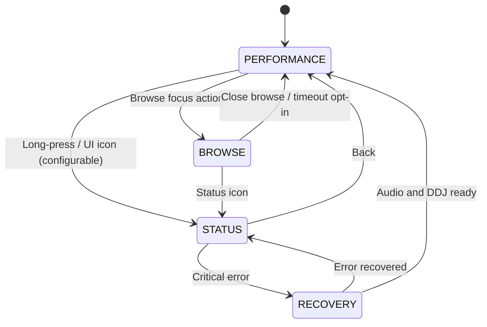

# UI/UX Detailed Specification — DeckBridge OS (P1–P4)

**Data:** 2026-10-21 | **Decisão OD-02 em 21/10/2026:** layout adaptável a qualquer resolução. Referência de tela de 7 polegadas: 800x480 e 1024x600, paisagem. O tablet alvo (Galaxy Tab S6 Lite, 10,4") também precisa caber em 2000x1200; o padrão de 7" não muda.  
**Padrão:** controla-se primariamente pela DDJ-400; interface serve de estado, browsing e informações de DJ.  
**Nota:** layouts abaixo são wireframes funcionais, não reproduções de interface comercial. Brand/assets produzidos pelo projeto, não copiados de Pioneer/AlphaTheta.

## 1. Objetivos de interação

- Usuário consegue iniciar set, encontrar playlist/faixa, carregar A e B e mixar por 15 minutos somente com a DDJ-400.
- Telas sempre exibem a faixa que está realmente carregada e estado de PLAY/SYNC, evitando indicar que um deck está tocando quando está em pausa.
- A interface não controla volume automaticamente, não solicita login, não depende de internet.
- Uma falha de áudio sempre ganha prioridade sobre recomendação e animações.

## 2. Wireframe: PERFORMANCE — estrutura, não um tamanho fixo

A tela Android 0.9.1 abre no player em paisagem. Uma faixa fina leva o aviso de simulação, o botão REC (cronómetro e medidor quando grava), o relógio, REMAIN e INFO. Por baixo, seis botões iguais: SOURCE, BROWSE, TAG LIST, PLAYLIST, SEARCH e MENU. O botão ativo usa preenchimento azul-escuro e texto branco, com contorno azul. A coluna curta por deck, as duas ondas com o playhead perto de 30% da esquerda, a grelha HOT CUE de 2×4 e os cartões de baixo continuam. Entre os hot cues e os cartões há uma faixa de toque: salto de −32 a +32 batidas e loop (4, IN, OUT, metade, dobro, sair, e 1/4 a 32). À direita, BEAT FX ou RMX. A vista cheia de RMX tem um dial circular de Scene FX (laranja em build-up, azul em break-down), células escuras para as cenas, X-Pad, isolador com medidor em gradiente e a fila RELEASE. MENU abre uma coluna à esquerda com ícone: Player, Áudio, Controladora, Biblioteca, Gravação, Histórico, Diagnóstico e Sobre. Cada linha é rótulo à esquerda e valor ou controlo segmentado à direita. HISTORY lista sessões e faixas. BROWSE > History abre a mesma lista. TAG LIST, PLAYLIST e SEARCH abrem as suas listas. Em 1024×600 os seis botões e a faixa REC continuam na largura. O desenho é próprio: sem logo e sem nome de produto de terceiros. Os rótulos RMX e REMIX FX são deste projeto. O wireframe abaixo continua a ordem das informações da versão anterior.

O desenho abaixo mostra a ordem das informações. Nas referências 800x480 e 1024x600 ele precisa caber inteiro. Em outra resolução, os mesmos blocos esticam ou encolhem sem cortar BPM, tempo e estado de PLAY. Em hardware fraco (OD-01), a waveform é o primeiro bloco a ser desligado.

```text
┌──────────────────────────────────────────────────────────────────────┐
│ SOURCE: RB_USB  ● AUDIO OK  ● DDJ OK       12:31   TEMP 48°C       │
├───────────────────────────────┬──────────────────────────────────────┤
│ DECK A                        │ DECK B                               │
│ ARTIST / TITLE                │ ARTIST / TITLE                       │
│ BPM 125.00  KEY 8A            │ BPM 125.03   KEY 9A                   │
│ 01:42 / 06:31   PLAY          │ 00:21 / 05:27    CUE                 │
│╭~~~~~~~ waveform A ~~~~~~~~╮  │╭~~~~~~~~ waveform B ~~~~~~~~~╮       │
││beats | bars | cue | loop  │  ││ beats | bars | cue | loop │       │
│╰────────────────────────────╯  │╰──────────────────────────────╯       │
│ ▮▮▮ VU     SYNC / LOOP / PFL  │ ▮▮ VU      SYNC / LOOP / PFL          │
├───────────────────────────────┴──────────────────────────────────────┤
│ ◉ BROWSE      LOAD A/B para faixa selecionada      REC: OFF         │
└──────────────────────────────────────────────────────────────────────┘
```

Em 800x480, reduzir metadados a título/autor truncado, BPM, tempo, waveform simples, flags e barra de status. Em 1024x600 cabe um pouco mais de texto, com os mesmos blocos. Não exibir um teclado on-screen permanente.

## 3. Wireframe: BROWSE

```text
┌──────────────────────────────────────────────────────────────────────┐
│ SOURCE ▸ RB_USB       PLAYLIST ▸ HOUSE / 2026                        │
├───────────────────┬──────────────────────────────────────────────────┤
│ ▸ USB: RB_USB      │  Track / Artist              BPM   Key   Time   │
│   ▸ HOUSE          │ > Warmup A                    124  8A    05:24  │
│     2026          │   Warmup B                    124  9A    06:10  │
│   TECHNO           │   Peak C                      126  8B    04:30  │
│ ▸ Local            │   Outro D                     123  7A    05:14  │
├───────────────────┴──────────────────────────────────────────────────┤
│ Rotate: selecionar · Press: abrir/voltar · LOAD A/B: carregar deck   │
└──────────────────────────────────────────────────────────────────────┘
```

Sem nomes técnicos de paths do SO. Se houver 2 USB com label idêntico, mostrar código curto derivado do source ID, não imprimir UUID completo.

## 4. Estados de segurança

- `USB_UNSUPPORTED`: mostrar "Exportação USB não reconhecida. Exporte no modo CDJ/XDJ tradicional do rekordbox." e link QR de ajuda somente se rede não for necessária.
- `AUDIO_4CH_MISSING`: indicar fones/canais não disponíveis e destacar que não há segurança para a pré-escuta.
- `E_USB_REMOVED`: banner persistente; manter UI responsiva, source marcada `DESCONHECIDA` até reconectar; não fingir cache completo.
- `POWER_BUDGET`: aviso amarelo; em P2, exibir no STATUS com informação de undervoltage.
- `E_ENGINE_CRASH`: tela recovery sem play automático; botão físico ou touch para reabrir app, se houver controls ainda ativos.

## 5. State chart de navegação



**Importante:** combinações físicas exatas `SHIFT+encoder`, `press encoder` etc. **não estão assumidas**. Devem ser definidas somente depois de auditar mapeamento DDJ-400 e testar conflito com funcionalidades existentes (T008/T009/T029). A estrutura de ações da UI é independente de botões específicos: `OPEN_BROWSE`, `BROWSE_NEXT`, `BROWSE_PREVIOUS`, `BROWSE_ENTER`, `BROWSE_BACK`, `LOAD_A`, `LOAD_B`, `OPEN_STATUS`, `BACK`, `SAFE_SHUTDOWN`.

## 6. Regras visuais

- Dois decks dividem área equilibradamente; cor semântica secundária, texto e formas suficientes para daltônicos.
- Tipografia de dados > títulos de seção; preferir números tabulares para BPM e tempo.
- Render de waveform utiliza componentes do Mixxx já existentes; não implementar canvas WebGL próprio no P1.
- Arraste/gestos multi-touch não são pré-requisito da performance; tela deve continuar usável com touch defeituoso se controles físicos estiverem presentes.
- Modo `BROWSE` não esconde status crítico de áudio.
- Mensagens de erro em pt-BR com fallback en-US, sem stack traces para o DJ; detalhes técnicos somente em Status/Diagnostics.
- Contraste mínimo WCAG AA nos elementos não decorativos quando aplicável, sem comprometer desenho para luz baixa.

## 7. Componentes a implementar

| Componente | Fonte de dados | Fase |
|---|---|---|
| `DeckHeader` | engine controls Mixxx | P1 |
| `WaveformPair` | skin engine Mixxx | P1 |
| `TrackOverview` | engine library | P1 |
| `LoopCueMarkers` | Mixxx cue model | P1 |
| `BrowserSourceTree` | Rekordbox in Mixxx + local library | P1 |
| `DeviceBanner` | system/device events | P1 |
| `StatusPanel` | device daemon metrics | P1/P2 |
| `HealthGraph` | health snapshots locais | P2 |
| `TrackSuggestionPanel` | recommendations reasons | P3 |
| `PhraseOverlay` | offline analyzed markers | P4 |
| `TrainingFeedback` | scored attempts | P4 |

## 8. Testes de interação

- UX-01: selecionar playlist com 100 músicas e carregar A/B sem teclado/mouse.
- UX-02: trocar de Browse para Performance durante reprodução sem atraso ou mudança de áudio.
- UX-03: retirar USB durante browse; aviso e retorno seguro.
- UX-04: DDJ ausente ao ligar; telas status e recuperação guiada.
- UX-05: UI landscape nas referências 800x480 e 1024x600, mais uma resolução diferente (sem corte/overflow). 1280x720 deixa de ser o padrão.
- UX-06: tecla LOAD rápida 10x não carrega faixa no deck errado; debounce de input com logs de ação.
- UX-07: navegar apenas pelo encoder com toque da tela desligado.
- UX-08: E_AUDIO_4CH_MISSING visível até correção.

## 9. Evolução visual

- P1: performance + browser + status e erros.
- P2: organização de preferências e diagnóstico; telas adaptativas.
- P3: contexto de set/tracklist, recomendações opcionais, conectividade PWA.
- P4: overlays de frases e exercícios, nunca tirando o foco dos decks.
