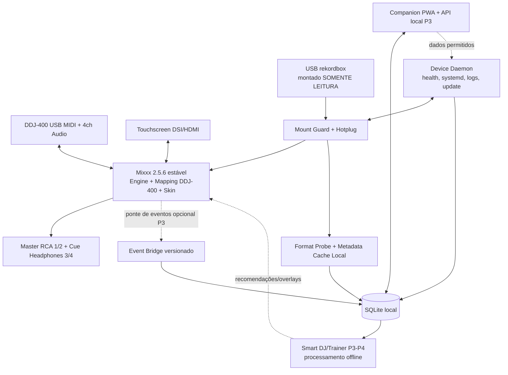
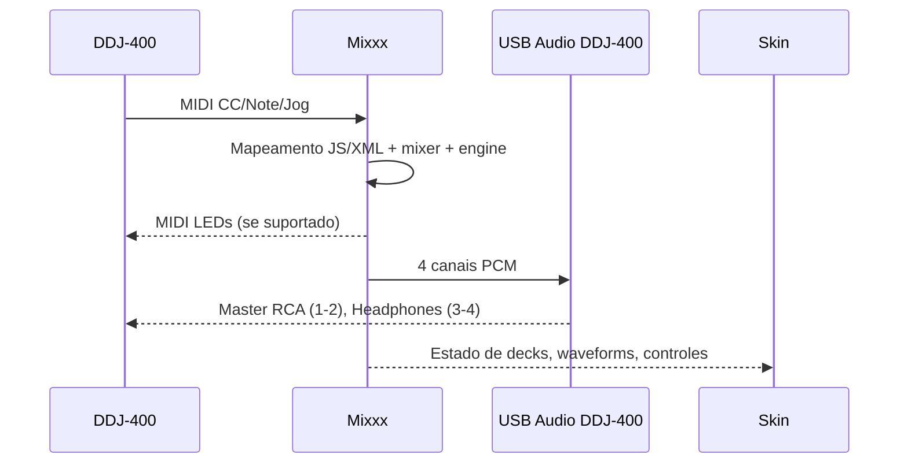

# Implementation Plan 001 — arquitetura e estratégia técnica

**Relacionado a:** `spec.md` v1.1.0 | **Estado:** alvo 1 em simulação até a 0.14.1; alvo 2 por executar | **Data:** 2026-10-21, emenda 2026-10-22

## Emenda 22/10/2026

O produto que existe é o app em `android/`: Kotlin, Jetpack Compose, motor C++ com Oboe, mapa MIDI do XML pinado do Mixxx 2.5.6, leitor próprio de `export.pdb` e ANLZ. O USB é somente leitura (OD-23). A tela é a do OD-17. Os efeitos e o drum build são os das OD-20 e OD-21.

O diagrama e as secções abaixo descrevem o alvo 2 (Raspberry + Mixxx). Essa trilha não foi construída como aparelho. Não apagar o plano: ele continua a ser o que falta fazer no Pi. Gates G0 e G1 continuam abertos. A leitura curta do que funciona e do que falta está em `STATUS.md`.

## 0. Technical Context

| Dimensão | Decisão inicial | Observação / verificação |
|---|---|---|
| Alvo 1 | App Android no Galaxy Tab S6 Lite (OD-11, OD-17) | Kotlin, Compose, C++/Oboe. APK 0.14.1, versionCode 18. Escuta `BLOCKED_HARDWARE` |
| Core DJ no alvo 2 | Mixxx 2.5.6 stable, tag imutável + patchset local | Não é o runtime do tablet. Mixxx 2.6 beta e 2.7 dev fora do release principal até nova decisão |
| Core/runtime | C++ / Qt / scripts MIDI JavaScript/XML do Mixxx | Preservar API de controles upstream; minimizar patches C++ |
| Pi OS | Raspberry Pi OS 64-bit, inicialmente Desktop Debian 13 Trixie onde suportado | alinhar distro/kernel ao hardware real e imagem mixxx-pi-gen |
| Hardware | DDJ-400 USB class-compliant; Raspberry de vários modelos e Linux x86/ARM genérico (OD-01, 21/10/2026) | nenhum modelo é requisito; capacidade lida em execução; HIL continua obrigatório por aparelho |
| Áudio | dispositivo USB da DDJ-400; master ch1–2, cue ch3–4 | ALSA preferido se estável; PipeWire/JACK apenas se benchmark justificar |
| MIDI | mapping nativo DDJ-400 Mixxx, scripts JS estendidos de forma conservadora | CC/notes, IDs e feedback inferidos do mapping fixado e captura HIL |
| Tela | skin nativa do Mixxx, paisagem, adaptável a qualquer resolução; referência 7" 800x480 e 1024x600 (OD-02, 21/10/2026) | usar LateNightMini como referência/derivação sujeita a licença; UI própria se necessário |
| USB | udev + udisks2/systemd mount com `ro,nodev,nosuid,noexec` onde suportados | fs-dependent; mount manual em laboratório inicialmente |
| Biblioteca USB | suporte nativo Mixxx à exportação PDB tradicional | rastrear limitacões do mixxx 2.5.6 e diferenças de cues |
| Persistência local | SQLite (dados do produto), Mixxx library DB separada | não editar banco Mixxx externamente com Mixxx rodando |
| Agente de dispositivo | Python 3.11+ `deckbridge-daemon`, systemd | fora do processo/thread de áudio; stdlib/dep mínimas |
| Companion PWA | TypeScript + Svelte ou Web Components; API local FastAPI no P3 | começar read-only, não obrigatório; escolha framework final por ADR |
| Interprocesso | Unix domain sockets + JSON versionado com timeouts | apenas fases P2/P3 que necessitem telemetria/comandos não críticos |
| Code quality | CMake/CTest, pytest, ruff, mypy, tests fixtures | adaptar versão real ambiente sem branch experimental |
| Build | Desktop x86_64 CI e arm64 nativo/cross-compile, artifacts pinned | build Pi lentos: runner arm64 preferencial |
| Licença | Mixxx GPL-2.0-or-later e derivados compatíveis; auditar tudo | código externo GPLv3 pode impor GPLv3 na distribuição combinada |

## 1. Arquitetura lógica



> Os traços pontilhados são APIs novas, **não** funcionalidades já presentes no Mixxx; seu contrato é entregue por T-3xx, depois dos gates de áudio. O P1 deve funcionar sem `BRIDGE`, API ou SMART.

### 1.1 Processos e responsabilidade

| Processo | Responsabilidade | Evitar |
|---|---|---|
| `mixxx` | áudio, DSP, control surfaces, biblioteca nativa, waveform, UI | chamadas síncronas a parsing externo ou serviços remotos |
| `deckbridge-daemon` | inventário de dispositivos, mounts RO, notificações simples, diagnósticos, filesystems | abrir o dispositivo ALSA de forma exclusiva e disputar com Mixxx |
| `deckbridge-eventd` (P3) | persistir/normalizar eventos não-críticos | processamento de áudio e polling excessivo de controls |
| `deckbridge-api` (P3) | endpoints de status, config e pairing local | controle remoto de mixer por default |
| `deckbridge-analyzer` (P3/P4) | heurísticas offline/análises em filas | qualquer inferência em contexto RT |
| `deckbridge-updater` (P2) | manifest, checksum, backup, rollback | alteração de versão durante set ativo |

### 1.2 Fluxo de dados da biblioteca

1. Kernel detecta bloco USB e aciona udev, sem executar parsers como root.
2. `deckbridge-daemon` valida dispositivo pelo `DEVTYPE`, UUID/FS e usa serviço de montagem com whitelist de paths, `ro`, permissões de usuário apropriadas e timeout limitado.
3. Guard verifica `findmnt -o OPTIONS` e mecanismo de bloqueio de escrita; se não conseguir garantir RO, não disponibiliza a fonte.
4. Mixxx descobre USB export via integração já existente; refresh automático só se API/script seguro disponível, caso contrário indicar ação controlada sem reiniciar áudio.
5. Daemon opcional identifica versão e metadados em subprocesso confinado com quotas; sem ler o DB interno do Mixxx durante escrita.
6. No MVP todas as mudanças de cues do Mixxx permanecem localmente; a origem é imutável.
7. Remoção USB invalida fonte e mensagens; os decks podem parar se arquivo não estiver em buffer; essa limitação será explicada.

### 1.3 Fluxo de áudio/MIDI



**Política RT:** não aplicar Python, sockets, DB, alocações grandes, logs síncronos ou locks de duração imprevisível no callback de áudio. O Mixxx já implementa seu engine: quaisquer patches devem obedecer padrões upstream e passar review focado em RT. Scripts MIDI também não devem executar operações pesadas.

### 1.4 Injeção futura de eventos (P3)

- Preferir observação de controles pelo mecanismo oficial do Mixxx (mapping JS `engine.makeConnection`/mecanismo disponível na versão fixa) para eventos não críticos.
- **Spiking obrigatório:** verificar se há canal seguro para exportar eventos sem sobrecarregar mapping. Opções: loopback MIDI virtual ALSA, patch C++ assíncrono que escreve em queue lock-free, ou mecanismo upstream suportado. Selecionar mediante ADR com teste de `input latency` e sem disputar I/O DDJ.
- Priorizar *at-most-once* para eventos brutos: perdas toleráveis em telemetria, nunca bloquear controls; inserir `sequence` e `source_event_id` para idempotência quando houver retry.
- O mapa canônico de eventos deve ser derivado do controle lógico, não dos bytes MIDI proprietários, para permitir outras controladoras no futuro.

## 2. Organização do repositório de implementação (proposta)

```text
DeckBridgeOS/
├── .specify/memory/constitution.md
├── AGENTS.md
├── README.md
├── specs/001-ddj400-standalone/{spec.md,plan.md,research.md,data-model.md,tasks.md,contracts/}
├── docs/{adr/,runbooks/,compatibility/,benchmarks/,legal/}
├── config/{profiles/pi4.toml,profiles/pi5.toml,defaults.toml}
├── mappings/ddj400/{mapping.xml,script.js,README.md}
├── skins/deckbridge/{skin.xml,assets/,translations/}
├── systemd/{deckbridge-daemon.service,deckbridge-ui.service,deckbridge-api.service}
├── tools/{probe-hardware.py,probe-usb.py,collect-diagnostics.py}
├── services/
│   ├── device-daemon/deckbridge/
│   ├── library-adapter/deckbridge_library/
│   ├── eventd/
│   ├── analyzer/
│   └── companion-api/
├── packages/deckbridge-common/ (schemas comuns)
├── images/{pi-gen-stage/,build-image.sh,manifest.json}
├── tests/{unit/,integration/,fixtures/,hil/,soak/,security/}
└── .github/workflows/{ci.yml,arm64.yml,release.yml}
```

**Não criar toda essa estrutura de uma vez sem conteúdo útil.** Criar diretórios por T-ID, mantendo nomes da spec. `mappings/ddj400` contém apenas deltas, quando possível, em vez de copiar o mapping upstream.

## 3. Estratégia de fork e proveniência

### 3.1 Escolha de base

1. **Core base obrigatório:** `mixxxdj/mixxx` em tag estável `2.5.6` como primeiro commit/commit pin do fork. Confirmar a tag e SHA no momento do bootstrap.
2. **Projetos auxiliares não intercambiáveis:**
   - `StandaloneMixxx` usa scripts de provisioning, LateNightMini e versões customizadas (2.7) para FLX2/FLX4. Reusar conceito/artefatos permitidos por licença; **não afirmar suporte DDJ-400 nativo deste instalador**.
   - `TriMixxx` demonstra Pi 4B + skin pequena + lib USB + custom hardware ESP32-S3 e patches; extrair lições, não copiar arquitetura de controladora custom.
   - `NauticMixxx` UX de biblioteca-only e interface RX3; compilações principais Windows/macOS, Pi é experimento; não usar como baseline arm64 do MVP.
   - `mixxx-pi-gen` candidata a build inicial da imagem Pi/Sway; auditar pins/serviços e escolher incrementalmente, sem misturar grandes mudanças.
3. Política: branches `upstream-stable`, `deckbridge/main`, `feature/*`; patches em `patches/mixxx/` por necessidade documentada; integração de upstream com smoke regressions em estação de teste.
4. Para skins, respeitar API/esquema Mixxx vigente; não utilizar assets gráficos comerciais copiados.

### 3.2 Regra de importação de código

Antes de importar código de um projeto de referência: registrar repositório/commit, licença, headers originais, diff, origem das dependências, versão de Qt/Mixxx suportada e matriz de testes; preferir implementar comportamento quando fonte incompatível ou excessivamente acoplada. Conferir histórico do repo e contribuição, não presumir que ter GitHub significa licença permissiva.

## 4. Plano de UI

### 4.1 Estados de apresentação

- `PERFORMANCE`: dois decks simétricos, waveforms centralizadas, BPM, tempo, posições de cue/loop, ganho/VU, source e estado de master/cue.
- `BROWSE`: seletor de fonte USB/local, pastas, playlists, lista de faixas com artista, título, BPM, key, duração, indicador carregado/ausente.
- `STATUS`: perifericos, fonte elétrica, output devices, diagnóstico sem abandonar áudio; acesso protegido contra acionamento acidental.
- `ERROR`: erro persistente sem bloquear controles que continuam funcionando; texto curta + ação de recuperação.

### 4.2 Design system

- Tema dark de alto contraste, cores de decks consistentes, sem depender de cores apenas para status.
- Layout adaptativo a qualquer resolução landscape. Referências obrigatórias: 800x480 e 1024x600 (OD-02, 21/10/2026). Uma resolução diferente entra no teste para mostrar que o layout não está preso a esses dois tamanhos.
- UI no P1 é skin Qt Mixxx com XML e assets vetoriais/licenciados. Customizar tags de skin e conexão de controls do próprio Mixxx; evitar overlay Electron/Chromium que consuma recursos em Pi antigo.
- Touch é recurso secundário; todos os gestos essenciais da performance/navegação mapeados para DDJ.
- “Onde tocar?”: shortcut/encoder navega playlist; botão LOAD define deck; SHIFT + seleção troca foco source/playlist quando mapeamento suportar; documentação de botões conforme mapping real.
- Screen não pode ocultar aviso crítico de áudio/USB por animação, popup ou transição.

### 4.3 Critérios UX mensuráveis

- Em 800x480 e em 1024x600, BPMs dos decks legíveis com distância 50–80 cm, títulos truncados sem apagar identificação, tempo/buffer mostrados claramente. Em perfil fraco, a waveform é o primeiro elemento a sair.
- Navegação por uma playlist de 100 faixas só com encoder e load, sem touch, em menos de 60s na prova humana (meta).
- Feedback para entrada em PLAY, CUE, LOOP, SYNC e ocorrência de desconexão em menos de 200ms perceptíveis; medido por vídeo ou logs quando aplicável.

## 5. Ingestão e parsing de biblioteca

### 5.1 P1 — Mixxx como parser de verdade

Não escrever parser PDB do zero quando integração nativa for suficiente. Usar a tree "Rekordbox" do Mixxx para montar source; comparar com fixtures de verdade (metadados/beatgrids/cues). A função de cache opcional deve ler fora da thread de áudio.

### 5.2 P2/P3 — `LibraryAdapter` normalizado

Se for necessário apresentar metadados para API/PWA e Smart DJ: criar `LibraryAdapter` independente com interfaces `probe(source)`, `list_playlists(source)`, `list_tracks(source, playlist)`, `get_track(source, id)`, `get_markers(source, id)` e `diagnostics(source)`. Implementar `LegacyExportAdapter` reutilizando bibliotecas maduras apenas quando necessário e legalmente compatível. Não acessar simultaneamente Mixxx DB por escrita. `LibraryAdapter` **não substitui o parser que Mixxx usa para carregar o deck**, a menos que alteração de core seja comprovadamente necessária.

### 5.3 P5 — OneLibrary

- `libdjinterop` pode ler OneLibrary com SQLCipher opcional, mas não fornece passphrase; os dados de grade/cues estão em arquivos ANLZ externos.
- O libdjinterop informa que leitura de WAL pode criar arquivos `-wal`/`-shm` no diretório do DB. Para cumprir política read-only, copiar snapshot do DB e arquivos associados para storage temporário local antes de inicializar SQLite; nunca abrir o DB diretamente na mídia para um parser com efeitos de escrita.
- Sem meios de acesso autorizados/segredos fornecidos licitamente, apenas detectar formato e instruir usuário a usar export legado. Não tentar brute force/decompilar app proprietário para roubar senha.
- Criar suíte de fixtures anonimizadas, versões específicas de export e grid/cue edge cases antes de aceitar.

## 6. Montagem USB e segurança

- Não usar `mount -o rw`, mesmo temporariamente. Preferir `ro,nodev,nosuid,noexec`, além de flags por filesystem aplicáveis; caso `uid/gid` de FAT exijam ajustes, documentar opções.
- Ponto de montagem único `/media/deckbridge/<uuid>` com nome saneado e validação por caminho real (realpath); não interpolar shell com valores de USB.
- Serviço com privilégios mínimos; regra udev aponta para serviço systemd/DBus autorizado; **não** executar scripts Python pesados diretamente em udev worker.
- Nunca seguir symlinks do USB que escapam da mount root; proteger também traversal em arquivos ANLZ com paths relativos.
- Defender contra `zip bomb`, comprimentos inválidos de registros binários, número excessivo de playlists/tracks e arquivos truncados.
- Fuzz de parser, timeouts e isolamento; em erro, fechar handle, liberar recursos e manter engine musical.
- Imutabilidade do pendrive verificada por mount + checksum da árvore de dados críticos (PDB/ANLZ; hash total opcional no laboratório); garantir consistência no teste e não prometer que ro protege contra remoção física.

## 7. Persistência, backups e atualizações

- **Mixxx library DB:** de propriedade exclusiva do Mixxx. Não manipular diretamente com SQL externo enquanto o player estiver ativo; se necessário usar arquivos de export temporários e interface suportada.
- **DeckBridge DB:** SQLite próprio em `/var/lib/deckbridge/deckbridge.db`, WAL e `busy_timeout`, transações e schema migrations reversíveis quando factível. Na falha de energia, validar `PRAGMA integrity_check` em laboratório.
- **Config:** `/etc/deckbridge/config.toml` somente config do produto; Mixxx user config isolada em home de service user.
- **Logs:** `journald`, quota definida, não incluir URI completa de músicas por default; diagnósticos zip coletados por comando autenticado local.
- **Backup:** snapshot de DB e config, versionado antes de migração/upgrade, sem copiar trilhas protegidas. Restaurar versão anterior da app/config compatível.
- **Atualizador P2:** download explícito somente fora de set e quando online opt-in; manifest SHA256 e assinatura para release pública; sem autoatualizar durante playback.
- **Imagem:** build reproducível/manifest (`os`, `kernel`, `Mixxx SHA`, `skin SHA`, `config schema`, `all packages`) com teste cold-boot, mídia SD A/B ou estratégia de snapshot validada. Não supor que overlayfs garante rollback sem teste.

## 8. Estratégia de testabilidade

### 8.1 Camadas

- Unit: serialização, IDs, state machines, parsing/validação, heurísticas do Smart DJ.
- Integration: mounts loopback de imagens FAT (read-only), fixtures de export RB autorizados, db migrations, re-scan process orchestration, HTTP loopback.
- Simulation: fake MIDI control changes; screenshots de UI quando possível; audio render deterministic via Mixxx headless/offline onde suportado.
- Hardware-in-the-loop (HIL): DDJ-400 real + Pi com 4ch e RCA/fones, MIDI/LED e hotplug, capture loopback/temperatura/latência.
- Soak: 15min P0, 120min P2 2 decks; medir problemas por runtime e syslog.
- Security: fuzz USB files, traversal, requests repetidas, tokens, CORS, alcance de rede, travamento de parser.

### 8.2 Benchmarks/restrições de coleta

`traces` do engine não podem ser coletados com frequência que cause cortes. CPU per-core a 1Hz, temperatura/undervoltage a cada 5–10s, contador de x-runs disponível por backend; áudio de teste loopback externo quando possível. Logs de MIDI de alta frequência habilitados apenas durante diagnóstico, jamais no release.

### 8.3 Quality gates em CI

- Python format/lint/type/pytest; JS mapping syntax/static tests; XML skin/mapping validity; C++ build/Ctest e sanitizers em x86_64 onde factível.
- `openapi.yaml` validado com parser OpenAPI; schema migration tests; SBOM/licensing report; SAST/secret scanning; Python dependency locks.
- Pi ARM build/test; HIL não reexecutável em CI geral fica identificado como manual/runner hardware dedicado.

## 9. Falhas, classificação e recuperação

| Código | Severidade | Política |
|---|---|---|
| `E_POWER_BUDGET` | WARNING/CRITICAL | exibir risco de instabilidade; sugerir hub/fonte, não liberar selo G2 |
| `E_DDJ_NOT_FOUND` | WARNING | buscar hotplug sem bloquear software; aviso persistente |
| `E_AUDIO_4CH_MISSING` | CRITICAL | impedir rótulo READY, separar diagnóstico Master/Cue |
| `E_RB_EXPORT_NOT_FOUND` | INFO/WARNING | instruir export CDJ/XDJ tradicional |
| `E_RB_UNSUPPORTED_VARIANT` | WARNING | recusar parser, não tentar escrever/converter in situ |
| `E_USB_READONLY_UNVERIFIED` | CRITICAL | não disponibilizar fonte, orientar remount |
| `E_USB_REMOVED` | WARNING | invalidar source, não congelar GUI |
| `E_DISK_LOW` | WARNING | suspender gravação/cache, preservar playback |
| `E_AUDIO_XRUN` | WARNING/CRITICAL | incrementar métrica; investigar e reprovar soak conforme critério |
| `E_ENGINE_CRASH` | CRITICAL | supervisor reinicia app em modo seguro, **sem auto-play** |
| `E_PARSER_TIMEOUT` | WARNING | encerrar worker confinado, manter áudio |
| `E_UPGRADE_FAILED` | CRITICAL | rollback e diagnóstico, nunca sobrescrever USB |

## 10. Sequenciamento e migração

### Fase A: Engenharia inicial (T001–T019)

Inventariar hardware, baseline Mixxx 2.5.6, USB MIDI/audio, firmware, USB export e primeira prova 2-decks. Entregar matriz H0/H1/H2 real com resultados. Não introduzir PWA, telemetria ou UI sofisticada.

### Fase B: MVP (T020–T039)

Montagem RO + hotplug, skin standalone, mapping UX com DDJ, fixtures rekordbox, configuração e boot, recovery básico. Fechar G1.

### Fase C: Appliance (T040–T054)

Imagem, release manifest, segurança, diagnóstico, bench longo, rollback, recovery, proteção de energia. Fechar G2.

### Fase D: Smart e futuro (T055+)

Event bridge versionada, store de sessões, PWA read-only, recommender offline, trainer e OneLibrary via spikes independentes e gates.

## 11. Interfaces a especificar antes de implementar

- USB volume event (`VolumeDetected`, `VolumeMountedRO`, `FormatProbeResult`, `VolumeRemoved`), contratos no `data-model.md`.
- Observability (`HealthSnapshot`, `AudioStatus`, `ControllerStatus`).
- Event schema (`PerformanceEvent`) separado do áudio.
- API REST P3 (`contracts/openapi.yaml`), sem endpoints de play/pause/FX em default.
- Config TOML versionada e documentada (exemplo em quickstart).

## 12. Revisão de segurança e licenças (obrigatória no bootstrap e release)

- Revisar dependências de lib, GPL-2.0-or-later Mixxx, GPL-3.0 TriMixxx/Nautic, LGPL-3.0 libdjinterop, MIT pyrekordbox e licenças de codecs/assets.
- Projeto próprio/combinação só pode ser distribuído conforme obrigações aplicáveis (fonte correspondente, avisos, modificações). Documento não é parecer jurídico.
- Pioneer DJ, DDJ, rekordbox e AlphaTheta são marcas de terceiros: uso descritivo, não sugerir parceria/aprovação.
- Excluir chaves, dados pessoais, mídias protegidas e bibliotecas proprietárias do repositório e fixtures públicas.

## 13. Planejamento de recursos (referência, não pedido de compra)

- **POC:** qualquer Raspberry já existente, ou um Linux x86/ARM genérico, + monitor HDMI + teclado/mouse só para o setup + DDJ-400 + cabo USB-B + fonte correta daquele aparelho + USB com biblioteca de teste. Não comprar um modelo específico para começar.
- **MVP:** o aparelho em que o perfil de execução couber, com fonte adequada ao próprio modelo, SD boa quando for Raspberry, tela de referência 7" (800x480 ou 1024x600) ou outra resolução com o mesmo layout. DDJ-400 já é a interface de áudio; não adicionar DAC externo.
- **Risco de energia (referência de fabricante, não escolha de modelo):** Pi 5 com fonte 3A limita periféricos a 600 mA; fonte 5A adequada permite orçamento USB agregado até 1,6A, compartilhado. Pi 4 possui limite agregado USB de ~1,2A. Medir consumo DDJ/controlador/tela na placa real; usar hub alimentado se necessário. Referência Raspberry Pi oficial nos docs.

## 14. Estratégia de evolução independente

- `EngineAdapter`: mantém abstração de Mixxx controls, UI não conhece MIDI bytes.
- `ControllerProfile`: mapeamento e capabilities genéricas para futuras FLX4, Hercules etc., com DDJ-400 primeiro.
- `LibraryAdapter`: source e parser versionados; PDB/OneLibrary separados.
- `ExperienceMode`: UX de performance vs guided/training, sem substituir áudio.
- `RecommendationProvider`: regras simples primeiro, ML offline facultativo.
- `EventBridge`: coletor não-crítico; não usar como command bus central para controls físicos.

Se uma implementação exigir reescrita de engine de áudio para suportar uma função não-MVP, registrar o risco e não prosseguir sem ADR e benchmark isolado. Uma release opera bem com metade das features; **não opera com metade da estabilidade**.

## 15. Trilha de simulação (T075–T079)

Atualização no mesmo dia: o alvo 1 passou a ser Android e o acesso ao tablet e à DDJ-400 ainda vai demorar. O Raspberry é o alvo 2. As tarefas T001–T074 não mudam de número. A simulação é uma trilha extra para adiantar verificação. **Simulação não é prova no hardware.** Resultado `SIMULATED` não marca tarefa HIL como `PASS` e não fecha G0 nem G1.

- **T075.** Controladora DDJ-400 virtual. Envia e recebe MIDI conforme o mapa pinado em `third_party/mixxx/2.5.6`, por ALSA virtual (`snd-virmidi`) ou equivalente. Não inventa byte ausente do mapa. Estado nesta rodada: TODO.
- **T076.** Dispositivo de áudio virtual de 4 canais. Master nos canais 1–2 e fone nos 3–4, para checar o roteamento do perfil. Estado nesta rodada: TODO.
- **T077.** Execução em emulação ARM, `arm64` e `armhf` (QEMU ou container), para os perfis de capacidade da OD-01. Isso prova a arquitetura em que o código rodou, não que uma placa toca.
- **T078.** Roteiro curto e numerado para a validação real, feito de uma vez no fim: `docs/hil/roteiro-validacao-final.md`. O texto existe. A execução está `BLOCKED_HARDWARE`.
- **T079.** A regra acima fica testada em `src/deckbridge/evidence.py`. Desktop, emulação e MIDI virtual continuam sendo simulação.

## 16. Trilha Android (A001 em diante; nada de T001–T079 muda de número)

OD-11 (21/10/2026): o alvo 1 é um tablet ligado direto na DDJ-400, sem equipamento extra. O Raspberry fica como alvo 2 e o plano das seções anteriores continua valendo para ele. OD-12 a OD-16 estão **provisório, confirmar com o dono**.

O tablet de referência é um Galaxy Tab S6 Lite, modelo e ano não confirmados, 4 GB de RAM, Android 10 a 14. A tela de 10,4" é 2000x1200. O padrão de 7" (800x480 e 1024x600) continua. O app usa minSdk 26 para também caber em aparelhos Android 8 da OD-01, e targetSdk 34 para cobrir até o Android 14.

A lógica compartilhada: mapa da DDJ-400 pinado, biblioteca só leitura, MP3 e WAV primeiro, perfil de capacidade pelos mesmos limiares de RAM e núcleos (o nome do modelo não escolhe o tier), UI que cabe nas três referências.

A prova A0 é a primeira tela do app: listar áudio USB e canais, tocar tons diferentes em 1–2 e em 3–4, ler MIDI e mostrar o nome do mapa, registrar modelo, string de hardware, SoC quando o sistema informar, versão do Android, latência, x-runs e bateria, e exportar um texto. O que não for lido fica UNKNOWN. Ouvir a separação no aparelho está `BLOCKED_HARDWARE`.

O relato do djay (master e fone separados nesse tablet) é referência do dono. Está no registro de riscos e reduz a chance de falha de 4 canais nesse aparelho. Não é medição nossa.
